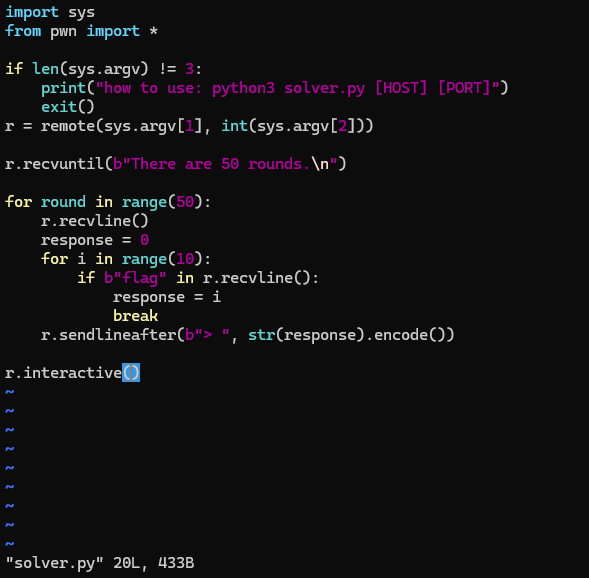
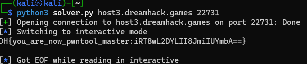

# B3 · flag-shop

### 1. 문제 분석

10개 상품 중 `flag`를 골라야 한다. 목록 순서는 매 라운드 `random.shuffle(items)`로 섞이고, 정답을 50번 연속 선택하면 파일에 저장된 FLAG를 출력한다.

```python
start = time.time()

for round in range(50):
    random.shuffle(items)
    for idx, item in enumerate(items):
        print(f"{idx}. {item}")

    choice = int(input("> "))
    if items[choice] != "flag":
        print("Failed to get flag...")
        exit()

end = time.time()
if end - start >= 10:
    print("TIME OUT")
    exit()
```

화면에 상품 이름과 번호가 함께 나오므로 `flag`의 위치 자체는 숨겨져 있지 않다. 한 라운드에서 보이는 번호를 입력하면 맞힐 수 있지만, 순서가 매번 바뀌고 이를 50회 이어서 해야 한다.

### 2. 풀이 스크립트

아래 스크립트는 문제 서버에 접속해 출력에서 `flag`가 있는 줄을 찾고, 해당 번호를 자동으로 보낸다.

```python
import sys
from pwn import *

if len(sys.argv) != 3:
    print("how to use: python3 solver.py [HOST] [PORT]")
    exit()

r = remote(sys.argv[1], int(sys.argv[2]))

r.recvuntil(b"There are 50 rounds.\n")

for round in range(50):
    r.recvline()
    response = 0

    for i in range(10):
        if b"flag" in r.recvline():
            response = i
            break

    r.sendlineafter(b"> ", str(response).encode())

r.interactive()
```

<p align="center">
  
</p>

### 3. 서버 통신과 자동 반복

사람이 직접 풀기 어려운 이유는 `flag`를 못 찾기 때문이 아니라 **전체 50라운드를 10초 안에 끝내야 하기 때문**이다. 한 라운드마다 10개 줄을 읽고 위치를 입력해야 하므로, 화면을 보고 타이핑하는 방식은 시간과 네트워크 지연 때문에 사실상 어렵다. 서버와 클라이언트가 한 번씩 주고받는 절차를 스크립트로 반복하면 빠르게 처리할 수 있다.

- `remote(host, port)`: 지정한 호스트와 포트에 TCP 연결을 만든다. 실행할 때는 `python3 solver.py host3.dreamhack.games 22731`처럼 입력한다. `sys.argv[1]`과 `sys.argv[2]`가 각각 호스트와 포트다.
- `recvuntil(...)`: 안내 문구가 끝날 때까지 받아 초기 메시지를 건너뛴다.
- `recvline()`: 한 줄을 받는다. 라운드마다 먼저 빈 줄 하나를 읽고, 이어서 상품 10줄을 확인한다.
- `for i in range(10)`: 출력된 상품 줄을 위에서부터 읽는다. `b"flag" in ...`가 참인 줄을 찾으면 그 줄의 순번 `i`가 상품 번호가 된다. `response`에 번호를 저장하고 `break`로 검색을 멈춘다.
- `sendlineafter(b"> ", ...)`: 입력 프롬프트가 올 때까지 받은 뒤, 정답 번호를 바이트로 보내고 줄바꿈을 붙인다. 서버는 그 선택을 검사하고 다음 라운드를 출력한다.
- 바깥쪽 `range(50)`은 이 수신·검색·전송 흐름을 50번 수행한다. `interactive()`는 마지막에 연결을 직접 확인할 수 있게 해 FLAG 출력을 보여준다.

### 4. 실행 및 결과

호스트와 포트는 문제 인스턴스마다 다를 수 있으므로, 문제 페이지에서 현재 제공되는 값을 인자로 전달한다. URL 형식의 `http://`나 끝의 `/`는 넣지 않는다.

```bash
python3 solver.py host3.dreamhack.games 22731
```

<p align="center">
  
</p>

50라운드의 선택이 끝나면 서버가 FLAG를 출력하고 연결을 닫는다. `Got EOF while reading in interactive`는 출력이 끝난 뒤 상대 프로그램이 연결을 종료했다는 표시다.

**풀이 핵심:** 매번 섞이는 상품 목록에서 `flag`가 적힌 줄 번호를 읽어 답으로 보내고, 이 과정을 50회 자동화해 10초 제한을 통과한다.
