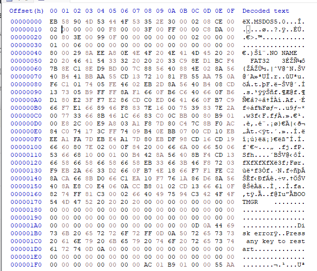
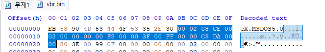

# B2 · VBR

### 1. 문제 확인

제공된 `vbr.bin`의 VBR(Volume Boot Record)을 분석해 다음 세 값을 구한다.

- **A:** 파일시스템이 FAT32면 `1`, NTFS면 `2`
- **B:** 해당 볼륨의 크기
- **C:** 볼륨 시리얼 번호

세 값을 더한 결과를 **10진수**로 변환해 `DH{A + B + C}` 형식으로 제출한다.

### 2. HxD에서 VBR 확인

압축을 해제하고 HxD에서 `Ctrl + O`로 `vbr.bin`을 연다. 왼쪽은 행의 시작 오프셋, 위쪽 `00`~`0F`는 열 번호다. `Ctrl + G`를 누르고 16진수 오프셋을 입력하면 해당 위치로 이동할 수 있다.

<p align="center">
  
</p>

여러 바이트로 저장된 숫자는 **리틀 엔디언**으로 읽는다. 예를 들어 화면에 `00 02`로 보이는 2바이트 값은 순서를 반대로 해 `0x0200`으로 해석한다.

### 3. A — 파일시스템

`0x52`부터 파일시스템 표시를 확인한다. `00000050` 행의 `02`열부터 읽으면 다음과 같다.

```text
오프셋:  52 53 54 55 56
16진수:  46 41 54 33 32
문자:     F  A  T  3  2
```

문자 영역에도 `FAT32`가 보인다. 문제의 조건에 따라 **A = 1**이다.

### 4. B — 볼륨 크기

볼륨 크기는 **섹터당 바이트 수 × 전체 섹터 수**로 계산한다.

| 항목 | 오프셋 | HxD의 바이트 | 리틀 엔디언으로 읽은 값 |
| --- | --- | --- | ---: |
| 섹터당 바이트 수 | `0x0B`~`0x0C` | `00 02` | `0x0200` = 512바이트 |
| 전체 섹터 수 | `0x20`~`0x23` | `00 80 3E 00` | `0x003E8000` = 4,096,000섹터 |

<p align="center">
  
</p>

사진의 선택 영역에는 다른 필드도 포함되어 있으므로, 표에 적힌 두 범위만 각각 읽는다. `0x20` 행에서는 첫 `00`뿐 아니라 그 뒤의 `80 3E 00`까지 4바이트가 전체 섹터 수다.

```text
B = 512바이트/섹터 × 4,096,000섹터
  = 2,097,152,000바이트
  = 0x7D000000
```

### 5. C — 볼륨 시리얼 번호

FAT32 VBR에서 볼륨 시리얼 번호는 `0x43`~`0x46`의 4바이트다. `00000040` 행의 `03`열부터 `06`열까지 확인한 뒤 바이트 순서를 바꿔 읽는다.

```text
HxD의 바이트:       8A EE A8 0E
리틀 엔디언 해석:   0x0EA8EE8A
10진수:             245,952,138
```

따라서 **C = 0x0EA8EE8A = 245,952,138**이다.

### 6. FLAG 계산

구한 A, B, C를 더하고 결과를 10진수로 표시한다.

```text
A + B + C
= 1 + 2,097,152,000 + 245,952,138
= 2,343,104,139

16진수: 0x1 + 0x7D000000 + 0x0EA8EE8A = 0x8BA8EE8B
```

```text
DH{2343104139}
```

**풀이 핵심:** VBR의 필드 위치를 확인하고 리틀 엔디언 값을 해석한 뒤, 볼륨 크기와 시리얼 번호를 계산해 더한다.
