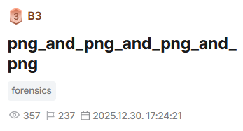
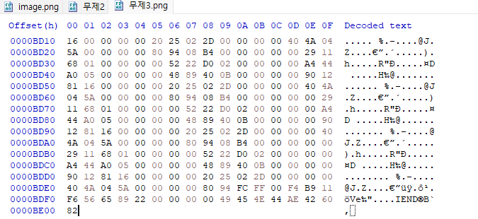
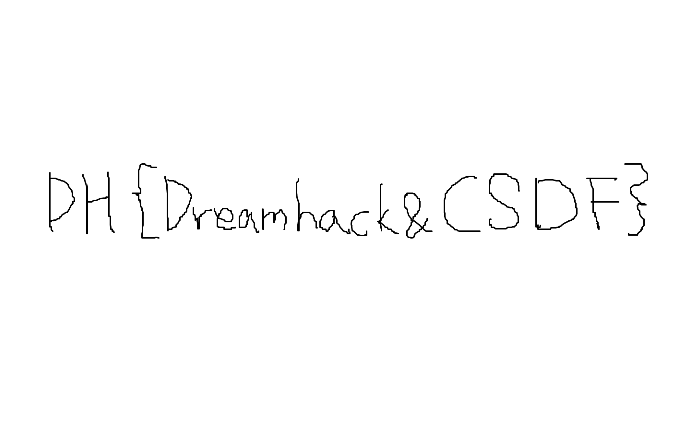

# B3 · png_and_png_and_png_and_png

### 1. 문제 확인

주어진 `image.png`에 여러 PNG 파일이 이어 붙어 있다. **HxD**는 파일의 실제 바이트를 16진수로 확인하고 범위를 선택할 수 있는 편집기다. PNG의 시작과 끝을 찾아 각각 분리한 뒤 이미지에 숨겨진 내용을 확인한다.

<p align="center">
  
</p>

### 2. PNG 끝 표시 검색

PNG의 시작과 끝을 구분하는 바이트는 다음과 같다.

```text
시작: 89 50 4E 47 0D 0A 1A 0A
끝:   49 45 4E 44 AE 42 60 82
```

끝 표시의 `49 45 4E 44`는 `IEND`이고, 뒤의 `AE 42 60 82`는 해당 청크의 CRC다. HxD에서 `Ctrl + F`를 누르고 **16진수 값**에 끝 표시를 입력한 뒤 **모두 찾기**를 선택한다.

검색 결과가 8개이며, 이 파일에서는 각 끝 표시 다음에 새로운 PNG 시작 표시가 이어진다. 첫 번째 PNG와 추가된 7개를 합쳐 총 8개의 이미지를 분리할 수 있다.

### 3. 시작과 끝 오프셋 계산

검색 결과의 오프셋은 **끝 표시의 첫 바이트**를 가리킨다. 끝 표시는 8바이트이므로 마지막 바이트는 검색 위치에 `7`을 더한 곳이다. 다음 PNG가 바로 이어지는 경우 그 시작은 `8`을 더해 구한다.

```text
첫 번째 끝 표시 시작: 0x62ED
첫 번째 PNG 마지막:   0x62ED + 0x7 = 0x62F4
두 번째 PNG 시작:     0x62ED + 0x8 = 0x62F5

두 번째 끝 표시 시작: 0xF913
두 번째 PNG 마지막:   0xF913 + 0x7 = 0xF91A
```

따라서 두 번째 PNG의 선택 범위는 **`62F5`부터 `F91A`까지**다. 검색된 `62ED`는 이전 PNG의 끝 표시이고 `62F5`는 그 다음 PNG의 시작이므로 값이 다르다. 실제 바이트에서도 `IEND` 뒤에 `89 50 4E 47`이 바로 이어진다.

같은 방법을 반복하면 FLAG가 있는 네 번째 PNG의 범위도 구할 수 있다. `1EB74`에서 시작하는 세 번째 끝 표시 바로 다음인 `1EB7C`가 네 번째 PNG의 시작이고, 네 번째 끝 표시 `2A975`의 마지막 바이트는 `2A97C`다.

| 분리할 PNG | 시작 오프셋 | 끝 표시 검색 결과 | 마지막 오프셋 |
| :---: | :---: | :---: | :---: |
| 두 번째 | `62F5` | `F913` | `F91A` |
| 세 번째 | `F91B` | `1EB74` | `1EB7B` |
| 네 번째 | `1EB7C` | `2A975` | `2A97C` |

### 4. HxD에서 선택하고 파일로 저장

1. 원본을 연 HxD에서 `Ctrl + E`를 눌러 **블록 선택**을 연다.
2. **16진수(hex)**를 선택하고 시작과 끝 오프셋을 입력한다. 예를 들어 두 번째 이미지는 `62F5`부터 `F91A`까지다. 끝 오프셋도 선택 범위에 포함된다.
3. 확인을 누른 뒤 아래 상태 표시줄의 선택 범위를 확인하고 `Ctrl + C`로 복사한다.
4. **HxD에서** `Ctrl + N`으로 새 파일을 열고 `Ctrl + V`로 붙여넣는다.
5. 새 파일의 처음이 PNG 시작 표시 `89 50 4E 47 0D 0A 1A 0A`인지 확인하고 `Ctrl + S`로 `.png` 확장자를 붙여 저장한다.

두 번째 이미지는 `0xF91A - 0x62F5 + 1 = 0x9626`, 즉 **38,438바이트**다. 네 번째 이미지는 `1EB7C–2A97C`를 같은 방식으로 분리한다. 아래는 분리된 PNG의 끝에 `IEND`와 마지막 CRC 바이트 `82`가 있는 모습이다.

<p align="center">
  
</p>

### 5. FLAG 확인

네 번째 PNG를 분리해 열면 이미지에서 FLAG를 확인할 수 있다.

<p align="center">
  
</p>

**풀이 핵심:** PNG 끝 표시의 검색 위치에서 끝 바이트와 다음 시작 위치를 계산하고, HxD에서 해당 바이트 범위를 새 PNG로 저장한다.
