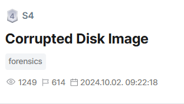
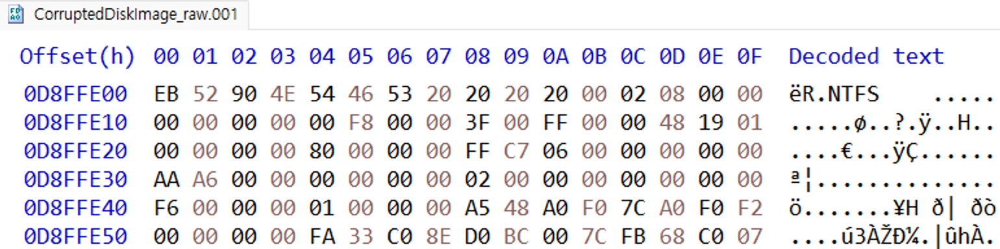
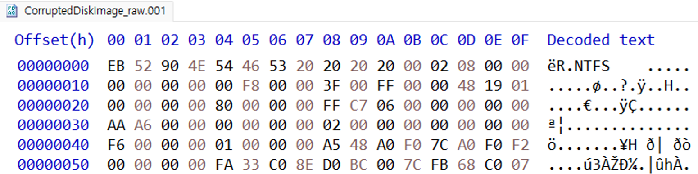
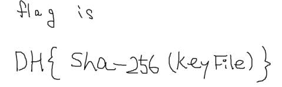
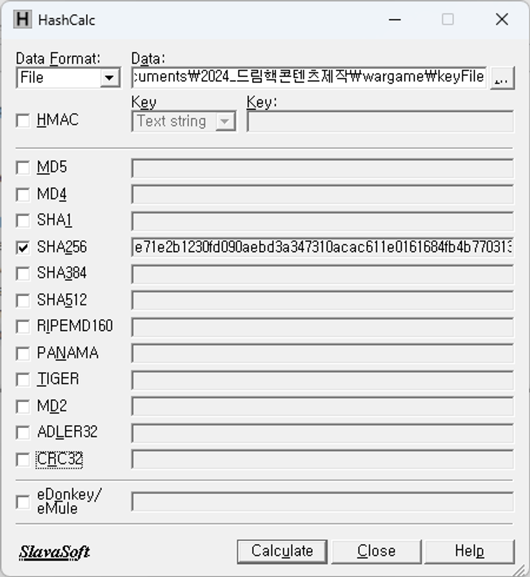

# S4 · Corrupted Disk Image

### 1. 문제 확인

손상된 디스크 이미지에서 파일시스템을 복구하고, 복구한 `keyFile`의 SHA-256 해시를 이용해 FLAG를 구한다.

<p align="center">
  
</p>

### 2. 손상된 VBR 확인

제공된 E01 이미지를 포렌식 도구에서 확인하면 볼륨 시작 부분이 `AA`로 덮여 있어 파일시스템이 인식되지 않는다. VBR(Volume Boot Record)에는 파일시스템과 볼륨을 읽는 데 필요한 정보가 들어 있다.

E01을 HxD에서 바로 열면 E01 파일 형식의 데이터가 보이므로, 디스크의 실제 바이트를 편집할 수 있도록 FTK Imager에서 **Raw (dd)** 형식으로 내보낸다. 원본 보존을 위해 내보낸 RAW 이미지의 복사본을 HxD로 연다.

### 3. 복구용 VBR 찾기

이 이미지의 볼륨 끝부분에는 원래 VBR을 복구할 때 사용할 수 있는 복사본이 있다. HxD에서 `Ctrl + G`를 눌러 16진수 오프셋 `0D8FFE00`으로 이동하면 `EB 52 90` 뒤에 `NTFS`가 이어지는 VBR 내용을 확인할 수 있다.

<p align="center">
  
</p>

복구용 VBR이 별도의 고유한 시작 표시를 갖는 것은 아니다. 이 문제에서는 **볼륨 끝에 있는 위치와 NTFS VBR 구조**를 함께 확인한다.

### 4. 손상된 VBR 복구

복구용 VBR 한 섹터는 `0x200`바이트다. 이 이미지에서는 `0D8FFE00`부터 `0D8FFFFF`까지 복사해, `AA`로 손상된 볼륨 시작 부분에 덮어쓴다.

1. HxD에서 `Ctrl + E`를 눌러 블록 선택 창을 연다.
2. **16진수**를 선택하고 시작 오프셋 `0D8FFE00`, 끝 오프셋 `0D8FFFFF`를 입력한다. 선택 길이는 `0x200`바이트다.
3. `Ctrl + C`로 선택한 바이트를 복사한다.
4. `Ctrl + G`로 `00000000`으로 이동한 뒤 `Ctrl + B`로 **덮어쓰기 붙여넣기**를 하고 저장한다.

<p align="center">
  
</p>

복구 후에는 볼륨 시작 `00000000`에서도 복구용 VBR과 같은 `EB 52 90 ... NTFS`가 보인다. 시작과 끝의 값이 같은 이유는 끝에 있던 복사본을 시작 위치에 붙여넣었기 때문이다. 복구한 이미지를 다시 열면 파일시스템이 인식되어 내부 파일을 확인할 수 있다.

### 5. keyFile 해시와 FLAG

복구된 이미지에서 `keyFile`을 확인한다. 이미지에 표시된 안내는 **`keyFile`의 SHA-256 해시값을 `DH{...}`에 넣으라**는 뜻이다.

<p align="center">
  
</p>

HashCalc에서 **Data Format**을 `File`로 선택하고 `keyFile`을 지정한다. `SHA256`을 체크한 뒤 **Calculate**를 눌러 파일의 해시를 계산한다.

<p align="center">
  
</p>

계산된 SHA-256 해시값은 다음과 같다.

```text
e71e2b1230fd090aebd3a347310acac611e0161684fb4b7703135b6cc91bb7ac
```

이를 `DH{}` 안에 넣으면 FLAG가 된다.

```text
DH{e71e2b1230fd090aebd3a347310acac611e0161684fb4b7703135b6cc91bb7ac}
```

**풀이 핵심:** 볼륨 끝의 복구용 VBR을 손상된 시작 부분에 덮어써 파일시스템을 복구하고, `keyFile`의 SHA-256을 계산한다.
